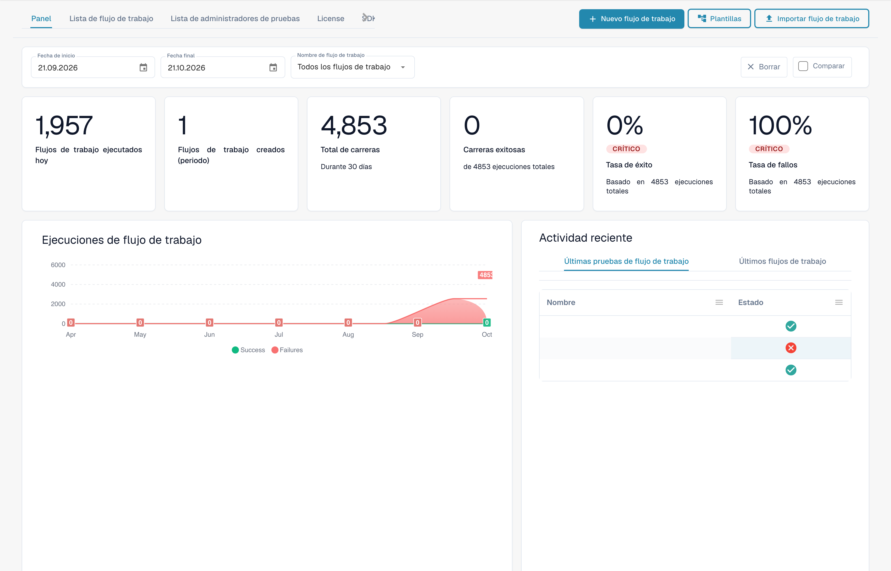
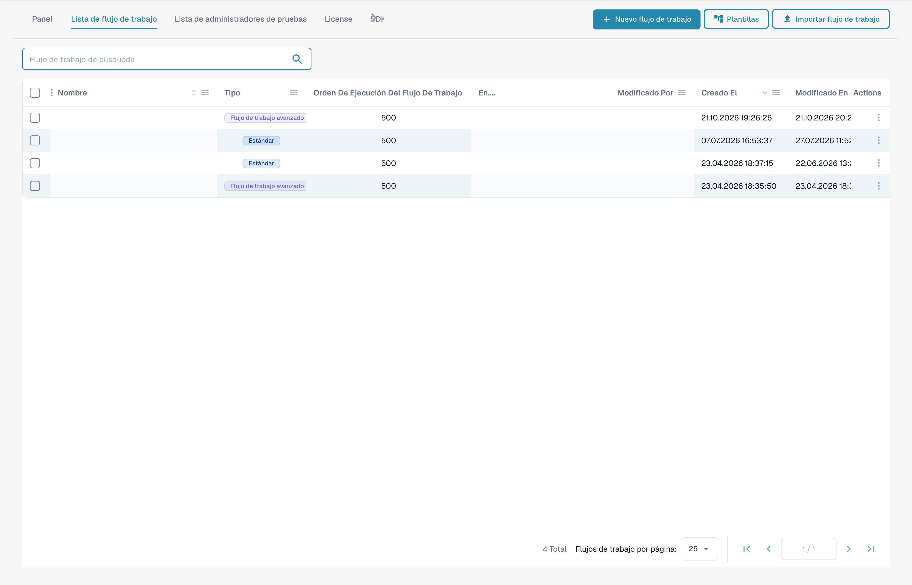

# Guías de patrones de flujo de trabajo

**Versión:** 1.0 **Última actualización:** 23 de octubre de 2025

***

## Descripción general

Este directorio contiene guías completas de patrones de flujo de trabajo que demuestran cómo combinar varias tarjetas de flujo de trabajo para resolver escenarios comerciales comunes. Cada patrón proporciona instrucciones de implementación paso a paso, ejemplos completos y mejores prácticas.

**¿Qué son los patrones de flujo de trabajo?**

Los patrones de flujo de trabajo son soluciones comprobadas y reutilizables para los desafíos comunes del procesamiento de documentación. En lugar de empezar desde cero, puedes utilizar estos patrones como plantillas y adaptarlos a tus necesidades específicas.

***

## El generador de flujos de trabajo de un vistazo

Cada patrón en esta página está ensamblado en **Generador de flujo de trabajo**. Puede acceder a él desde **Panel de flujo de trabajo → Lista de flujos de trabajo → Agregar flujo de trabajo** (o abriendo un flujo de trabajo existente). El panel le brinda el historial de ejecución y las tasas de éxito/fracaso de todos sus flujos de trabajo:

<figure><figcaption><p>El Workflow Dashboard: totales de ejecuciones, tasas de éxito/fallo y actividad reciente de cada flujo de trabajo. Los nombres y las referencias de documentos confidenciales están ocultos.</p></figcaption></figure>

La pestaña **Lista de flujos de trabajo** enumera cada flujo de trabajo con su tipo, orden de ejecución y desencadenante. Utilice **Agregar flujo de trabajo** para crear uno nuevo o haga clic en un flujo de trabajo para abrirlo en el generador:

<figure><figcaption><p>La Workflow List: cada fila es un flujo de trabajo que puede abrir, activar/desactivar o editar. Los nombres y las referencias de documentos confidenciales están ocultos.</p></figcaption></figure>

Un flujo de trabajo consta de tres grupos de tarjetas: **Cuando** (activador), **Y** (condiciones adicionales) y **Entonces** (acciones). El siguiente ejemplo sin guardar muestra esta estructura. Aún deben seleccionarse el tipo de documento, la suborganización y el usuario:

<figure><figcaption><p>Ejemplo sin guardar con tarjetas Cuando, Y y Entonces. Configure todos los campos antes de ejecutarlo. Algunas etiquetas de esta versión de la tarjeta todavía tienen una traducción incompleta o incorrecta en la interfaz. Las explicaciones de esta página utilizan los términos correctos.</p></figcaption></figure>

Haga clic en **Agregar tarjeta** en cualquier grupo para abrir la biblioteca de tarjetas. Las tarjetas están organizadas por categoría (Comparar con orden de compra, tarjetas de socio, campo de documento, fecha y hora, documento, lógica, estado, tabla, responsable, etc.) para que pueda encontrar el componente básico que requiere cada patrón:

<figure><figcaption><p>Tarjetas disponibles en la categoría seleccionada. Configure los campos antes de utilizarlas. Algunas etiquetas de esta versión de la tarjeta todavía tienen una traducción incompleta o incorrecta en la interfaz. Las explicaciones de esta página utilizan los términos correctos.</p></figcaption></figure>

***

## Patrones disponibles

### 1. [Patrón de integración API](api-integration-pattern.md)

**Complejidad:** Mediana | **Tiempo de configuración:** 45-60 minutos

Aprenda a integrar DocBits con API externas para recuperar, validar y almacenar datos de sistemas externos.

**Casos de uso:**

* Obtenga precios en tiempo real de sistemas externos
* Validar la información del proveedor contra bases de datos maestras.
* Busque detalles de productos en sistemas de catálogos
* Obtenga tipos de cambio de servicios de divisas
* Verificar direcciones con servicios de geocodificación

**Tarjetas utilizadas:** CALL\_API, CONDITION\_HTTPS\_REQUEST\_STATUS, ACTION\_SET\_FIELD\_TO\_TEXT, CONDITION\_COMPARE\_TWO\_DOCFIELD\_VALUES

[**Ver patrón completo →**](api-integration-pattern.md)

***

### 2. [Patrón de gestión de tareas](task-management-pattern.md)

**Complejidad:** Baja-Media | **Tiempo de configuración:** 30-45 minutos

Domine el arte de crear, asignar, rastrear y administrar tareas dentro de los flujos de trabajo de DocBits para los procesos de aprobación y revisión.

**Casos de uso:**

* Crear flujos de trabajo de aprobación
* Asignar tareas de revisión a los usuarios
* Manejar excepciones que requieren intervención humana.
* Escalar problemas a los gerentes
* Cree cadenas de aprobación de varios niveles
* Realice un seguimiento de la finalización de tareas y los plazos

**Tarjetas utilizadas:** tasks\_create, ACTION\_ASSIGN\_TO\_USER, ACTION\_SEND\_EMAIL\_TO\_GROUPS, CONDITION\_TASK\_STATUS

[**Ver patrón completo →**](task-management-pattern.md)

***

### 3. [Patrón de coincidencia de PO](po-matching-pattern.md)

**Complejidad:** Media-Alta | **Tiempo de configuración:** 60-90 minutos

Implemente flujos de trabajo completos de comparación de órdenes de compra para validar facturas con órdenes de compra con enrutamiento basado en tolerancias.

**Casos de uso:**

* Validar facturas contra órdenes de compra.
* Detectar errores de precios antes del pago
* Identificar discrepancias de cantidad.
* Hacer cumplir los controles de adquisiciones
* Evite pagos duplicados
* Automatizar la coincidencia de tres vías

**Tarjetas utilizadas:** PURCHASE\_ORDER\_FULL\_MATCH, CONDITION\_DOC\_TO\_PO\_UNIT\_PRICE, CONDITION\_DOC\_TO\_PO\_QUANTITY, CONDITION\_DOC\_TO\_PO\_TAX\_LINES

[**Ver patrón completo →**](po-matching-pattern.md)

***

### 4. [Patrón lógico de decisión](decision-logic-pattern.md)

**Complejidad:** Mediana | **Tiempo de configuración:** 30-45 minutos

Implemente árboles de decisión complejos y lógica de enrutamiento condicional para procesar documentos a través de diferentes rutas basadas en reglas comerciales.

**Casos de uso:**

* Enrutar documentos por umbrales de importe
* Aplicar diferentes reglas para diferentes tipos de documentos
* Implementar lógica de aprobación multinivel
* Manejar políticas comerciales complejas
* Cree rutas dinámicas basadas en múltiples criterios
* Implementar matrices de aprobación

**Tarjetas utilizadas:** CONDITION\_DOC\_FIELD\_AMOUNT, CONDITION\_DOC\_TYPE\_IS\_ISNOT, CONDITION\_SUPPLIER\_STATUS\_IS\_ISNOT, ACTION\_ASSIGN\_TO\_USER

[**Ver patrón completo →**](decision-logic-pattern.md)

***

### 5. [Patrón de transformación de datos](data-transformation-pattern.md)

**Complejidad:** Mediana | **Tiempo de configuración:** 30-45 minutos

Transforme, calcule, formatee y enriquezca los datos de los documentos para prepararlos para la exportación, realizar cálculos y estandarizar formatos.

**Casos de uso:**

* Calcular totales, subtotales, impuestos.
* Convertir monedas o unidades
* Dar formato a fechas, números y texto.
* Derivar valores de campos existentes
* Enriquecer datos de fuentes externas
* Estandarizar formatos de datos
* Validar cálculos

**Tarjetas utilizadas:** ACTION\_CALCULATE\_FIELD, ACTION\_SET\_FIELD\_TO\_TEXT, ACTION\_COPY\_FIELD\_VALUE, CALL\_API, CONDITION\_COMPARE\_TWO\_DOCFIELD\_VALUES

[**Ver patrón completo →**](data-transformation-pattern.md)

***

## Guía de selección de patrones

### Por complejidad

| Complejidad      | Patrones                                                                                                                                                                                      | Mejor para                               |
| --------------- | --------------------------------------------------------------------------------------------------------------------------------------------------------------------------------------------- | -------------------------------------- |
| **Bajo-Medio**  | [Gestión de tareas](task-management-pattern.md)                                                                                                                                                 | Principiantes, flujos de trabajo simples            |
| **Medio**      | <p><a href="api-integration-pattern.md">Integración API</a><br><a href="decision-logic-pattern.md">Lógica de decisión</a><br><a href="data-transformation-pattern.md">Transformación de datos</a></p> | Usuarios intermedios, flujos de trabajo estándar |
| **Medio-Alto** | [Coincidencia de PO](po-matching-pattern.md)                                                                                                                                                         | Usuarios avanzados, validación compleja     |

***

### Por caso de uso

| Necesito...                     | Utilice este patrón                                              |
| -------------------------------- | ------------------------------------------------------------- |
| Integrar con sistemas externos  | [Patrón de integración API](api-integration-pattern.md)         |
| Crear flujos de trabajo de aprobación        | [Patrón de gestión de tareas](task-management-pattern.md)         |
| Validar contra órdenes de compra | [Patrón de coincidencia de PO](po-matching-pattern.md)                 |
| Ruta según condiciones.        | [Patrón lógico de decisión](decision-logic-pattern.md)           |
| Calcular y transformar datos     | [Patrón de transformación de datos](data-transformation-pattern.md) |

***

### Por industria/departamento

| Industria/Departamento    | Patrones recomendados                                                                                                                        |
| ---------------------- | ------------------------------------------------------------------------------------------------------------------------------------------- |
| **Finanzas/Contabilidad** | [Coincidencia de pedidos](po-matching-pattern.md), [Gestión de tareas](task-management-pattern.md), [Transformación de datos](data-transformation-pattern.md) |
| **Adquisiciones**        | [Coincidencia de PO](po-matching-pattern.md), [Lógica de decisión](decision-logic-pattern.md), [Integración de API](api-integration-pattern.md)           |
| **Operaciones**         | [Gestión de tareas](task-management-pattern.md), [Lógica de decisión](decision-logic-pattern.md)                                                  |
| **TI/Integración**     | [Integración API](api-integration-pattern.md), [Transformación de datos](data-transformation-pattern.md)                                        |
| **Todos los departamentos**    | [Lógica de decisión](decision-logic-pattern.md), [Gestión de tareas](task-management-pattern.md)                                                  |

***

## Cómo utilizar estos patrones

### Paso 1: elige un patrón

1. Revise las descripciones de patrones anteriores
2. Identifique qué patrón coincide con su caso de uso
3. Verifique la complejidad y el tiempo estimado de configuración.
4. Revise la sección "Cuándo usar" en la guía de patrones.

### Paso 2: revisar los requisitos previos

Cada guía de patrones enumera:

* Conocimientos requeridos
* Guías relacionadas para leer primero
* Tarjetas que se utilizarán
* Requisitos de configuración

### Paso 3: siga las instrucciones paso a paso

Cada patrón proporciona:

* Ejemplo completo de flujo de trabajo
* Guía de implementación paso a paso
* Plantillas de configuración
* Ejemplos del mundo real
* Consejos para solucionar problemas

### Paso 4: Personalice según sus necesidades

* Adapte el ejemplo a sus reglas de negocio
* Ajustar umbrales y tolerancias.
* Modificar la lógica de enrutamiento
* Agregar o quitar pasos según sea necesario
* Pruebe minuciosamente antes del uso en producción.

### Paso 5: monitorear y optimizar

* Seguimiento del rendimiento del flujo de trabajo
* Monitorear las tasas de éxito
* Recopilar comentarios de los usuarios
* Refinar la configuración
* Personalizaciones de documentos

***

## Combinaciones de patrones

Muchos escenarios del mundo real requieren combinar múltiples patrones:

### Ejemplo 1: procesamiento completo de facturas

```
1. API Integration Pattern → Fetch current pricing
2. Data Transformation Pattern → Calculate totals
3. PO Matching Pattern → Validate against PO
4. Decision Logic Pattern → Route based on variance
5. Task Management Pattern → Create approval tasks
```

### Ejemplo 2: Aprobación de factura de alto valor

```
1. Data Transformation Pattern → Calculate amounts
2. Decision Logic Pattern → Check thresholds
3. Task Management Pattern → Multi-level approval
4. API Integration Pattern → Notify external systems
```

### Ejemplo 3: manejo de excepciones

```
1. PO Matching Pattern → Detect variances
2. Decision Logic Pattern → Classify exception severity
3. Task Management Pattern → Create review tasks
4. Data Transformation Pattern → Calculate impact
```

***

## Plantillas de patrones

Cada patrón incluye estas secciones estandarizadas:

1. **Descripción general** - Qué hace el patrón
2. **Cuándo utilizar**: casos de uso apropiados
3. **Ejemplo completo** - Escenario del mundo real
4. **Paso a Paso** - Instrucciones de implementación
5. **Configuración** - Plantillas de configuración de tarjetas
6. **Diagrama de flujo de trabajo** - Representación visual
7. **Variaciones avanzadas** - Implementaciones alternativas
8. **Manejo de errores**: problemas comunes y soluciones
9. **Lista de verificación de pruebas** - Pasos de validación
10. **Patrones relacionados** - Patrones complementarios
11. **Guías relacionadas** - Documentación de referencia

***

## Obtener ayuda

### Recursos de soporte de patrones

**Documentación:**

* [Índice completo de la guía de flujo de trabajo](..)
* [Guías de tarjetas individuales](../then/action)
* [Referencia de tarjetas de condición](../and/condition-cards-complete-guide.md)
* [Mapa de vinculación de flujo de trabajo](https://github.com/Fellow-Consulting-AG/docbits/tree/main/WORKFLOW_LINKING_MAP.md)

**Recursos adicionales:**

* [Guía de referencia rápida](https://github.com/Fellow-Consulting-AG/docbits/tree/main/WORKFLOW_LINKING_QUICK_REFERENCE.md)
* [Notas de la versión de octubre de 2025](https://github.com/Fellow-Consulting-AG/docbits/tree/main/readme/administration-and-setup/workflow/changelog/2025-10-october.md)
* [Referencia de versiones de tarjetas](../cards-overview/po-comparison-versions-guide.md)

**Contacto:**

* Comentarios sobre patrones: docs@docbits.com
* Soporte técnico: support@docbits.com
* Ayuda de implementación: consultoría@docbits.com

***

## Estadísticas de patrones

| Métrica                      | Valor               |
| --------------------------- | ------------------- |
| **Patrones totales**          | 5                   |
| **Total de tarjetas cubiertas**     | 30+                 |
| **Documentación combinada**  | \~1200 líneas       |
| **Escenarios de ejemplo**       | 25+                 |
| **Plantillas de configuración** | 15+                 |
| **Diagramas de flujo de trabajo**       | 5 diagramas completos |
| **Referencias cruzadas**        | Más de 87 enlaces internos  |

***

## Contribuyendo a los patrones

¿Tiene un patrón de flujo de trabajo que beneficiaría a otros?

**Pautas de contribución de patrones:**

1. **Documente su flujo de trabajo**
   * Escenario empresarial claro
   * Implementación paso a paso
   * Ejemplos de configuración de trabajo
   * Resultados de pruebas del mundo real
2. **Seguir plantilla de patrón**
   * Usar estructura de sección estándar
   * Incluir todos los elementos requeridos
   * Proporcionar diagramas/ejemplos
   * Agregar guía de solución de problemas
3. **Enviar para revisión**
   * Envíe un correo electrónico a: docs@docbits.com
   * Incluye: descripción del patrón, casos de uso, guía de implementación.
   * Revisaremos y potencialmente agregaremos documentación oficial.

**Beneficios:**

* Ayuda a otros usuarios de DocBits
* Obtener reconocimiento en la documentación
* Mejorar la base de conocimiento general del producto
* Reciba comentarios sobre su implementación

***

## Registro de cambios

### Versión 1.0 (23 de octubre de 2025)

* Lanzamiento inicial de 5 patrones de flujo de trabajo completos
* Patrón de integración API agregado
* Patrón de gestión de tareas agregado
* Patrón de coincidencia de PO agregado
* Patrón de lógica de decisión agregado
* Patrón de transformación de datos agregado
* Enlaces de referencias cruzadas implementados (87 enlaces)
* Guía de selección de patrones creada

***

## Próximos pasos

**¿Nuevo en patrones de flujo de trabajo?**

1. Comience con [Patrón de gestión de tareas](task-management-pattern.md): el más fácil de entender
2. Revisión [Patrón lógico de decisión](decision-logic-pattern.md): fundamental para todos los flujos de trabajo
3. Explore [Patrón de integración API](api-integration-pattern.md): necesidad de integración común

**¿Listo para implementar?**

1. Elige tu patrón de la lista de arriba
2. Lee la guía de patrones completa
3. Revisar los requisitos previos y las guías relacionadas
4. Siga las instrucciones paso a paso
5. Prueba con documentos de muestra
6. Implementar en producción
7. Monitorear y optimizar

**¿Necesita más ayuda?**

* Revisar [Descripción general de la documentación del flujo de trabajo](..)
* Consulte la [Guía de referencia rápida](https://github.com/Fellow-Consulting-AG/docbits/tree/main/WORKFLOW_LINKING_QUICK_REFERENCE.md)
* Contactar al equipo de soporte

***

**Última actualización:** 23 de octubre de 2025 **Mantenido por:** Equipo de documentación **Versión:** 1.0
