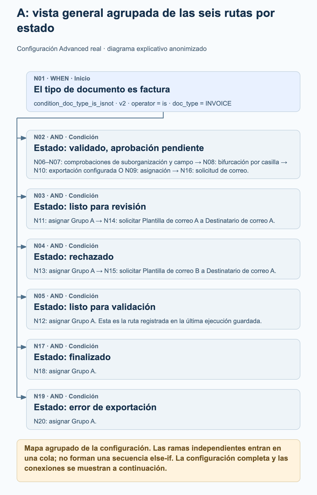
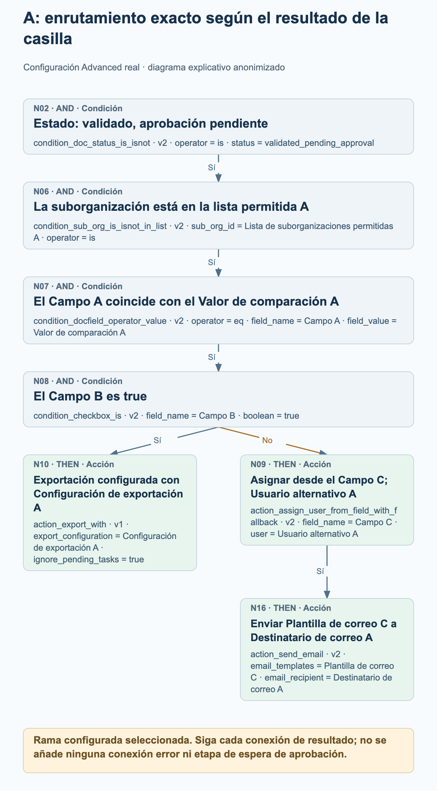
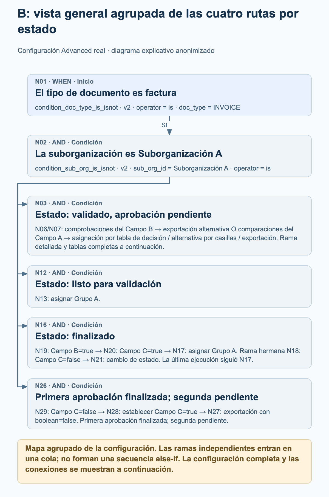
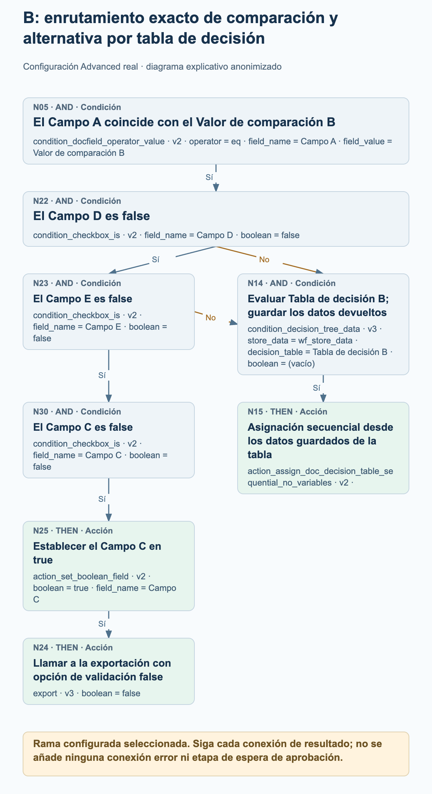

# Ejemplos de workflows Advanced de producción

Dos workflows Advanced activos en producción muestran cómo el enrutamiento real de facturas combina ramas por estado, decisiones mediante casillas de verificación, asignaciones y acciones de exportación configuradas. Los cuatro gráficos de proceso explican partes seleccionadas de cada grafo; la configuración completa de los nodos y las conexiones se presenta por separado.

Revisión de las fuentes en modo de solo lectura el 27 de octubre de 2026: ambas configuraciones actuales coinciden con los datos de nodos, tarjetas, versiones, ajustes y conexiones guardados en sus últimas ejecuciones registradas. El ejemplo A tiene 20 nodos y 19 conexiones; el ejemplo B tiene 30 nodos y 30 conexiones. Ambas ejecuciones registradas tienen el estado global failed_condition, aunque cada una incluye una acción de asignación a un grupo con resultado success. Se trata de configuraciones observadas y registros de ejecución guardados, no de pruebas ejecutadas de nuevo. Los valores de organización, campo, usuario, grupo, tabla, plantilla y destinatario están anonimizados. Los alias mantienen las distinciones dentro de cada ejemplo y no identifican la misma entidad real entre ejemplos.

## Cómo interpretar estos grafos

Cada conexión sigue un resultado concreto: success, failed_condition o error. Estos ejemplos contienen conexiones success y failed_condition; ninguno de los dos grafos configura una conexión error. Una condición no cumplida es un resultado normal de una condición y no debe interpretarse como un error técnico.

Varias conexiones success salientes añaden varios destinos a la cola de ejecución. No forman una cadena else-if ni significan que las acciones se ejecuten en paralelo. Un destino se procesa como máximo una vez en una misma ejecución del grafo. Siga las conexiones reales en lugar de deducir el flujo de control a partir de la posición de una tarjeta.

Un destino con varias conexiones entrantes no es automáticamente una unión que espera a todas las ramas. En el ejemplo B, cualquiera de las dos conexiones failed_condition configuradas puede añadir a la cola la tarjeta de condición ordinaria N14; no es una pasarela ALL o ANY independiente.

Las asignaciones no demuestran que una persona haya aprobado un documento. De una asignación o una tarjeta de exportación configurada no se puede deducir una etapa de espera, una aprobación finalizada ni la recepción por un sistema externo. Los diagramas no añaden ninguna de esas etapas.

Las vistas generales agrupadas resumen las rutas por estado y agrupan explícitamente los nodos posteriores. Los gráficos de detalle amplían las rutas seleccionadas de casillas de verificación o de alternativa. Utilice las listas completas de nodos y conexiones para examinar todo el grafo configurado.

## A. Enrutamiento por estado con una ruta de exportación o asignación controlada por una casilla

Una factura da lugar a seis comprobaciones de estado. La rama de validación completada y aprobación pendiente comprueba además una lista de suborganizaciones permitidas, compara el Campo A y comprueba el Campo B. El resultado de la casilla selecciona una tarjeta de exportación configurada o una acción de asignación desde un campo seguida de un correo. Las otras rutas por estado asignan el Grupo A, y dos de ellas envían después un correo configurado.

### A: vista general agrupada de las seis rutas por estado

<figure><figcaption>N01 da lugar a seis comprobaciones de estado independientes. La vista general agrupa la rama más extensa de N02 y muestra las rutas de asignación y correo configuradas para los demás estados. Es un mapa agrupado de la configuración, no una traza de ejecución ni una secuencia else-if.</figcaption></figure>

### A: enrutamiento exacto según el resultado de la casilla

<figure><figcaption>Rama ampliada N02 → N06 → N07 → N08. Campo B=true sigue success hasta la tarjeta de exportación configurada N10 con ignore_pending_tasks=true. La conexión failed_condition conduce a la tarjeta de asignación desde campo N09, cuyo resultado success conduce a la tarjeta de correo N16. No se presupone ningún resultado de exportación, aprobación humana ni etapa de espera.</figcaption></figure>

### Qué muestra realmente la última ejecución guardada

Ejecución guardada: 26 de octubre de 2026, 12:01:54 UTC. N01 y la comprobación ready_for_validation N05 devolvieron success; la asignación N12 devolvió después success. Las otras cinco comprobaciones de estado devolvieron failed_condition, y los nodos restantes no tienen ningún resultado registrado en esta ejecución. El registro global es failed_condition. Por tanto, esta ejecución demuestra la ruta de asignación al grupo N01 → N05 → N12; no demuestra las rutas de casilla, exportación o correo.

- Después de que N01 devuelva success, las comprobaciones de estado N02, N03, N04, N05, N17 y N19 se añaden a la cola mediante conexiones success independientes. No forman una cadena else-if.
- La rama de aprobación detallada es N02 → N06 → N07 → N08 siguiendo success. N08 comprueba el Campo B frente a true. Su conexión success conduce a N10; su conexión failed_condition conduce a N09.
- N10 es action_export_with v1, configurada con Configuración de exportación A e ignore_pending_tasks=true. El gráfico indica la configuración y no afirma que la exportación haya tenido éxito ni que se haya recibido en un sistema externo. En esta tarjeta, ignore_pending_tasks=true desactiva la comprobación de tareas pendientes para la solicitud de exportación; es una opción específica de este ejemplo.
- N09 está configurada para asignar desde el Campo C con Usuario alternativo A. Solo su conexión success conduce a N16, configurada con Plantilla de correo C y Destinatario de correo A.
- El Campo C debe contener un ID de usuario. Un ID de usuario sin coincidencia puede utilizar la alternativa configurada; un campo ausente del documento puede provocar un fallo antes de alcanzar esa alternativa. La alternativa no garantiza la asignación en todos los casos de campo ausente.
- N11, N12, N13, N18 y N20 configuran el mismo Grupo A dentro de este ejemplo. Solo N11 y N13 tienen nodos de correo posteriores conectados: N14 y N15.

Configuración completa de los nodos

| Nodo | Tarjeta | Configuración |
| --- | --- | --- |
| N01 | condition_doc_type_is_isnot · v2 | operator = is; doc_type = INVOICE |
| N02 | condition_doc_status_is_isnot · v2 | operator = is; status = validated_pending_approval |
| N03 | condition_doc_status_is_isnot · v2 | operator = is; status = ready_for_review |
| N04 | condition_doc_status_is_isnot · v2 | operator = is; status = rejected |
| N05 | condition_doc_status_is_isnot · v2 | operator = is; status = ready_for_validation |
| N06 | condition_sub_org_is_isnot_in_list · v2 | sub_org_id = Lista de suborganizaciones permitidas A; operator = is |
| N07 | condition_docfield_operator_value · v2 | operator = eq; field_name = Campo A; field_value = Valor de comparación A |
| N08 | condition_checkbox_is · v2 | field_name = Campo B; boolean = true |
| N09 | action_assign_user_from_field_with_fallback · v2 | field_name = Campo C; user = Usuario alternativo A |
| N10 | action_export_with · v1 | export_configuration = Configuración de exportación A; ignore_pending_tasks = true |
| N11 | doc_group_assign · v2 | groups = Grupo A; use_decision_table = (vacío) |
| N12 | doc_group_assign · v2 | groups = Grupo A; use_decision_table = (vacío) |
| N13 | doc_group_assign · v2 | groups = Grupo A; use_decision_table = (vacío) |
| N14 | action_send_email · v2 | email_templates = Plantilla de correo A; email_recipient = Destinatario de correo A |
| N15 | action_send_email · v2 | email_templates = Plantilla de correo B; email_recipient = Destinatario de correo A |
| N16 | action_send_email · v2 | email_templates = Plantilla de correo C; email_recipient = Destinatario de correo A |
| N17 | condition_doc_status_is_isnot · v2 | operator = is; status = finished |
| N18 | doc_group_assign · v2 | groups = Grupo A; use_decision_table = (vacío) |
| N19 | condition_doc_status_is_isnot · v2 | operator = is; status = export_error |
| N20 | doc_group_assign · v2 | groups = Grupo A; use_decision_table = (vacío) |

Todas las conexiones configuradas

| Nodo | Ruta del resultado | Nodo |
| --- | --- | --- |
| N01 | success | N02 |
| N01 | success | N03 |
| N01 | success | N04 |
| N01 | success | N05 |
| N08 | failed_condition | N09 |
| N08 | success | N10 |
| N07 | success | N08 |
| N06 | success | N07 |
| N02 | success | N06 |
| N03 | success | N11 |
| N04 | success | N13 |
| N05 | success | N12 |
| N13 | success | N15 |
| N11 | success | N14 |
| N09 | success | N16 |
| N01 | success | N17 |
| N17 | success | N18 |
| N19 | success | N20 |
| N01 | success | N19 |

## B. Enrutamiento mediante tablas de decisión con alternativas por casillas y ramas por estado

Una factura de la Suborganización A da lugar a cuatro comprobaciones de estado. La ruta de validación completada y aprobación pendiente utiliza el Campo B, dos comparaciones alternativas del Campo A, tablas de decisión y comprobaciones adicionales de casillas. La ruta de documento finalizado utiliza los Campos B y C antes de asignar el Grupo A o configurar un cambio de estado. Una ruta independiente de segunda aprobación pendiente establece el Campo C y llama a la exportación cuando se cumple la condición configurada.

### B: vista general agrupada de las cuatro rutas por estado

<figure><figcaption>N01 y N02 conducen a cuatro comprobaciones de estado conectadas por separado. La vista general agrupa la rama más extensa de tablas de decisión, conserva la ruta de asignación de documentos listos para validación y la bifurcación por casillas de documentos finalizados, y resume la ruta de exportación con segunda aprobación pendiente. Las listas completas de nodos y conexiones conservan los 30 nodos y las 30 conexiones.</figcaption></figure>

### B: enrutamiento exacto de comparación y alternativa por tabla de decisión

<figure><figcaption>Rama configurada seleccionada tras N01 → N02 → N03 → N07: N05 compara el Campo A con el Valor de comparación B. Cualquiera de las conexiones failed_condition de N22 (Campo D=false) o N23 (Campo E=false) puede añadir a la cola la Tabla de decisión B en la tarjeta de condición ordinaria N14, seguida de la asignación secuencial N15. En cambio, success de N23 continúa por N30 → N25 → N24. No se presupone ninguna unión ALL, tarjeta ANY, aprobación finalizada ni recepción externa.</figcaption></figure>

### Qué muestra realmente la última ejecución guardada

Ejecución guardada: 27 de octubre de 2026, 11:56:25 UTC. N01, N02, la comprobación del estado finished N16, la comprobación Campo B=true N19, la comprobación Campo C=true N20 y la asignación al grupo N17 devolvieron success. N03, N12, N18 y N26 devolvieron failed_condition; los demás nodos no tienen ningún resultado registrado en esta ejecución. El registro global es failed_condition. Esta ejecución demuestra la ruta de asignación del documento finalizado, no las rutas de las tablas de decisión, un cambio de estado ni una exportación.

- Cuando las comprobaciones de factura y Suborganización A devuelven success, N02 añade a la cola las comprobaciones de estado N03, N12, N16 y N26. El grafo no espera a que termine una rama por estado antes de definir otra.
- Si N03 devuelve success, N06 comprueba Campo B=false y N07 comprueba Campo B=true. El resultado success de N06 conduce a establecer Campo B=true en N10 y después a la tarjeta de exportación alternativa N11. El resultado success de N07 añade a la cola las dos comparaciones del Campo A, N04 y N05.
- N06 y N07 se añaden a la cola antes de la actualización del Campo B en N10. Ambas comprobaciones se evalúan antes de esa actualización; establecer Campo B=true no hace que N07 devuelva success más tarde en el mismo recorrido. Las tarjetas añadidas posteriormente a la cola pueden observar valores devueltos por acciones anteriores; las ramas no son instantáneas aisladas.
- La ruta de Valor de comparación A conduce a la Tabla de decisión A en N08 y a la asignación secuencial N09. La ruta de Valor de comparación B comprueba Campo D=false en N22, Campo E=false en N23 y Campo C=false en N30 antes de establecer Campo C=true en N25 y llamar a la exportación N24.
- Un resultado failed_condition de N22 o de N23 puede añadir a la cola N14, la tarjeta de condición ordinaria para la Tabla de decisión B. N14 no es una unión que espera a todas las ramas ni una tarjeta ANY añadida. Su conexión success conduce a la asignación secuencial N15.
- Para los documentos finalizados, N19 comprueba Campo B=true y después añade tanto N18 como N20 a la cola. Campo C=true en N20 conduce a la asignación al Grupo A N17. Campo C=false en N18 conduce a la tarjeta de cambio de estado N21, configurada con validated_pending_approval y trigger_docflow=true. No es una etapa de espera.
- La ruta approved_pending_second_approval recorre N29 → N28 → N27 siguiendo success: comprobar Campo C=false, establecer Campo C=true y después llamar a la exportación. Las tarjetas de exportación N24 y N27 conservan boolean=false. Es una opción de validación, no una instrucción para desactivar la llamada a la exportación.
- Ambas tarjetas de condición de tabla de decisión guardan datos en wf_store_data. Sus acciones de asignación secuencial no tienen ajustes propios. Las reglas de las tablas y los destinatarios reales no se publican, y el grafo no demuestra que la aprobación haya finalizado.
- La exportación alternativa N11 depende de los atributos de exportación del tipo de documento. No se puede deducir ninguna configuración ni destino de exportación a partir de los ajustes vacíos del nodo. El cambio de estado N21 solicita activar posteriormente los workflows; no añade ninguna conexión implícita de vuelta al mismo recorrido.

Configuración completa de los nodos

| Nodo | Tarjeta | Configuración |
| --- | --- | --- |
| N01 | condition_doc_type_is_isnot · v2 | operator = is; doc_type = INVOICE |
| N02 | condition_sub_org_is_isnot · v2 | sub_org_id = Suborganización A; operator = is |
| N03 | condition_doc_status_is_isnot · v2 | operator = is; status = validated_pending_approval |
| N04 | condition_docfield_operator_value · v2 | operator = eq; field_name = Campo A; field_value = Valor de comparación A |
| N05 | condition_docfield_operator_value · v2 | operator = eq; field_name = Campo A; field_value = Valor de comparación B |
| N06 | condition_checkbox_is · v2 | field_name = Campo B; boolean = false |
| N07 | condition_checkbox_is · v2 | field_name = Campo B; boolean = true |
| N08 | condition_decision_tree_data · v3 | store_data = wf_store_data; decision_table = Tabla de decisión A; boolean = (vacío) |
| N09 | action_assign_doc_decision_table_sequential_no_variables · v2 | — |
| N10 | action_set_boolean_field · v2 | boolean = true; field_name = Campo B |
| N11 | action_alternate_export · v2 | — |
| N12 | condition_doc_status_is_isnot_in_list · v2 | operator = is; status = ready_for_validation |
| N13 | doc_group_assign · v2 | groups = Grupo A; use_decision_table = (vacío) |
| N14 | condition_decision_tree_data · v3 | store_data = wf_store_data; decision_table = Tabla de decisión B; boolean = (vacío) |
| N15 | action_assign_doc_decision_table_sequential_no_variables · v2 | — |
| N16 | condition_doc_status_is_isnot_in_list · v2 | operator = is; status = finished |
| N17 | doc_group_assign · v2 | groups = Grupo A; use_decision_table = (vacío) |
| N18 | condition_checkbox_is · v2 | field_name = Campo C; boolean = false |
| N19 | condition_checkbox_is · v2 | field_name = Campo B; boolean = true |
| N20 | condition_checkbox_is · v2 | field_name = Campo C; boolean = true |
| N21 | staus_change · v3 | status = validated_pending_approval; trigger_docflow = true |
| N22 | condition_checkbox_is · v2 | field_name = Campo D; boolean = false |
| N23 | condition_checkbox_is · v2 | field_name = Campo E; boolean = false |
| N24 | export · v3 | boolean = false |
| N25 | action_set_boolean_field · v2 | boolean = true; field_name = Campo C |
| N26 | condition_doc_status_is_isnot_in_list · v2 | operator = is; status = approved_pending_second_approval |
| N27 | export · v3 | boolean = false |
| N28 | action_set_boolean_field · v2 | boolean = true; field_name = Campo C |
| N29 | condition_checkbox_is · v2 | field_name = Campo C; boolean = false |
| N30 | condition_checkbox_is · v2 | field_name = Campo C; boolean = false |

Todas las conexiones configuradas

| Nodo | Ruta del resultado | Nodo |
| --- | --- | --- |
| N01 | success | N02 |
| N02 | success | N03 |
| N03 | success | N06 |
| N03 | success | N07 |
| N07 | success | N04 |
| N07 | success | N05 |
| N06 | success | N10 |
| N10 | success | N11 |
| N02 | success | N12 |
| N12 | success | N13 |
| N16 | success | N19 |
| N20 | success | N17 |
| N19 | success | N20 |
| N19 | success | N18 |
| N18 | success | N21 |
| N04 | success | N08 |
| N02 | success | N16 |
| N05 | success | N22 |
| N22 | success | N23 |
| N25 | success | N24 |
| N02 | success | N26 |
| N22 | failed_condition | N14 |
| N23 | failed_condition | N14 |
| N28 | success | N27 |
| N26 | success | N29 |
| N29 | success | N28 |
| N23 | success | N30 |
| N30 | success | N25 |
| N08 | success | N09 |
| N14 | success | N15 |

## Antes de adaptar un ejemplo

Sustituya cada alias neutro por un valor adecuado de su propia organización. Mantenga qué ajustes se refieren al mismo campo y cuáles a campos distintos; no reutilice estos marcadores como identificadores reales.

Compruebe explícitamente cada conexión de resultado, incluido el enrutamiento failed_condition y los destinos con varias conexiones entrantes. Defina el tratamiento de errores para su propio proceso en lugar de suponer que el grafo gestiona una ruta error sin conectar.

Revise los ajustes de exportación, las opciones de validación y el tratamiento de tareas pendientes según sus requisitos. Una acción de exportación configurada o un registro de nodo con resultado success no demuestra la recepción por un sistema externo.

Valide el workflow adaptado en un entorno de pruebas autorizado, incluidos todos los resultados relevantes de las condiciones y los datos de asignación ausentes. Estos ejemplos de producción se leyeron sin modificarlos ni volver a ejecutarlos.
