# Patrón de lógica de decisión

**Tipo de patrón:** Enrutamiento condicional y lógica **Complejidad:** Media **Configuración estimada:** 30-45 minutos **Casos de uso habituales:** Enrutamiento multirruta, procesamiento condicional, árboles de decisión, implementación de reglas de negocio

***

En el diseñador Standard, abra **Añadir tarjeta** en el grupo **Y....** y seleccione **Lógica**. La imagen siguiente muestra una tarjeta de condición basada en una tabla de decisiones dentro de la biblioteca, antes de seleccionarla y configurarla. Configure la tabla que se utilizará y el almacenamiento de sus resultados para las tarjetas posteriores. También debe configurar y comprobar las demás condiciones, acciones y conexiones de este patrón. La condición utiliza los resultados de la tabla para el documento o la organización del proveedor.

<figure>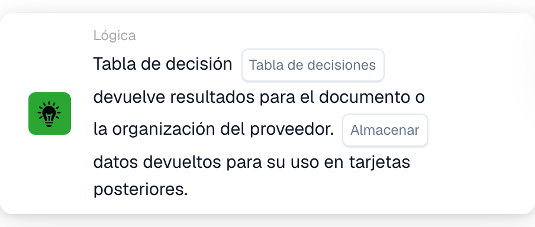<figcaption><p>Tarjeta de condición de la categoría «Lógica» en la biblioteca, antes de seleccionarla y configurarla. La tabla de decisiones y el almacenamiento de sus resultados todavía deben configurarse.</p></figcaption></figure>

***

## Resumen del patrón

#### Diagrama: Vista general

<figure>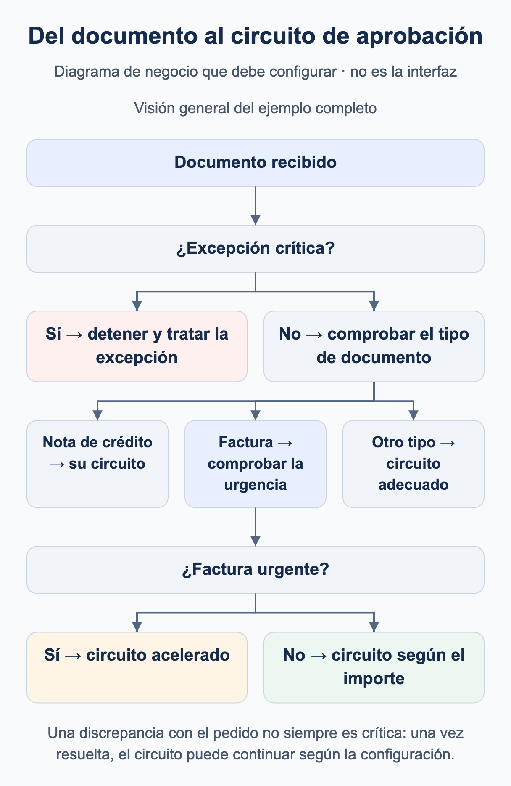<figcaption><p>Visión general del ejemplo completo: comprobar las excepciones críticas, el tipo de documento y la urgencia antes de elegir el circuito de aprobación. Cada tratamiento y cada conexión deben configurarse; el diagrama no representa un comportamiento automático del producto.</p></figcaption></figure>

Estos diagramas explican reglas de negocio que debe configurar. Complementan la imagen de la biblioteca anterior. En el modo Advanced, conecte expresamente cada circuito. En una secuencia lineal Standard, defina las condiciones que permiten sus acciones.

Este patrón muestra cómo implementar lógica de decisión compleja en los flujos de trabajo de DocBits usando tarjetas de condición para enrutar documentos por distintas rutas de procesamiento según los atributos del documento, los valores de los campos y las reglas de negocio.

**Qué hace este patrón:**

1. Evalúa varias condiciones en secuencia o en paralelo
2. Enruta los documentos por distintas rutas según las condiciones
3. Implementa reglas y políticas de negocio
4. Gestiona árboles de decisión complejos
5. Combina varios criterios para las decisiones de enrutamiento

***

## Cuándo usar este patrón

Use este patrón cuando necesite:

* ✅ Enrutar documentos por umbrales de importe
* ✅ Aplicar distintas reglas para distintos tipos de documento
* ✅ Implementar lógica de aprobación multinivel
* ✅ Gestionar políticas de negocio complejas
* ✅ Crear enrutamiento dinámico basado en varios criterios
* ✅ Implementar lógica de gestión de excepciones
* ✅ Crear matrices de aprobación

**No use este patrón cuando:**

* ❌ Un flujo de trabajo lineal simple sea suficiente
* ❌ Todos los documentos sigan la misma ruta
* ❌ No se necesite procesamiento condicional

***

## Tipos de lógica de decisión

En el pseudocódigo se conservan literalmente los identificadores, claves, valores configurados y operadores técnicos. Las acciones y explicaciones están en español.

Los ejemplos IF-THEN, AND, OR y anidados siguientes son independientes. Sus umbrales ilustran cada principio; no forman una única matriz de aprobación. La matriz completa posterior utiliza cuatro tramos sin solapamiento. Un valor desconocido o un error de evaluación no equivale automáticamente a Falso: defina y pruebe su tratamiento por separado.

### 1. Lógica IF-THEN simple

#### Diagrama: Condición simple

<figure>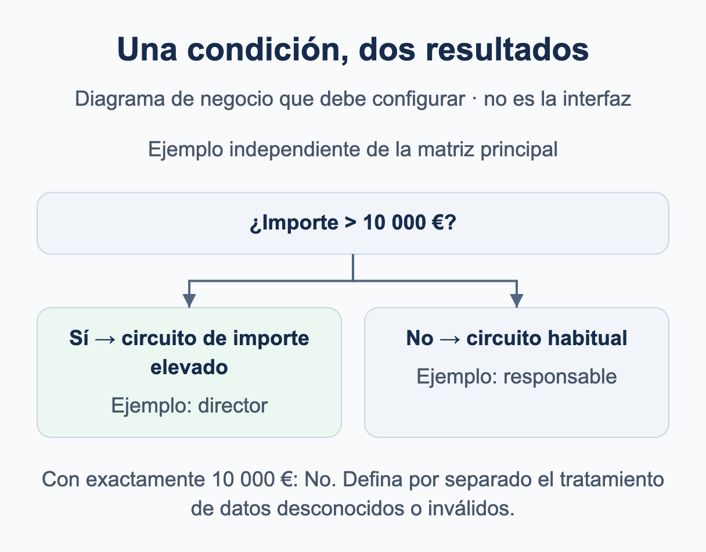<figcaption><p>Ejemplo IF-THEN independiente: un importe estrictamente superior a 10 000 € selecciona al director; en caso contrario, al responsable. La igualdad queda en la segunda rama. Debe configurar los destinos.</p></figcaption></figure>

<details>
<summary>Principio IF-THEN: una condición, dos resultados</summary>

```
IF condition:
  → Acción A
ELSE:
  → Acción B
```

</details>

**Ejemplo:**

Explicación visual: [condición simple](#diagrama-condicion-simple).

<details>
<summary>Ejemplo IF-THEN: umbral de importe</summary>

```
IF Amount > €10,000:
  → Asignar al director
ELSE:
  → Asignar al responsable
```

</details>

#### Diagrama: Criterios Y y O

<figure>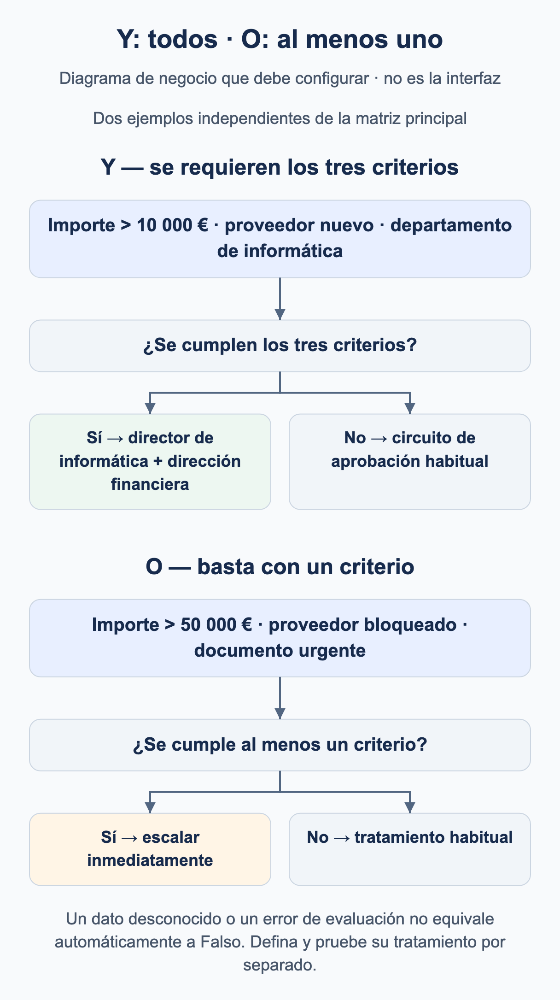<figcaption><p>Dos ejemplos independientes: Y exige los tres criterios; O exige al menos uno. Sus umbrales ilustrativos no sustituyen los tramos de la matriz completa. Las salidas y el tratamiento de datos desconocidos o errores deben configurarse.</p></figcaption></figure>

### 2. Varios criterios (lógica AND)

<details>
<summary>Principio AND: todos los criterios</summary>

```
IF condition1 AND condition2 AND condition3:
  → Acción A
ELSE:
  → Acción B
```

</details>

**Ejemplo:**

Explicación visual: [criterios y y o](#diagrama-criterios-y-y-o).

<details>
<summary>Ejemplo AND: tres criterios</summary>

```
IF Amount > €10,000 AND Supplier = "New" AND Department = "IT":
  → Asignar al director de informática + CFO (doble aprobación)
ELSE:
  → Flujo de aprobación habitual
```

</details>

### 3. Criterios alternativos (lógica OR)

Explicación visual: [criterios y y o](#diagrama-criterios-y-y-o).

<details>
<summary>Principio OR: al menos un criterio</summary>

```
IF condition1 OR condition2 OR condition3:
  → Acción A
ELSE:
  → Acción B
```

</details>

**Ejemplo:**

Explicación visual: [criterios y y o](#diagrama-criterios-y-y-o).

<details>
<summary>Ejemplo OR: importe, bloqueo o urgencia</summary>

```
IF Amount > €50,000 OR Supplier is "Blocked" OR Document has el indicador "Urgent":
  → Escalar inmediatamente
ELSE:
  → Procesamiento habitual
```

</details>

### 4. Árbol de decisión anidado

#### Diagrama: Decisiones anidadas

<figure>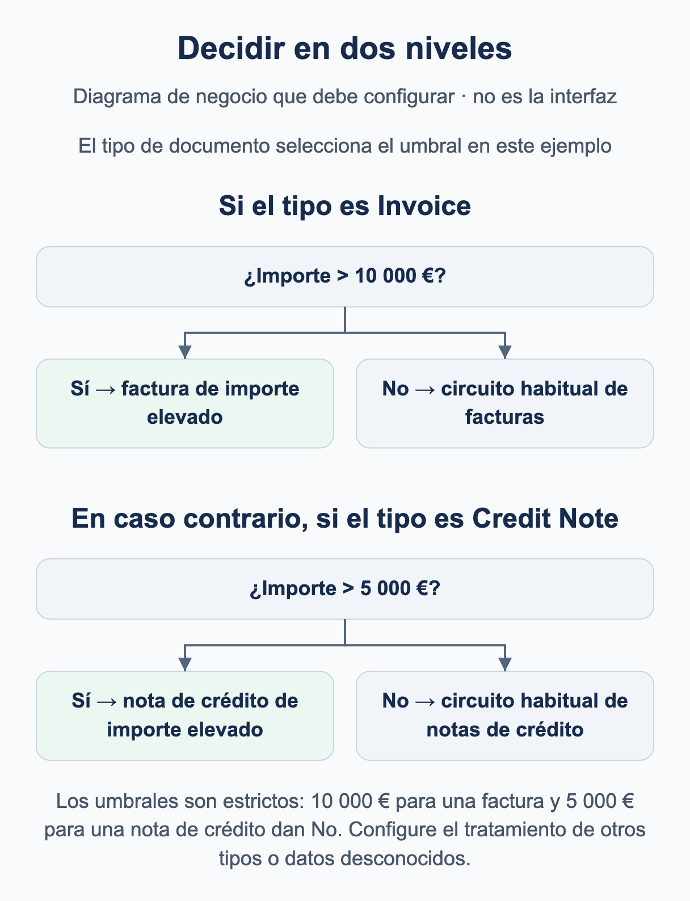<figcaption><p>Ejemplo anidado independiente: el tipo de documento selecciona una comparación de importe. Los umbrales son estrictos: una factura de 10 000 € o una nota de crédito de 5 000 € no cumplen la condición «mayor que». Defina el tratamiento de otros tipos y datos desconocidos.</p></figcaption></figure>

<details>
<summary>Principio de decisión anidada</summary>

```
IF condition1:
  IF condition2:
    → Acción A
  ELSE:
    → Acción B
ELSE:
  IF condition3:
    → Acción C
  ELSE:
    → Acción D
```

</details>

**Ejemplo:**

Explicación visual: [decisiones anidadas](#diagrama-decisiones-anidadas).

<details>
<summary>Ejemplo anidado: factura y nota de crédito</summary>

```
IF Document_Type = "Invoice":
  IF Amount > €10,000:
    → Flujo de facturas de importe elevado
  ELSE:
    → Flujo habitual de facturas
ELSE IF Document_Type = "Credit Note":
  IF Amount > €5,000:
    → Flujo de notas de crédito de importe elevado
  ELSE:
    → Flujo habitual de notas de crédito
```

</details>

***

## Ejemplo de flujo de trabajo completo

### Escenario: Matriz de aprobación de facturas

**Reglas de negocio:**

1. Antes de enrutar por importe, detenga y trate las excepciones críticas, incluido un proveedor bloqueado. Una discrepancia con el pedido no siempre es crítica: una vez resuelta por compras, el circuito puede continuar según la configuración. Después, compruebe el tipo de documento.
2. Para una factura urgente, siga el circuito acelerado de este ejemplo en lugar de los tramos ordinarios de importe.
3. Para una factura no urgente con importe válido:
   * importe < 1 000 €: aprobación automática;
   * 1 000 € ≤ importe < 10 000 €: aprobación del responsable;
   * 10 000 € ≤ importe < 50 000 €: controles del proveedor y después aprobación del director; si el proveedor no está bloqueado y tiene menos de 180 días, se requiere la aprobación del director y después la de la dirección financiera; los demás proveedores también pasan por un control de riesgo;
   * importe ≥ 50 000 €: aprobación de la dirección, detallada en el circuito D.
4. En este ejemplo, un importe ausente o inválido lleva a una revisión manual configurada expresamente. Es una política de ejemplo, no una alternativa automática del producto.
5. Después de crear una tarea, espere su resultado. El rechazo detiene la cadena y sigue el tratamiento configurado; un resultado pendiente no permite continuar. Cree la tarea de la dirección financiera solo tras la aprobación positiva del director.

#### Diagrama: Tramos de importe

<figure>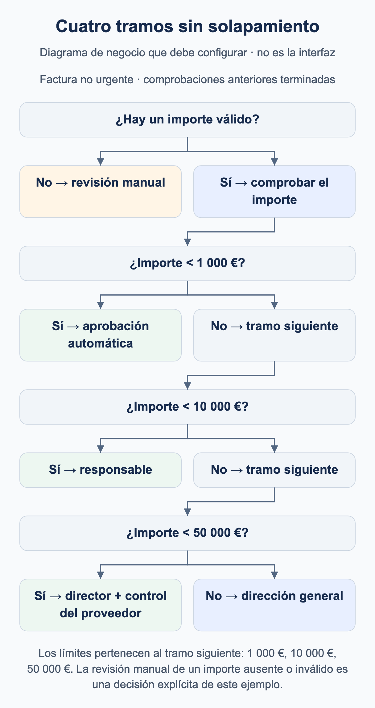<figcaption><p>Umbrales del nivel 2: menos de 1 000 €; desde 1 000 € incluido hasta 10 000 € excluido; desde 10 000 € incluido hasta 50 000 € excluido; 50 000 € o más. Cada comprobación sigue al resultado negativo de la anterior. La revisión manual de un importe ausente o inválido debe configurarse explícitamente.</p></figcaption></figure>

Los valores límite de 1 000 €, 10 000 € y 50 000 € entran en el tramo superior. Configure y pruebe los controles previos, la espera de resultados y las conexiones entre circuitos. Una tarea creada no demuestra aprobación ni exportación del documento.

**Implementación ilustrativa:** Adapte los nombres técnicos y el pseudocódigo a las tarjetas realmente disponibles en su versión. Estos bloques describen un ejemplo que debe configurar, no un archivo importable. Verifique los resultados y efectos de la ejecución.

Explicación visual: [vista general](#diagrama-vista-general), [tramos de importe](#diagrama-tramos-de-importe), [análisis del proveedor](#diagrama-analisis-del-proveedor), [circuito automático](#diagrama-circuito-automatico), [tarea del responsable](#diagrama-tarea-del-responsable), [aprobación de la dirección](#diagrama-aprobacion-de-la-direccion), [registro de la regla](#diagrama-registro-de-la-regla).

<details>
<summary>Pseudocódigo de la matriz completa</summary>

```
COMPROBACIÓN PREVIA: Excepciones críticas
  IF Critical_Exception = TRUE OR Supplier_Status = "BLOCKED":
    → Detener y tratar la excepción antes del enrutamiento

PASO 1: Comprobar discrepancias con el pedido
  IF PO_Match_Status = "FAIL":
    → Enrutar a compras para resolver la discrepancia con el pedido
    → Tras la resolución, continuar abajo según la configuración

PASO 1b: Comprobar el tipo de documento
  IF Document_Type = "Credit Note":
    → Flujo configurado de notas de crédito
  ELSE IF Document_Type is not "Invoice":
    → Flujo configurado para este tipo de documento
  ELSE:
    → Continuar abajo

PASO 2: Comprobar el indicador de urgencia
  IF Urgent_Flag = TRUE:
    → Omitir las comprobaciones de importe
    → Enviar al aprobador de mayor nivel
    → Establecer prioridad = URGENT
    → Plazo de 1 día

PASO 3: Enrutamiento por importe (Invoice, si no es urgente)
  IF Amount está ausente o no es válido:
    → Revisión manual (política explícita del ejemplo)
    → No entrar en los tramos de importe

  ELSE IF Amount < €1,000:
    → Aprobar automáticamente
    → Exportar inmediatamente

  ELSE IF Amount < €10,000:
    → Crear tarea para el responsable
    → Prioridad: Media
    → Plazo: 3 días

  ELSE IF Amount < €50,000:
    COMPROBAR estado y riesgo del proveedor:
      IF Supplier_Status = "BLOCKED":
        → Detener y tratar la excepción
      ELSE IF Supplier_Age < 180 días (nuevo):
        → Crear tarea para el director (tarea 1)
        → Esperar la aprobación positiva del director antes de crear la tarea de CFO (tarea 2)
        → Esperar la aprobación positiva de CFO antes de continuar
        → Cualquier rechazo: detener la cadena y tratarlo según la configuración
        → Pendiente: no continuar
        → Prioridad: Alta
        → Plazo: 2 días cada una
      ELSE IF Supplier_Risk_Rating = "HIGH":
        → Controles adicionales y aprobación previa del responsable
        → Esperar la aprobación positiva del responsable antes de la aprobación del director
        → Pendiente o rechazo: no continuar la cadena de aprobación
      ELSE (proveedor existente):
        → Crear tarea solo para el director
        → Prioridad: Alta
        → Plazo: 2 días

  ELSE (Amount ≥ €50,000):
    → Circuito de aprobación de la dirección (véase el circuito D)
```

</details>

***

## Implementación paso a paso

### Paso 1: Definir las tarjetas de condición

**Condición 1: Umbral de importe**

#### Diagrama: Parámetros independientes

<figure>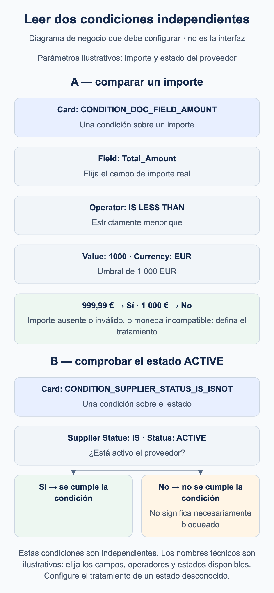<figcaption><p>Dos condiciones independientes: un importe estrictamente inferior a 1 000 EUR y un proveedor con estado ACTIVE. La igualdad del importe da No; un proveedor inactivo no está necesariamente bloqueado. Los parámetros técnicos son ilustrativos y deben adaptarse a la configuración real.</p></figcaption></figure>

<details>
<summary>Parámetros ilustrativos: umbral de importe</summary>

```
Card: CONDITION_DOC_FIELD_AMOUNT
Field: Total_Amount
Operator: IS LESS THAN
Value: 1000
Currency: EUR
```

</details>

**Condición 2: Comprobación del tipo de documento**

#### Diagrama: Tipos de documento

<figure>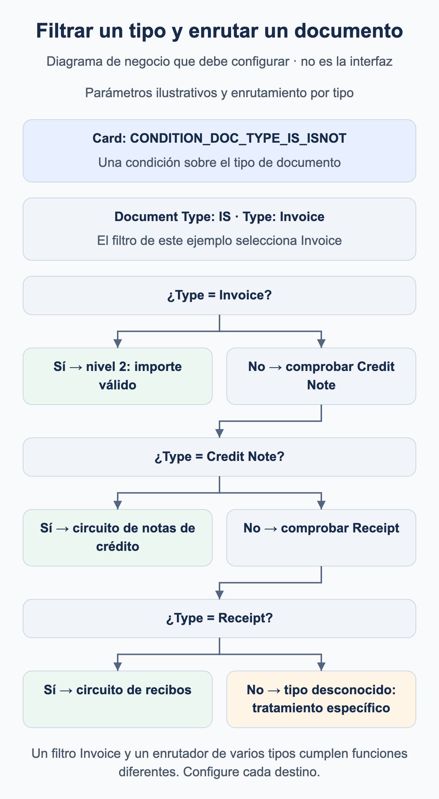<figcaption><p>El filtro Invoice y el enrutador por tipo ilustran aspectos complementarios de este ejemplo. El enrutador distingue factura, nota de crédito, recibo y tipo desconocido. Los nombres de tarjetas y flujos son ilustrativos; debe configurar cada destino.</p></figcaption></figure>

<details>
<summary>Parámetros ilustrativos: tipo de documento</summary>

```
Card: CONDITION_DOC_TYPE_IS_ISNOT
Document Type: IS
Type: Invoice
```

</details>

**Condición 3: Estado del proveedor**

Explicación visual: [parámetros independientes](#diagrama-parametros-independientes).

<details>
<summary>Parámetros ilustrativos: estado activo</summary>

```
Card: CONDITION_SUPPLIER_STATUS_IS_ISNOT
Supplier Status: IS
Status: ACTIVE
```

</details>

**Condición 4: Comprobación de proveedor nuevo**

Para este ejemplo, calcule la fecha situada 180 días antes de la evaluación y compare la fecha de la primera transacción con ese límite. «IS AFTER» significa estrictamente posterior: la igualdad da No. Seleccione el campo real y calcule o introduzca la fecha límite; los nombres de tarjeta y campo y la referencia {{TODAY_MINUS_180_DAYS}} son ilustrativos. Compruebe por separado que la fecha de primera transacción sea válida y no posterior a la evaluación; configure el tratamiento de valores ausentes o inválidos.

#### Diagrama: Condición de 180 días

<figure>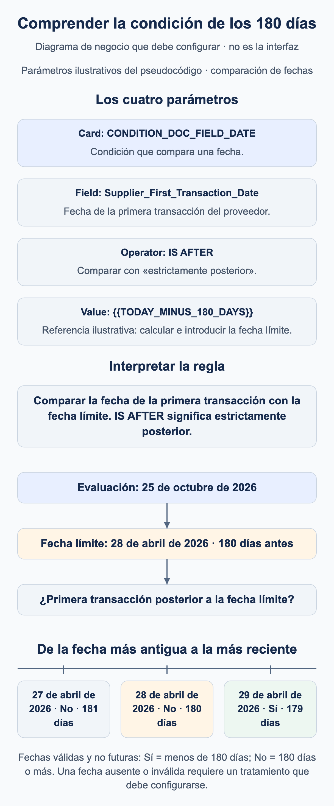<figcaption><p>Ejemplo de comparación: el 25 de octubre de 2026, la fecha límite es el 28 de abril de 2026. «IS AFTER» excluye la igualdad: el 29 de abril da Sí; el 28 y el 27 de abril dan No. Los nombres de la tarjeta y del campo y la referencia {{TODAY_MINUS_180_DAYS}} son ilustrativos: seleccione el campo real y calcule o introduzca la fecha límite. Se suponen fechas válidas y no futuras; compruebe por separado que una fecha no sea futura. El tratamiento de una fecha ausente o inválida debe configurarse.</p></figcaption></figure>

<details>
<summary>Copiar los parámetros ilustrativos del ejemplo</summary>

```
Card: CONDITION_DOC_FIELD_DATE
Field: Supplier_First_Transaction_Date
Operator: IS AFTER
Value: {{TODAY_MINUS_180_DAYS}}
```

</details>


**Referencia de guía:** [Guía completa de tarjetas de condición](../and/condition-cards-complete-guide.md)

***

### Paso 2: Construir el árbol de decisión

**Nivel 1: Tipo de documento**

Explicación visual: [tipos de documento](#diagrama-tipos-de-documento).

<details>
<summary>Enrutador ilustrativo por tipo de documento</summary>

```
Workflow: "Invoice Processing"

IF Document_Type = "Invoice":
  → Continuar al nivel 2

ELSE IF Document_Type = "Credit Note":
  → Ramificar a "Credit Note Processing"

ELSE IF Document_Type = "Receipt":
  → Ramificar a "Receipt Processing"

ELSE:
  → Enrutar al tratamiento "Unknown Document Type"
```

</details>

**Nivel 2: Umbrales de importe (facturas no urgentes, importe válido)**

Explicación visual: [tramos de importe](#diagrama-tramos-de-importe).

<details>
<summary>Cuatro tramos de importe: pseudocódigo</summary>

```
IF Amount < €1,000:
  → Ramificar a "Auto-Approve Path"

ELSE IF Amount < €10,000:
  → Ramificar a "Manager Approval Path"

ELSE IF Amount < €50,000:
  → Ramificar a "Director Approval Path"
  → Comprobar las condiciones del nivel 3

ELSE (Amount ≥ €50,000):
  → Ramificar a "Executive Approval Path"
  → Se requiere doble o triple aprobación
```

</details>

**Nivel 3: Análisis del proveedor (para facturas de alto valor)**

#### Diagrama: Análisis del proveedor

<figure>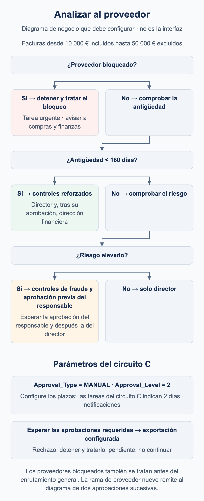<figcaption><p>Detalle del circuito del proveedor: tratar el bloqueo, después la antigüedad y después el riesgo. La rama de proveedores con menos de 180 días remite al diagrama de dos aprobaciones sucesivas. Configure las tareas, plazos, notificaciones y acciones del circuito C.</p></figcaption></figure>

<details>
<summary>Análisis del proveedor: bloqueo, antigüedad y riesgo</summary>

```
IF Supplier_Status = "BLOCKED":
  → DETENER el procesamiento
  → Crear tarea urgente de escalamiento
  → Notificar a compras y finanzas

ELSE IF Supplier_Age < 180 días (nuevo):
  → Se requiere aprobación adicional
  → Añadir CFO a la cadena de aprobación
  → Verificación reforzada

ELSE IF Supplier_Risk_Rating = "HIGH":
  → Se requieren controles adicionales
  → Revisión para detectar fraude
  → Aprobación previa del responsable; esperar una aprobación positiva
  → Aprobación del director; esperar una aprobación positiva

ELSE:
  → Flujo habitual de importe elevado
```

</details>

***

### Paso 3: Crear las acciones de enrutamiento

**Ruta A: Aprobación automática (importe < 1.000 €)**

#### Diagrama: Circuito automático

<figure>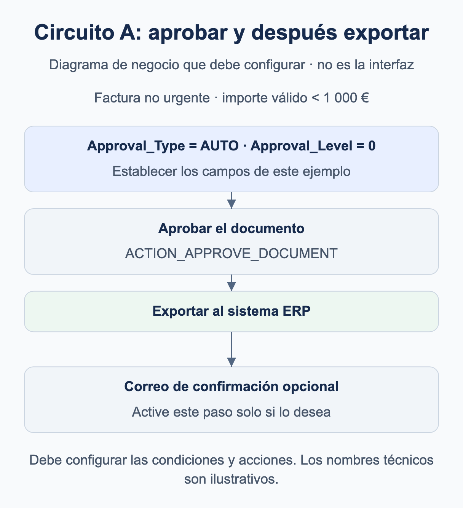<figcaption><p>Ejemplo del circuito A: establecer los campos de aprobación, aprobar el documento y después exportarlo. El correo de confirmación es opcional. Este diagrama describe acciones que deben configurarse, no una ejecución observada.</p></figcaption></figure>

<details>
<summary>Acciones del circuito A: aprobación automática</summary>

```
Acciones:
1. Establecer el campo "Approval_Type" = "AUTO"
2. Establecer el campo "Approval_Level" = "0"
3. ACTION_APPROVE_DOCUMENT
4. Exportar al ERP
5. Enviar correo de confirmación (opcional)
```

</details>

**Circuito B: Aprobación del responsable (1 000 € ≤ importe < 10 000 €)**

#### Diagrama: Tarea del responsable

<figure>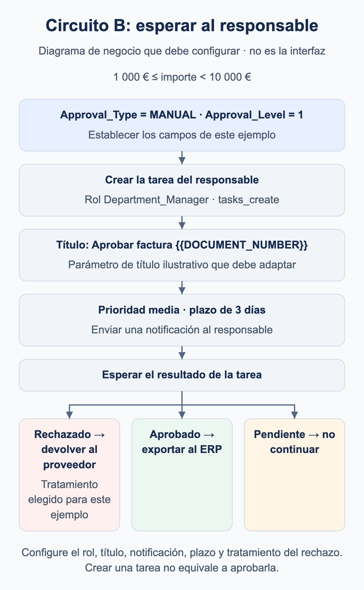<figcaption><p>Ejemplo del circuito B: crear una tarea para el responsable, notificarle y esperar su resultado. Solo la aprobación permite exportar; aquí, el rechazo devuelve el documento al proveedor. El plazo de tres días y los destinatarios son decisiones de configuración.</p></figcaption></figure>

<details>
<summary>Acciones del circuito B: tarea del responsable</summary>

```
Acciones:
1. Establecer el campo "Approval_Type" = "MANUAL"
2. Establecer el campo "Approval_Level" = "1"
3. tasks_create:
   - Title: "Aprobar factura {{DOCUMENT_NUMBER}}"
   - Assign to: Department_Manager
   - Priority: Medium
   - Deadline: 3 días
4. Enviar notificación por correo al responsable
5. Esperar a que termine la tarea
6. Si se aprueba: exportar al ERP
7. Si se rechaza: devolver al proveedor
```

</details>

**Circuito C: Aprobación del director (10 000 € ≤ importe < 50 000 €)**

Explicación visual: [análisis del proveedor](#diagrama-analisis-del-proveedor), [aprobaciones sucesivas](#diagrama-aprobaciones-sucesivas).

<details>
<summary>Acciones del circuito C: controles y aprobaciones requeridas</summary>

```
Acciones:
1. Establecer el campo "Approval_Type" = "MANUAL"
2. Establecer el campo "Approval_Level" = "2"
3. Comprobar Supplier_Age y Supplier_Risk_Rating:
   IF New (< 180 días):
     - Crear tarea 1: aprobación del director
     - Esperar la aprobación positiva de la tarea 1 antes de crear la tarea 2: aprobación de CFO
     - Esperar la aprobación positiva de la tarea 2 antes de continuar
     - Pendiente: no continuar
     - Cualquier rechazo: detener la cadena y tratarlo según la configuración
     - Se requieren ambas aprobaciones positivas
   ELSE IF Supplier_Risk_Rating = "HIGH":
     - Controles de riesgo adicionales y aprobación previa del responsable
     - Esperar la aprobación positiva del responsable antes de la aprobación del director
     - Esperar la aprobación positiva del director antes de exportar
     - Pendiente o rechazo: detener el avance y tratar el resultado según la configuración
   ELSE:
     - Crear tarea: aprobación solo del director
4. Prioridad: Alta
5. Plazo: 2 días para las tareas de aprobación del circuito C; configure por separado los plazos de control de riesgo
6. Enviar notificaciones por correo
7. Esperar a que terminen
8. Si se aprueban todas: exportar
9. Si se rechaza alguna: devolver al proveedor
```

</details>

#### Diagrama: Aprobaciones sucesivas

<figure>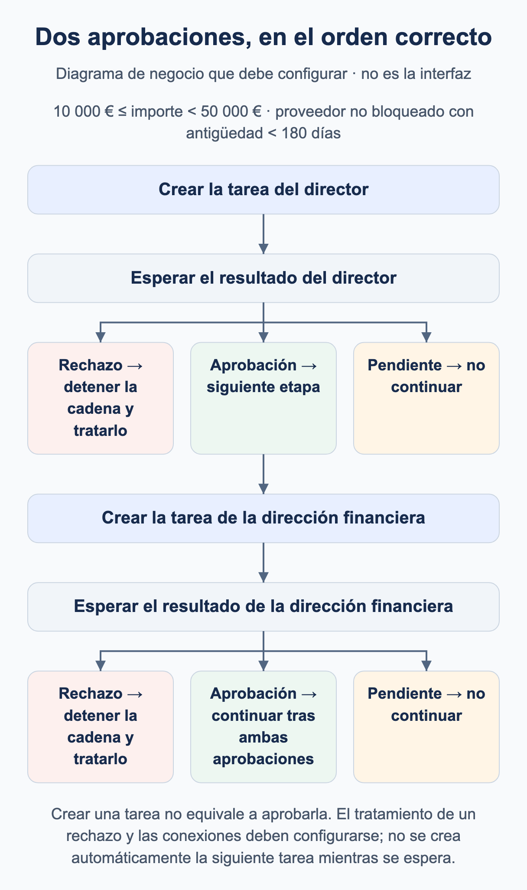<figcaption><p>Ejemplo de aprobaciones sucesivas: crear la tarea de la dirección financiera solo después de la aprobación del director y esperar entonces su resultado. Continuar únicamente tras ambas aprobaciones. Un rechazo detiene la cadena y sigue el tratamiento configurado; un resultado pendiente no permite continuar.</p></figcaption></figure>

Según la configuración, un rechazo puede devolver el documento al proveedor o seguir otro circuito. El diagrama solo exige detener esta cadena de aprobación; no impone una revisión manual en todos los casos.

**Ruta D: Aprobación ejecutiva (≥ 50.000 €)**

#### Diagrama: Aprobación de la dirección

<figure>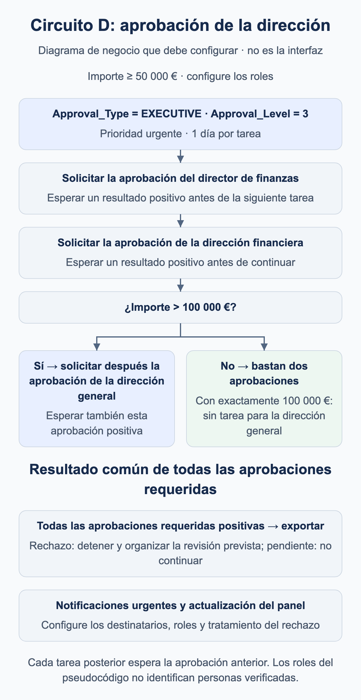<figcaption><p>Ejemplo del circuito D: dos aprobaciones sucesivas desde 50 000 €, con una tercera solo por encima de 100 000 €. Cada tarea posterior espera la aprobación anterior. Configure los roles, plazos, notificaciones y tratamiento del rechazo.</p></figcaption></figure>

<details>
<summary>Acciones del circuito D: aprobación de la dirección</summary>

```
Acciones:
1. Establecer el campo "Approval_Type" = "EXECUTIVE"
2. Establecer el campo "Approval_Level" = "3"
3. Aprobaciones sucesivas:
   - Tarea 1: director de finanzas
   - Tarea 2: CFO
   - Tarea 3: CEO (si > €100,000)
4. Prioridad: Urgente
5. Plazo: 1 día cada una
6. Enviar notificaciones urgentes
7. Actualizar el panel de dirección
8. Esperar todas las aprobaciones
9. Si se aprueban todas: exportar
10. Si se rechaza alguna: reunión de revisión de la dirección
```

</details>

***

## Patrones avanzados de lógica de decisión

Los patrones siguientes son variantes independientes. Las puntuaciones, umbrales departamentales y reglas de tiempo no se añaden automáticamente a la matriz completa anterior; elija y configure las reglas para su caso.

### Patrón 1: Enrutamiento basado en puntuación

**Calcule una puntuación de riesgo entera y enrute según ella en este ejemplo:**

#### Diagrama: Puntuación de riesgo

<figure>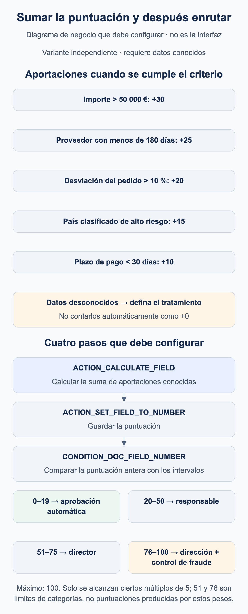<figcaption><p>Variante independiente: cinco aportaciones conocidas producen una puntuación entera de 0 a 100 y después un circuito. Los límites 51 y 76 definen categorías; estos cinco pesos no producen esas puntuaciones. Defina por separado el tratamiento de datos desconocidos.</p></figcaption></figure>

<details>
<summary>Cálculo de puntuación de riesgo e intervalos</summary>

```
Cálculo de la puntuación de riesgo:
  Score = 0

  IF Amount > €50,000: Score += 30
  IF Supplier_Age < 180 días: Score += 25
  IF PO_Variance > 10%: Score += 20
  IF Supplier_Country = "High Risk Country": Score += 15
  IF Payment_Terms < 30 días: Score += 10

  Intervalo de puntuación total: 0-100

Enrutamiento:
  IF Score < 20: aprobación automática
  IF Score 20-50: aprobación del responsable
  IF Score 51-75: aprobación del director
  IF Score > 75: aprobación de la dirección + control de fraude
```

</details>

**Implementación:**

Explicación visual: [puntuación de riesgo](#diagrama-puntuacion-de-riesgo).

<details>
<summary>Implementación ilustrativa de la puntuación</summary>

```
1. ACTION_CALCULATE_FIELD: calcular la puntuación de riesgo
2. ACTION_SET_FIELD_TO_NUMBER: guardar la puntuación
3. CONDITION_DOC_FIELD_NUMBER: comprobar los umbrales de puntuación
4. Enrutar según la puntuación
```

</details>

***

### Patrón 2: Matriz basada en departamentos

**Distintas reglas de aprobación por departamento:**

#### Diagrama: Matriz departamental

<figure>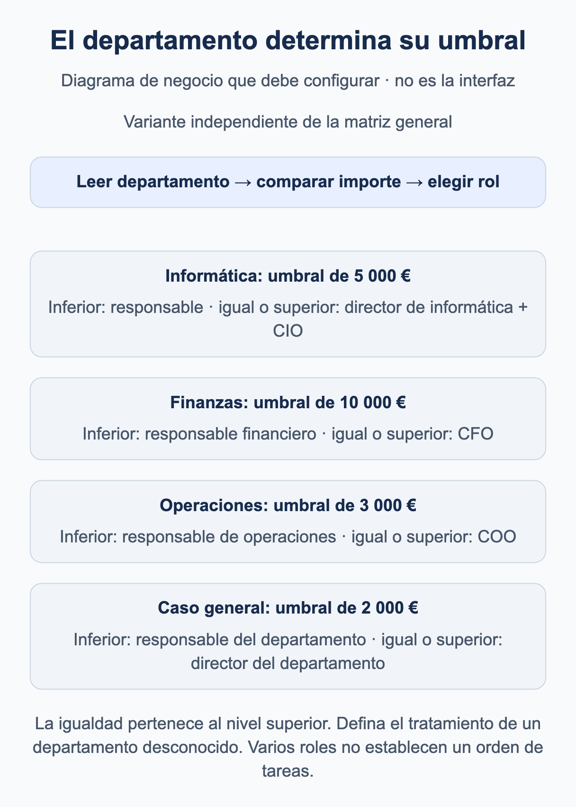<figcaption><p>Matriz departamental independiente: los umbrales difieren para informática, finanzas, operaciones y el caso general. La igualdad selecciona el tramo superior. Configure los roles; su presencia no demuestra una aprobación sucesiva.</p></figcaption></figure>

<details>
<summary>Matriz de umbrales por departamento</summary>

```
Matriz departamental:

  Departamento de informática:
    Amount < €5,000: responsable de informática
    Amount ≥ €5,000: director de informática + CIO

  Departamento de finanzas:
    Amount < €10,000: responsable financiero
    Amount ≥ €10,000: CFO

  Departamento de operaciones:
    Amount < €3,000: responsable de operaciones
    Amount ≥ €3,000: COO

  Caso general:
    Amount < €2,000: responsable del departamento
    Amount ≥ €2,000: director del departamento
```

</details>

**Implementación:**

Explicación visual: [matriz departamental](#diagrama-matriz-departamental).

<details>
<summary>Implementación ilustrativa de la matriz departamental</summary>

```
1. Comprobar el campo Department
2. Según el departamento, comprobar el umbral de importe
3. Enrutar al aprobador adecuado
4. Umbrales diferentes según el departamento
```

</details>

***

### Patrón 3: Lógica basada en el tiempo

**Distintas reglas según el momento:**

#### Diagrama: Variantes de tiempo

<figure>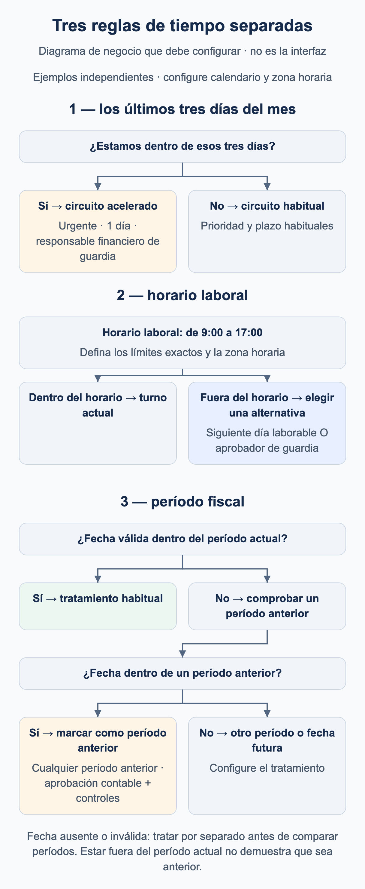<figcaption><p>Tres variantes independientes: fin de mes, horario laboral y período fiscal. La cola y la aprobación de guardia son alternativas entre las que elegir. Una fecha fuera del período actual no es necesariamente anterior; compruebe su caso por separado.</p></figcaption></figure>

<details>
<summary>Tres variantes de tiempo independientes</summary>

```
Procesamiento de fin de mes (últimos 3 días del mes):
  IF Today está en los últimos 3 días del mes:
    - Prioridad: URGENT
    - Plazo: 1 día
    - Aprobador: responsable financiero de guardia
    - Flujo acelerado
  ELSE:
    - Prioridad habitual
    - Plazo habitual
    - Flujo habitual

Horario laboral y fuera de horario:
  IF Time está entre 9 AM - 5 PM:
    - Asignar al turno actual
  ELSE:
    - Poner en cola para el siguiente día laborable
    - OR enrutar al aprobador de guardia

Período fiscal (política ilustrativa independiente):
  IF Document_Date está ausente o no es válido:
    - Tratar la fecha inválida o desconocida según la configuración
  ELSE IF Document_Date in Current_Fiscal_Period:
    - Procesamiento habitual
  ELSE IF Document_Date in cualquier Fiscal_Period before Current_Fiscal_Period:
    - Marcar como "Prior Period"
    - Exigir aprobación contable
    - Controles adicionales
  ELSE:
    - Período fiscal futuro u otro: tratar según la configuración
```

</details>

***

### Patrón 4: Enrutamiento basado en excepciones

**Enrute las excepciones por separado:**

#### Diagrama: Gravedad de excepciones

<figure>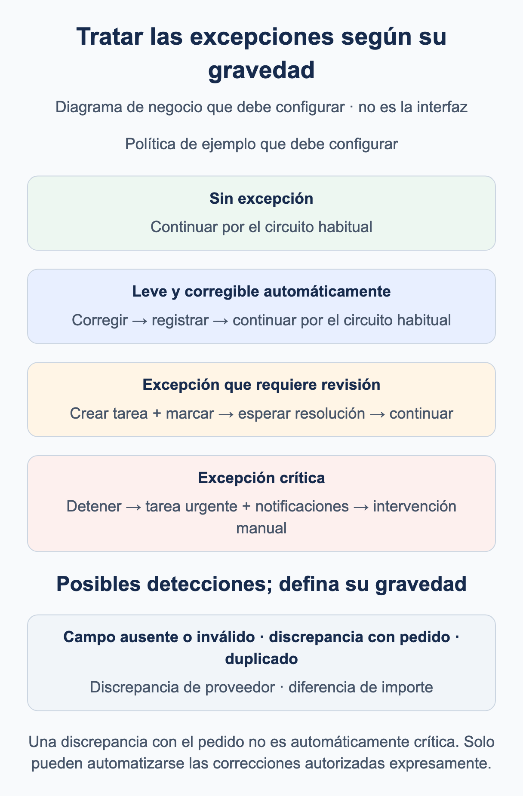<figcaption><p>Política de gravedad de ejemplo: continuar solo tras la corrección configurada o la resolución esperada. Una excepción crítica detiene el procesamiento. Los ejemplos de detección no determinan por sí solos la gravedad.</p></figcaption></figure>

<details>
<summary>Política de gravedad de excepciones</summary>

```
Detección de excepciones:

  Sin excepción:
    → Flujo habitual

  Excepción leve (corregible automáticamente):
    → Corregir automáticamente
    → Registrar la corrección
    → Continuar el flujo habitual

  Excepción media (requiere revisión):
    → Crear tarea de revisión
    → Marcar el documento
    → Tras la corrección: continuar el flujo

  Excepción grave (requiere escalamiento):
    → Detener el procesamiento
    → Crear tarea urgente
    → Notificar a varios niveles
    → Se requiere intervención manual

Tipos de excepción:
  - Campo obligatorio ausente
  - Valor de campo inválido
  - Discrepancia con el pedido
  - Factura duplicada
  - Discrepancia de proveedor
  - Diferencia de importe
```

</details>

***

## Diagrama completo de lógica de decisión

Los diagramas presentan las etapas esenciales. El árbol de texto detallado siguiente conserva el ejemplo técnico; sus destinos siguen requiriendo configuración.


Explicación visual: [vista general](#diagrama-vista-general), [tramos de importe](#diagrama-tramos-de-importe), [análisis del proveedor](#diagrama-analisis-del-proveedor), [aprobaciones sucesivas](#diagrama-aprobaciones-sucesivas), [circuito automático](#diagrama-circuito-automatico), [tarea del responsable](#diagrama-tarea-del-responsable), [aprobación de la dirección](#diagrama-aprobacion-de-la-direccion).

<details>
<summary>Ejemplo completo: árbol de texto detallado</summary>

```
LLEGA LA FACTURA
│
├─ NIVEL 1: COMPROBACIÓN DE EXCEPCIONES
│  │
│  ├─ ¿Excepción crítica o proveedor BLOCKED?
│  │  (Debe configurar la gravedad; no toda discrepancia con el pedido es crítica.)
│  │  │
│  │  ├─ SÍ → Detener y escalar
│  │  │        Crear tarea urgente
│  │  │        Notificar al administrador
│  │  │        → FIN (tratamiento de excepciones)
│  │  │
│  │  └─ NO → Continuar al nivel 2
│
├─ NIVEL 2: TIPO DE DOCUMENTO
│  │
│  ├─ ¿Type = Invoice?
│  │  └─ SÍ → Continuar al nivel 3
│  │
│  ├─ ¿Type = Credit Note?
│  │  └─ SÍ → Ramificar al flujo de notas de crédito
│  │           → FIN (circuito de notas de crédito)
│  │
│  └─ ¿Otro tipo?
│     └─ SÍ → Ramificar al flujo adecuado
│              → FIN (circuito de otro tipo)
│
├─ NIVEL 3: COMPROBACIÓN DE URGENCIA (para facturas)
│  │
│  ├─ ¿Urgent Flag = TRUE?
│  │  │
│  │  ├─ SÍ → Flujo acelerado
│  │  │        Prioridad: URGENT
│  │  │        Plazo: 1 día
│  │  │        Asignar a: aprobador de mayor nivel
│  │  │        → FIN (circuito acelerado)
│  │  │
│  │  └─ NO → Continuar al nivel 4
│
├─ NIVEL 4: UMBRALES DE IMPORTE
│  │
│  ├─ ¿Amount ausente o inválido?
│  │  ├─ SÍ → Revisión manual (política explícita del ejemplo)
│  │  └─ NO → Continuar a los umbrales de importe siguientes
│  │
│  ├─ ¿Amount < €1,000?
│  │  │
│  │  ├─ SÍ → CIRCUITO DE APROBACIÓN AUTOMÁTICA
│  │  │        Establecer Approval_Type = "AUTO"
│  │  │        Aprobar inmediatamente
│  │  │        Exportar al ERP
│  │  │        → FIN (aprobado automáticamente)
│  │  │
│  │  └─ NO → Continuar
│  │
│  ├─ ¿Amount < €10,000?
│  │  │
│  │  ├─ SÍ → CIRCUITO DE APROBACIÓN DEL RESPONSABLE
│  │  │        Crear tarea para el responsable
│  │  │        Prioridad: Media
│  │  │        Plazo: 3 días
│  │  │        → ESPERAR el resultado; no continuar si está pendiente
│  │  │           → Aprobado: continuar el procesamiento configurado
│  │  │           → Rechazado: detener la cadena y tratarlo según la configuración
│  │  │
│  │  └─ NO → Continuar
│  │
│  ├─ ¿Amount < €50,000?
│  │  │
│  │  ├─ SÍ → CIRCUITO DE APROBACIÓN DEL DIRECTOR
│  │  │        Continuar al nivel 5 (control del proveedor)
│  │  │
│  │  └─ NO → Continuar
│  │
│  └─ ¿Amount ≥ €50,000?
│     │
│     └─ SÍ → CIRCUITO DE APROBACIÓN DE LA DIRECCIÓN
│              Crear tareas sucesivas:
│              - Director de finanzas
│              - CFO
│              - CEO (si > €100,000)
│              Prioridad: URGENT
│              Plazo: 1 día cada una
│              → ESPERAR todos los resultados requeridos
│                 → Todos aprobados: continuar el procesamiento configurado
│                 → Pendiente: no continuar
│                 → Cualquier rechazo: detener la cadena y tratarlo según la configuración
│
├─ NIVEL 5: ANÁLISIS DEL PROVEEDOR (€10,000 ≤ Amount < €50,000)
│  │
│  ├─ ¿Supplier Status = "BLOCKED"?
│  │  │
│  │  ├─ SÍ → BLOQUEAR Y ESCALAR
│  │  │        Detener el procesamiento
│  │  │        Crear tarea urgente
│  │  │        Notificar a compras y finanzas
│  │  │        → FIN (proveedor bloqueado)
│  │  │
│  │  └─ NO → Continuar
│  │
│  ├─ ¿Supplier Age < 180 días (nuevo)?
│  │  │
│  │  ├─ SÍ → SE REQUIERE DOBLE APROBACIÓN
│  │  │        Tarea 1: director (2 días)
│  │  │        → ESPERAR la tarea 1
│  │  │           IF tarea 1 aprobada:
│  │  │             Tarea 2: CFO (2 días)
│  │  │             → ESPERAR la tarea 2
│  │  │                → Pendiente: no continuar
│  │  │                → Aprobado: continuar solo tras ambas aprobaciones positivas
│  │  │                → Rechazado: detener la cadena y tratarlo según la configuración
│  │  │           IF tarea 1 rechazada:
│  │  │             → Detener la cadena y tratarlo según la configuración
│  │  │           IF tarea 1 pendiente:
│  │  │             → No crear la tarea 2 ni continuar
│  │  │
│  │  └─ NO → Continuar
│  │
│  ├─ ¿Supplier Risk Rating = "HIGH"?
│  │  │
│  │  ├─ SÍ → APROBACIÓN REFORZADA
│  │  │        Controles adicionales de fraude
│  │  │        Aprobación previa del responsable y después aprobación del director
│  │  │        Esperar cada resultado positivo; no continuar si está pendiente o rechazado
│  │  │        Configure los plazos de control de riesgo; las tareas de aprobación del circuito C indican 2 días
│  │  │        → FIN (circuito reforzado)
│  │  │
│  │  └─ NO → APROBACIÓN HABITUAL DEL DIRECTOR
│  │           Crear tarea para el director
│  │           Prioridad: Alta
│  │           Plazo: 2 días
│  │           → ESPERAR el resultado; no continuar si está pendiente
│  │              → Aprobado: continuar el procesamiento configurado
│  │              → Rechazado: detener la cadena y tratarlo según la configuración
│  │
│  └─ [Análisis del proveedor terminado]
│
└─ [Todos los niveles de decisión procesados]
```

</details>


***

## Buenas prácticas de configuración

### 1. Mantenga la lógica clara y mantenible

La comparación siguiente presenta una condición simple, una condición densa y otra política por etapas. El diagrama distingue sus propósitos sin afirmar que sean equivalentes.

#### Diagrama: Decisiones legibles

<figure>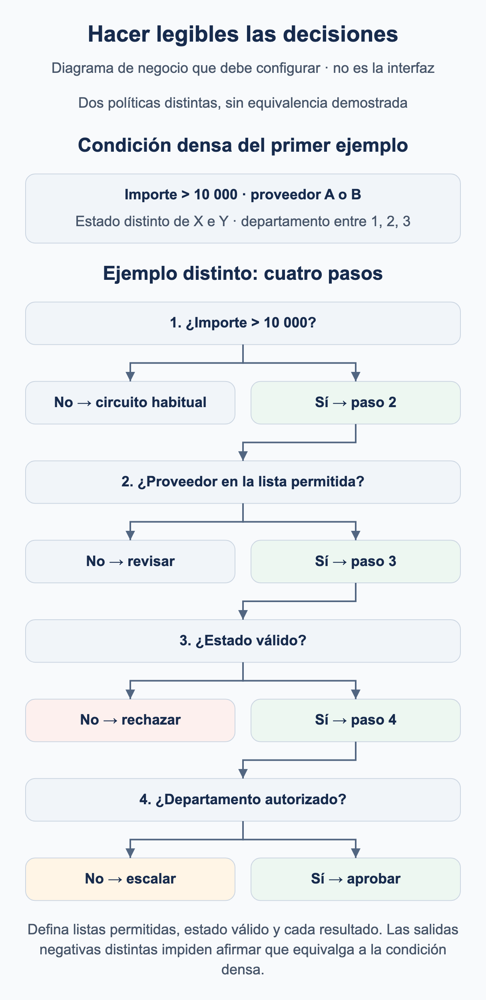<figcaption><p>El ejemplo de cuatro pasos ilustra una política distinta de la condición densa. Hace visible cada resultado negativo; no es una transformación lógica de equivalencia demostrada. Defina listas permitidas y tratamiento de las salidas.</p></figcaption></figure>

✅ **Bien:**

Explicación visual: [condición simple](#diagrama-condicion-simple).

<details>
<summary>Ejemplo simple: circuito de importe elevado</summary>

```
IF Amount > 10000:
  → Circuito de importe elevado
ELSE:
  → Circuito habitual
```

</details>

❌ **Mal (demasiado complejo):**

Explicación visual: [decisiones legibles](#diagrama-decisiones-legibles).

<details>
<summary>Ejemplo de condición densa</summary>

```
IF (Amount > 10000 AND (Supplier = "A" OR Supplier = "B") AND NOT (Status = "X" OR Status = "Y") AND Department IN [1,2,3]):
  → Circuito complejo
```

</details>

**Otro ejemplo: una política distinta en cuatro etapas:**

Este ejemplo distingue los resultados de cada etapa. No es una reformulación lógicamente equivalente de la condición densa anterior: las listas de proveedores, estados válidos, departamentos permitidos y tratamiento de resultados negativos deben definirse para este segundo ejemplo.

Explicación visual: [decisiones legibles](#diagrama-decisiones-legibles).

<details>
<summary>Otro ejemplo: política de cuatro pasos</summary>

```
Paso 1: IF Amount > 10000: continuar, ELSE: circuito habitual
Paso 2: IF Supplier in lista permitida: continuar, ELSE: revisar
Paso 3: IF Status válido: continuar, ELSE: rechazar
Paso 4: IF Department autorizado: aprobar, ELSE: escalar
```

</details>

***

### 2. Documente la lógica de decisión

**Incluya siempre:**

* El propósito de cada punto de decisión
* La regla de negocio que se implementa
* Los resultados esperados
* La gestión de excepciones

**Ejemplo de documentación:**

#### Diagrama: Registro de la regla

<figure>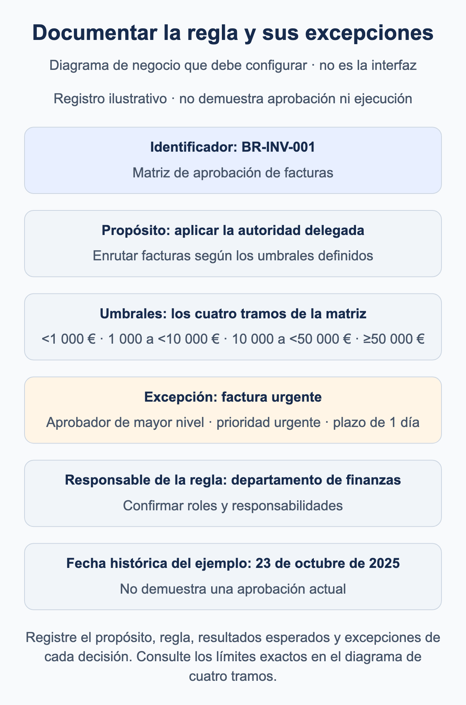<figcaption><p>Registro ilustrativo BR-INV-001: propósito, umbrales, excepción, responsable y fecha de referencia. Remitir a los cuatro tramos evita duplicar la regla; este registro no demuestra aprobación ni ejecución.</p></figcaption></figure>

<details>
<summary>Registro ilustrativo de la regla BR-INV-001</summary>

```
Punto de decisión: comprobación del umbral de importe
Regla de negocio: BR-INV-001 (matriz de aprobación de facturas)
Propósito: enrutar facturas por umbrales de importe según la política de la empresa
Umbrales:
  < €1,000: aprobación automática (umbral aprobado por CFO)
  €1,000 ≤ Amount < €10,000: aprobación del responsable (matriz de delegación)
  €10,000 ≤ Amount < €50,000: aprobación del director con controles del proveedor
  Amount ≥ €50,000: aprobación de la dirección
Excepciones: las facturas urgentes pasan directamente al nivel superior
Actualización: 2025-10-23
Responsable: departamento de finanzas
```

</details>

***

### 3. Pruebe todas las rutas

**Matriz de pruebas propuesta: resultados esperados, no pruebas ejecutadas:**

Verifique estos resultados esperados en su configuración y registre lo que observe.

| Caso | Importe | Tipo | Proveedor | Circuito esperado | Verificación |
| --- | --- | --- | --- | --- | --- |
| TC1 | 500 € | Factura | Existente | Aprobación automática | Por probar |
| TC2 | 5 000 € | Factura | Existente | Responsable | Por probar |
| TC3 | 15 000 € | Factura | Nuevo | Director y después dirección financiera | Por probar |
| TC4 | 60 000 € | Factura | Existente | Dirección | Por probar |
| TC5 | 2 000 € | Nota de crédito | Existente | Circuito de notas de crédito | Por probar |
| TC6 | 100 000 € | Factura | Bloqueado | Detener y escalar | Por probar |
| TC7 | 999,99 € | Factura | Existente | Aprobación automática | Por probar |
| TC8 | 1 000 € | Factura | Existente | Responsable | Por probar |
| TC9 | 9 999,99 € | Factura | Existente | Responsable | Por probar |
| TC10 | 10 000 € | Factura | Existente | Director + controles del proveedor | Por probar |
| TC11 | 49 999,99 € | Factura | Existente | Director + controles del proveedor | Por probar |
| TC12 | 50 000 € | Factura | Existente | Dirección | Por probar |
| TC13 | Ausente o inválido | Factura | Existente | Revisión manual elegida para este ejemplo | Por probar |
| TC14 | 15 000 € | Factura | Nuevo | Director pendiente: no crear la siguiente tarea | Por probar |
| TC15 | 15 000 € | Factura | Nuevo | Rechazo del director o dirección financiera: detener y tratarlo | Por probar |
| TC16 | 15 000 € | Factura | Nuevo | Ambas aprobaciones positivas: continuar según configuración | Por probar |

***

### 4. Supervise las métricas de decisión

**Haga seguimiento de:**

* La distribución entre las rutas de decisión
* La tasa de aprobación automática
* La tasa de revisión manual
* El tiempo medio de procesamiento por ruta
* Las tasas de excepción
* La utilización de cada ruta

**Métricas de ejemplo ficticias:** Estos valores ilustran un informe; no demuestran rendimiento actual ni ejecución de este flujo de trabajo.

#### Diagrama: Métricas ficticias

<figure>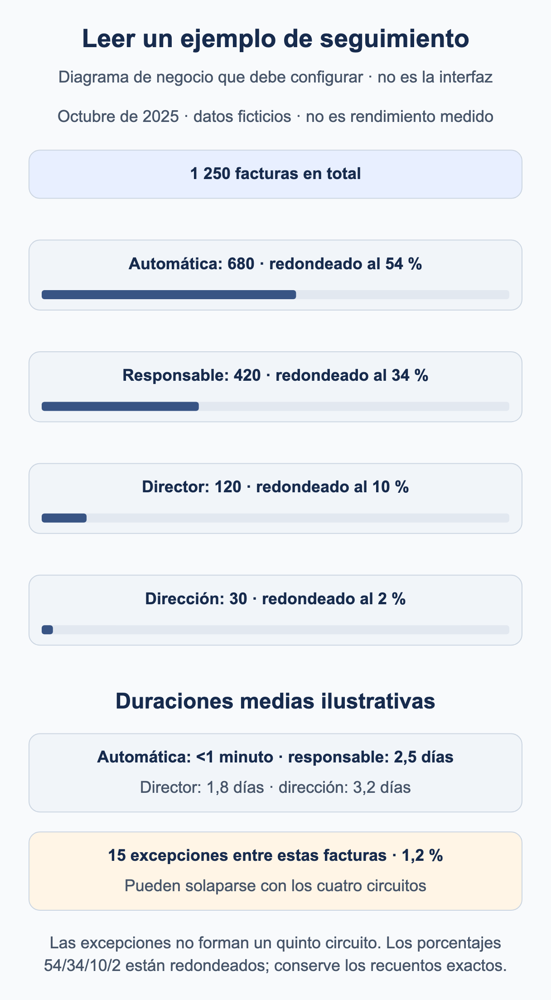<figcaption><p>Ejemplo ficticio: los cuatro circuitos suman 1 250 facturas. Los porcentajes están redondeados. Las 15 excepciones, o el 1,2 %, pueden afectar a esas mismas facturas; no forman un quinto circuito. Las duraciones no son rendimiento medido de DocBits.</p></figcaption></figure>

<details>
<summary>Ejemplo ficticio de distribución y duraciones</summary>

```
Mes: octubre de 2025
Total de facturas: 1250

Distribución de circuitos de decisión:
- Aprobación automática (< €1k): 680 (54%)
- Circuito del responsable (€1k ≤ Amount < €10k): 420 (34%)
- Circuito del director (€10k ≤ Amount < €50k): 120 (10%)
- Circuito de la dirección (Amount ≥ €50k): 30 (2%)

Tiempo de procesamiento:
- Aprobación automática: < 1 minuto
- Circuito del responsable: 2,5 días de media
- Circuito del director: 1,8 días de media
- Circuito de la dirección: 3,2 días de media

Excepciones: 15 (1,2%)
```

</details>

***

## Patrones relacionados

### Patrones que funcionan bien juntos:

* [**Patrón de gestión de tareas**](task-management-pattern.md) - Crea tareas según las decisiones
* [**Patrón de integración de API**](api-integration-pattern.md) - Obtiene datos para la toma de decisiones
* [**Patrón de cotejo de PO**](po-matching-pattern.md) - Usa los resultados de PO en las decisiones
* [**Patrón de transformación de datos**](data-transformation-pattern.md) - Transforma los datos antes de las decisiones

***

## Guías relacionadas

### Requisitos previos

* [Guía completa de tarjetas de condición](../and/condition-cards-complete-guide.md) - Todas las tarjetas de condición
* [Guía de manipulación de campos](../then/document-field/field-manipulation-guide.md) - Operaciones con campos
* [Guía de asignación a usuario](../then/assignee/assignment-user-guide.md) - Lógica de enrutamiento

### Tarjetas relacionadas

* **CONDITION\_DOC\_FIELD\_AMOUNT** - [Guía de tarjetas de condición](../and/condition-cards-complete-guide.md)
* **CONDITION\_DOC\_TYPE\_IS\_ISNOT** - [Guía de tarjetas de condición](../and/condition-cards-complete-guide.md)
* **CONDITION\_SUPPLIER\_STATUS\_IS\_ISNOT** - [Guía de tarjetas de condición](../and/condition-cards-complete-guide.md)
* **ACTION\_ASSIGN\_TO\_USER** - [Guía de asignación](../then/assignee/assignment-user-guide.md)
* **tasks\_create** - [Guía de asignación de tareas](../then/task/task-assignment-guide.md)

### Próximos pasos

* Crear tareas: [Patrón de gestión de tareas](task-management-pattern.md)
* Añadir cotejo complejo: [Patrón de cotejo de PO](po-matching-pattern.md)
* Integrar API: [Patrón de integración de API](api-integration-pattern.md)

***

**Metadatos históricos del ejemplo:**

**Versión del patrón:** 1.0 **Última actualización:** 23 de octubre de 2025 **Dificultad:** Media **Tiempo estimado:** 30-45 minutos