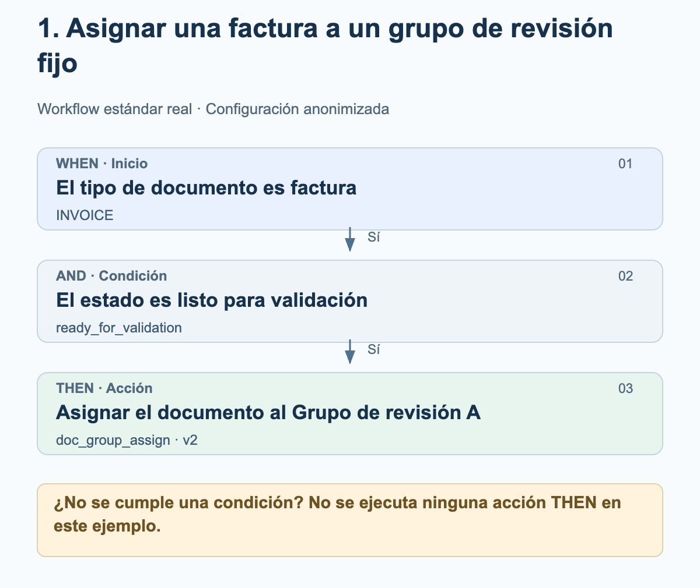
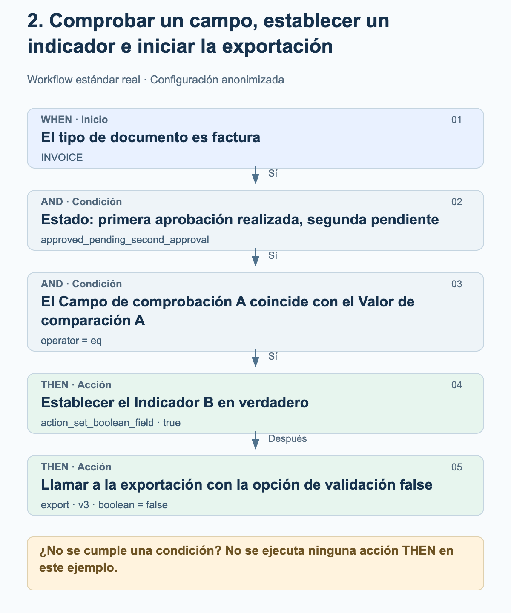
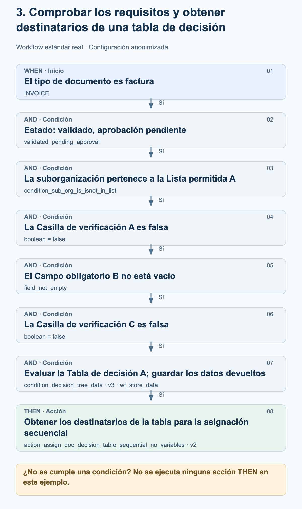

# Ejemplos reales de workflows en la práctica

Estos tres ejemplos proceden de workflows estándar activados en el entorno de producción. Muestran el orden realmente configurado de WHEN, AND y THEN. Los grupos, las organizaciones, los nombres de campos, los valores de comparación y las tablas de decisión se han sustituido por denominaciones neutras. Los gráficos explican la configuración; no son capturas de pantalla.

Estado a 27 de octubre de 2026. Las tarjetas, versiones, parámetros y su orden se han contrastado con las configuraciones guardadas de ejecuciones de producción finalizadas correctamente. Un registro de workflow con el resultado success no confirma una aprobación humana ni la recepción en el ERP. No se han modificado workflows ni se han ejecutado con fines de prueba.

## Cómo leer los gráficos

Los ejemplos utilizan el modo estándar. WHEN delimita el tipo de documento; todas las condiciones AND deben cumplirse antes de que se ejecuten las acciones THEN. En estos ejemplos, una condición no cumplida implica que no se ejecuta ninguna acción THEN. Las flechas entre acciones muestran su orden configurado. No representan un paso adicional de éxito o aprobación. Una ejecución también puede terminar con un error.

## 1. Asignar una factura a un grupo de revisión fijo

Una factura debe enviarse para su revisión a un grupo configurado de forma fija en cuanto alcance el estado «lista para validación». Este ejemplo no necesita ninguna tabla de decisión.

<figure><figcaption>Factura y estado correspondiente: el documento se asigna al Grupo de revisión A configurado de forma fija. La asignación todavía no constituye una aprobación.</figcaption></figure>

Tarjetas y ajustes

| Fase / Tarjeta | Ajuste del ejemplo | Significado |
| --- | --- | --- |
| WHEN · condition_doc_type_is_isnot_list · v2 | operator = is; doc_type = INVOICE | Solo las facturas cumplen esta condición. |
| AND · condition_doc_status_is_isnot · v2 | operator = is; status = ready_for_validation | El documento está listo para validación. |
| THEN · doc_group_assign · v2 | groups = Grupo de revisión A | La versión 2 utiliza el grupo configurado. La opción de tabla de decisión no es determinante en esta versión de la tarjeta. |

### Qué comprobar al reproducirlo

- Grupo de revisión A es una denominación anonimizada. Elige un grupo de tu organización y comprueba sus responsabilidades.
- Comprueba por separado el tipo de documento y el estado: una factura en otro estado no cumple las condiciones de este ejemplo.
- La asignación de documentos, las tareas y las aprobaciones son operaciones distintas. Esta configuración solo contiene la asignación.

## 2. Comprobar un campo, establecer un indicador e iniciar la exportación

Una factura en un estado de aprobación concreto solo continúa procesándose si su Campo de comprobación A coincide exactamente con el Valor de comparación A. Después, el workflow intenta establecer el Indicador B en verdadero y, a continuación, llama a la exportación. Los nombres originales de los campos y el valor de comparación están anonimizados.

<figure><figcaption>La comprobación del campo habilita las dos acciones. Primero se llama a la acción que establece el indicador; después se realiza la llamada a la exportación. El estado y las comprobaciones de validación desactivadas forman parte de esta configuración concreta.</figcaption></figure>

Tarjetas y ajustes

| Fase / Tarjeta | Ajuste del ejemplo | Significado |
| --- | --- | --- |
| WHEN · condition_doc_type_is_isnot_list · v2 | operator = is; doc_type = INVOICE | Solo las facturas cumplen esta condición. |
| AND · condition_doc_status_is_isnot · v2 | operator = is; status = approved_pending_second_approval | El estado configurado significa «primera aprobación realizada, segunda aprobación pendiente». Aquí no se sustituye por un estado de aprobación más general. |
| AND · condition_docfield_operator_value · v2 | field_name = Campo de comprobación A; operator = eq; field_value = Valor de comparación A | El contenido del campo debe coincidir con el valor configurado; la condición no comprueba únicamente que el campo esté relleno. |
| THEN 1 · action_set_boolean_field · v2 | field_name = Indicador B; boolean = true | Intenta establecer el campo booleano configurado en verdadero. |
| THEN 2 · export · v3 | boolean = false | Inicia la exportación con ignore_field_validation_errors = true y validate_po_match = false. Aquí false desactiva las comprobaciones de validación, no la exportación. |

### Qué comprobar al reproducirlo

- La opción de exportación false es un ajuste específico del cliente y no una recomendación general. Antes de reproducirlo, comprueba especialmente la validación de campos, el cotejo con el pedido de compra (PO) y los requisitos de aprobación.
- No hay ninguna condición adicional configurada entre el establecimiento del indicador y la exportación. El orden por sí solo no garantiza que la primera acción se haya completado correctamente; las excepciones y los errores de las acciones deben comprobarse por separado.
- El workflow no contiene ningún paso de espera para una segunda aprobación humana. Una ejecución correcta del workflow no sustituye la prueba de recepción en el ERP.

## 3. Comprobar los requisitos y obtener destinatarios de una tabla de decisión

Una factura solo debe asignarse mediante una tabla de decisión cuando coincidan la organización, el estado, dos casillas de verificación y un campo obligatorio. El workflow guarda los datos devueltos por la tabla de decisión para que la asignación secuencial posterior pueda utilizarlos.

<figure><figcaption>Deben cumplirse las seis condiciones AND. Los datos devueltos por la tabla de decisión se guardan y después se utilizan para la asignación secuencial del documento. El gráfico no inventa destinatarios ni etapas de aprobación.</figcaption></figure>

Tarjetas y ajustes

| Fase / Tarjeta | Ajuste del ejemplo | Significado |
| --- | --- | --- |
| WHEN · condition_doc_type_is_isnot_list · v2 | operator = is; doc_type = INVOICE | Limita el ejemplo a las facturas. |
| AND 1 · condition_doc_status_is_isnot · v2 | operator = is; status = validated_pending_approval | El documento está validado y tiene una aprobación pendiente. |
| AND 2 · condition_sub_org_is_isnot_in_list · v2 | operator = is; sub_org_id = Lista permitida A | Solo las suborganizaciones configuradas pertenecen al ámbito de aplicación. |
| AND 3 · condition_checkbox_is · v2 | field_name = Casilla de verificación A; boolean = false | La primera casilla de verificación configurada debe ser falsa. |
| AND 4 · condition_docfield_status · v2 | field_name = Campo obligatorio B; field_status = field_not_empty | El campo configurado debe estar relleno. |
| AND 5 · condition_checkbox_is · v2 | field_name = Casilla de verificación C; boolean = false | La segunda casilla de verificación también debe ser falsa. |
| AND 6 · condition_decision_tree_data · v3 | decision_table = Tabla de decisión A; store_data = wf_store_data | La tabla se evalúa para el documento. Los datos devueltos se guardan para las tarjetas posteriores. El campo boolean adicional de la versión anterior está vacío y no controla esta versión. |
| THEN · action_assign_doc_decision_table_sequential_no_variables · v2 | sin variables propias de la tarjeta | Obtiene los destinatarios de los datos guardados de la tabla para la asignación secuencial. Los destinatarios y las prioridades dependen de la tabla. |

### Qué comprobar al reproducirlo

- Casilla de verificación A, Campo obligatorio B y Casilla de verificación C designan tres campos configurados diferentes. Los nombres neutros sustituyen a los nombres originales.
- Una comprobación de campo no vacío todavía no confirma la corrección funcional de su contenido.
- Comprueba la tabla de decisión real, incluidos los destinatarios y las prioridades. Sus reglas no se publican aquí; no se inventan umbrales de importe ni roles.
- Una evaluación correcta de la tabla todavía no garantiza que los destinatarios sean utilizables. La asignación posterior necesita salidas válidas de usuarios o grupos.
- Una asignación secuencial no demuestra que se haya completado una aprobación humana. Este workflow no contiene ninguna llamada a la exportación.

## Del ejemplo a tu propia configuración

Define los campos, grupos y tablas de decisión adecuados en tu propia organización. No utilices las denominaciones neutras como si fueran campos existentes del producto. Comprueba cada caso de cumplimiento e incumplimiento de las condiciones, así como los errores de las acciones, en un entorno de pruebas adecuado. Verifica las aprobaciones y exportaciones según sus resultados reales; activa un workflow solo después de su aceptación funcional.

[Ejemplos de workflows Advanced de producción](advanced-production-workflow-examples.md)
