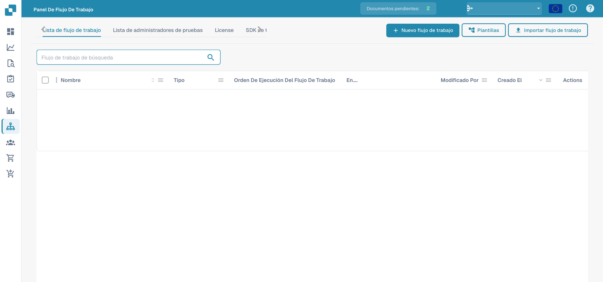
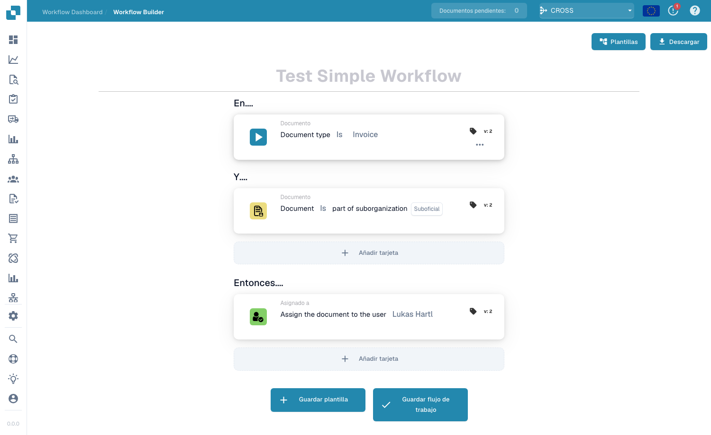
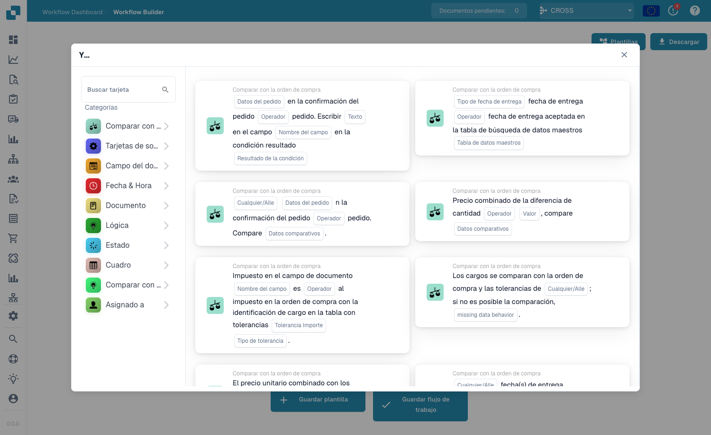

# Flujo estándar

El constructor **Flujo estándar** es el editor lineal basado en tarjetas para automatizar el procesamiento de documentos. Un flujo de trabajo se compone de tres grupos de tarjetas: **Cuando** (el disparador), **Y** (condiciones adicionales) y **Entonces** (las acciones a ejecutar). Cuando un documento cumple las condiciones When/And, las acciones Then se ejecutan automáticamente.

## Crear y probar un Standard Workflow 

Cree un Standard Workflow completo en la interfaz real de DocBits: seleccione la factura, compruebe su número y un importe superior a 1000, asigne un revisor y cambie el estado. Guarde la regla, ejecute tres escenarios de prueba y confirme el resultado real en el documento.



[Ver con subtítulos](https://docbits-videos.fra1.cdn.digitaloceanspaces.com/settings-assistant/standard-workflow-admin/v2/es.html) · [Abrir vídeo](https://docbits-videos.fra1.cdn.digitaloceanspaces.com/settings-assistant/standard-workflow-admin/v2/es.mp4) · [Subtítulos (WebVTT)](https://docbits-videos.fra1.cdn.digitaloceanspaces.com/settings-assistant/standard-workflow-admin/v2/es.vtt) · [Transcripción](https://docbits-videos.fra1.cdn.digitaloceanspaces.com/settings-assistant/standard-workflow-admin/v2/es.txt) · 3:29

Capítulos y transcripción

| Capítulo | Inicio |
| --- | --- |
| Qué hace este workflow | [0:00](https://docbits-videos.fra1.cdn.digitaloceanspaces.com/settings-assistant/standard-workflow-admin/v2/es.mp4#t=0.000) |
| Nombrar el workflow | [0:12](https://docbits-videos.fra1.cdn.digitaloceanspaces.com/settings-assistant/standard-workflow-admin/v2/es.mp4#t=12.875) |
| When: tipo de documento | [0:22](https://docbits-videos.fra1.cdn.digitaloceanspaces.com/settings-assistant/standard-workflow-admin/v2/es.mp4#t=22.542) |
| And: número de factura | [0:33](https://docbits-videos.fra1.cdn.digitaloceanspaces.com/settings-assistant/standard-workflow-admin/v2/es.mp4#t=33.083) |
| And: importe superior a 1000 | [0:45](https://docbits-videos.fra1.cdn.digitaloceanspaces.com/settings-assistant/standard-workflow-admin/v2/es.mp4#t=45.708) |
| Then: asignar un revisor | [0:58](https://docbits-videos.fra1.cdn.digitaloceanspaces.com/settings-assistant/standard-workflow-admin/v2/es.mp4#t=58.292) |
| Then: cambiar el estado | [1:10](https://docbits-videos.fra1.cdn.digitaloceanspaces.com/settings-assistant/standard-workflow-admin/v2/es.mp4#t=70.958) |
| Revisar y guardar | [1:23](https://docbits-videos.fra1.cdn.digitaloceanspaces.com/settings-assistant/standard-workflow-admin/v2/es.mp4#t=83.500) |
| Comprobar la regla guardada | [1:38](https://docbits-videos.fra1.cdn.digitaloceanspaces.com/settings-assistant/standard-workflow-admin/v2/es.mp4#t=98.167) |
| Preparar el escenario de prueba | [1:48](https://docbits-videos.fra1.cdn.digitaloceanspaces.com/settings-assistant/standard-workflow-admin/v2/es.mp4#t=108.667) |
| Ejecutar el caso positivo | [2:08](https://docbits-videos.fra1.cdn.digitaloceanspaces.com/settings-assistant/standard-workflow-admin/v2/es.mp4#t=128.208) |
| Probar el valor límite | [2:26](https://docbits-videos.fra1.cdn.digitaloceanspaces.com/settings-assistant/standard-workflow-admin/v2/es.mp4#t=146.417) |
| Probar otro número de factura | [2:43](https://docbits-videos.fra1.cdn.digitaloceanspaces.com/settings-assistant/standard-workflow-admin/v2/es.mp4#t=163.292) |
| Comprobar el resultado en el documento | [2:59](https://docbits-videos.fra1.cdn.digitaloceanspaces.com/settings-assistant/standard-workflow-admin/v2/es.mp4#t=179.875) |
| Activar la regla probada | [3:16](https://docbits-videos.fra1.cdn.digitaloceanspaces.com/settings-assistant/standard-workflow-admin/v2/es.mp4#t=196.625) |

**Qué hace este workflow**

Bueno, creo un Standard Workflow completo para una factura de formación. Por encima de mil debe asignarse a un revisor y esperar aprobación. Un número de factura exclusivo limita el ejemplo al documento previsto.

**Nombrar el workflow**

En la lista hago clic en Nuevo workflow. Le doy un nombre claro antes de añadir tarjetas. Esta organización abre directamente el diseñador Standard.

**When: tipo de documento**

En Cuando abro la biblioteca y selecciono la tarjeta de tipo de documento. Elijo el operador Es y selecciono Factura. Así defino el tipo de documento que comprueba la regla.

**And: número de factura**

En Y añado una condición de campo del documento. Selecciono invoice_id, elijo Igual e introduzco nuestro número de factura de formación. Esta condición limita la demostración a la factura prevista.

**And: importe superior a 1000**

Otra condición Y comprueba total_amount. Selecciono Mayor que e introduzco mil. Exactamente mil no cumple esta condición. El importe y la moneda deben corresponder al documento de formación.

**Then: asignar un revisor**

En Entonces selecciono la acción para asignar el documento a un usuario. Elijo Docs User A2, nuestro revisor de pruebas de documentación. Esta acción asigna el documento sin crear una notificación por correo.

**Then: cambiar el estado**

La segunda acción cambia el estado a Pendiente de aprobación. Configuro Activar workflows como falso. Este ejemplo no necesita otra ejecución cuando su propia acción cambia el estado.

**Revisar y guardar**

Antes de guardar leo la regla completa. Deben coincidir Factura, el número exacto y un importe superior a mil. Después se ejecutan las dos acciones en el orden mostrado. Guardo el workflow y compruebo la confirmación.

**Comprobar la regla guardada**

En la lista compruebo el workflow guardado y su estado de activación. Guardar puede activar un workflow directamente. Desactivo esta regla de formación mientras preparo las pruebas.

**Preparar el escenario de prueba**

En Test Manager añado un escenario y selecciono nuestro workflow guardado. Escribo un nombre claro y cargo los archivos JSON de entrada y resultado esperado. La entrada contiene nuestro número de factura, el importe mil setecientos ochenta y cinco y el estado Listo para validación. El estado esperado es Pendiente de aprobación.

**Ejecutar el caso positivo**

Envío el escenario y elijo Ejecutar prueba en su menú. Vuelvo a abrir la lista para cargar el resultado guardado. La prueba aprobada compara el estado esperado del documento. En este sandbox, el panel de tarjetas no muestra los mensajes individuales de forma fiable, así que también compruebo el documento real.

**Probar el valor límite**

Ahora pruebo exactamente mil. El número y el tipo de documento siguen coincidiendo, pero Mayor que debe ser falso. En esta entrada de prueba, el estado esperado sigue siendo Listo para validación. Guardo y ejecuto este escenario independiente y compruebo su resultado.

**Probar otro número de factura**

Otro escenario utiliza un número de factura diferente y un importe superior a mil. El importe por sí solo no debe iniciar las acciones. Guardo y ejecuto el escenario con el estado inicial como resultado esperado. Estos casos negativos comprueban los límites de la regla.

**Comprobar el resultado en el documento**

En Dashboard encuentro nuestro documento de formación. Su estado real es Pendiente de aprobación y está asignado a Docs User A2. Así confirmo el resultado visible de las dos acciones. Este cambio procede de la prueba manual y no demuestra un procesamiento automático.

**Activar la regla probada**

En la lista activo la regla probada y compruebo que el interruptor esté encendido. Antes de ponerla en servicio reviso condiciones, destinatarios y resultados. Después de esta demostración vuelvo a desactivar la regla de formación.

## Cómo acceder

Abra **Panel de flujos de trabajo → Lista de flujos de trabajo** y, a continuación, haga clic en **Agregar flujo de trabajo** para crear un nuevo flujo de trabajo Standard, o haga clic en un flujo de trabajo existente para editarlo.

<figure><figcaption>
Lista de flujos de trabajo y controles de importación.
</figcaption></figure>

## El modelo When / And / Then

<figure><figcaption>
El lienzo de Standard Workflow. Este ejemplo se dispara con facturas en una suborganización y se las asigna a un usuario.
</figcaption></figure>

- **Cuando** — el disparador que inicia el flujo de trabajo (p. ej. *Document type is Invoice*).
- **Y** — condiciones adicionales que también deben cumplirse (p. ej. *Document is part of sub-organization*). Déjelo vacío para ejecutarlo en cada coincidencia de la tarjeta When.
- **Entonces** — las acciones a realizar (p. ej. *Assign the document to the user*, crear una tarea, llamar a una API, enviar un correo electrónico).

## Añadir tarjetas

Haga clic en **Añadir tarjeta** en cualquier grupo para abrir la biblioteca de tarjetas. Las tarjetas están organizadas por categoría para que pueda encontrar el bloque de construcción que necesita:

<figure><figcaption>
La biblioteca <strong>Add Card</strong> — tarjetas de condición, tarjetas de comparación, tarjetas de acción y más, agrupadas por categoría.
</figcaption></figure>

Guarde con **Guardar flujo de trabajo**, o guarde el diseño como una plantilla reutilizable con **Guardar plantilla**.

## Próximos pasos

- Vea qué hace cada tarjeta en la sección **Tarjetas**.
- Combine tarjetas en soluciones probadas con las **Guías de patrones de flujo**.
- Para flujos con ramificaciones y rutas paralelas (Wait ALL / Wait ANY / OR), utilice el constructor **Flujo de trabajo avanzado**.
