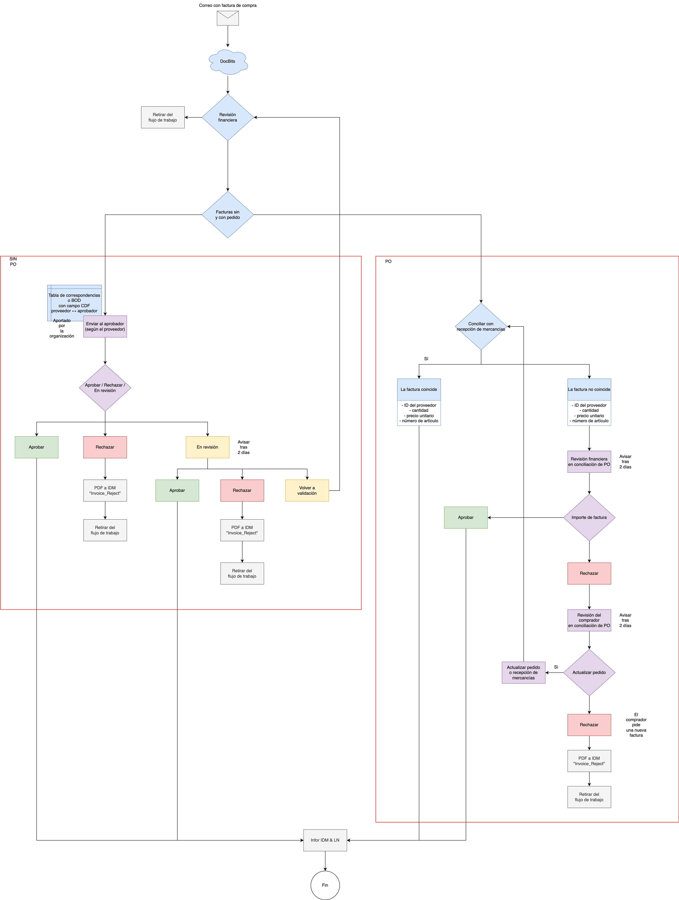

# Flujo de trabajo estándar

El diagrama muestra un ejemplo de tramitación de facturas con y sin pedido. Adapte las rutas, las personas responsables, los plazos y la integración ERP a su configuración.

<figure><figcaption>
Ejemplo de flujo de trabajo de facturas con y sin pedido. Las rutas de aprobación, el plazo de dos días y la conexión ERP forman parte de este ejemplo y deben ajustarse a la configuración propia.
</figcaption></figure>

## Entrada y revisión inicial

En este ejemplo, una factura recibida por correo pasa por DocBits y una revisión financiera. Desde esa revisión puede retirarse del flujo o continuar por la ruta de facturas con pedido o sin pedido.

## Facturas sin pedido

La asignación del aprobador se basa en el proveedor, mediante una tabla de correspondencias o los campos BOD/CDF indicados. El esquema contempla aprobar, rechazar o dejar en revisión. El aviso tras dos días es un plazo del ejemplo. Las rutas de rechazo archivan el PDF con el identificador técnico `Invoice_Reject`; una revisión puede devolver el documento a validación.

## Facturas con pedido

La ruta de pedidos compara la factura con la recepción de mercancías y contempla ID del proveedor, cantidad, precio unitario y número de artículo. Las discrepancias pasan por revisión financiera y, según la decisión, por revisión del comprador. El esquema permite actualizar el pedido o la recepción y repetir la comprobación, o rechazar y solicitar una nueva factura.

## Destino del ejemplo

Las rutas aprobadas convergen en Infor IDM y LN antes del final. Compruebe los conectores, las condiciones y las acciones configuradas en su organización; el diagrama no acredita una aprobación o transferencia ERP ejecutada.
