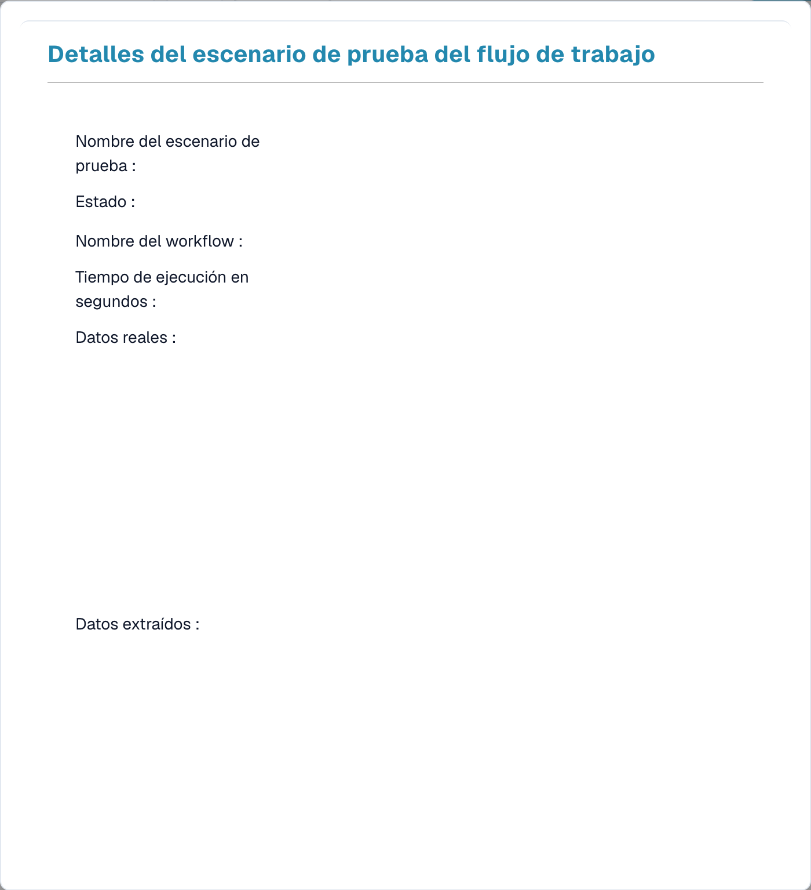

# Test Manager

El **Test Manager** te permite guardar **escenarios de prueba** reutilizables para tus flujos de trabajo y ejecutarlos en conjunto, de modo que puedas confirmar que un flujo de trabajo sigue comportándose correctamente después de modificarlo. Funciona tanto para flujos de trabajo Estándar como Avanzados.

Ábrelo desde **Workflow Dashboard → Test Manager List**.

<figure><figcaption>
La Test Manager List: cada escenario guardado muestra un resultado de aprobado/fallido.
</figcaption></figure>

## Qué es un escenario de prueba

Un escenario de prueba captura un flujo de trabajo, una entrada de ejemplo y el **resultado esperado**. Cuando lo ejecutas, el Test Manager reproduce el flujo de trabajo con esa entrada y compara el resultado con lo que esperabas, poniendo la fila en **verde** (aprobado) o en **rojo** (fallido).

## Trabajar con escenarios

- **Agregar escenario de prueba** — crea un nuevo escenario a partir de un flujo de trabajo y un documento de ejemplo.
- **Ejecutar todas las pruebas** — ejecuta todos los escenarios a la vez y comprueba de un vistazo qué flujos de trabajo siguen aprobando.
- **Ver detalles** — abre un escenario para inspeccionar su resultado.

<figure><figcaption>
Detalles de un escenario del gestor de pruebas; los datos están ocultos.
</figcaption></figure>

La vista de detalles muestra el nombre del escenario y su **estado**, el **nombre del flujo de trabajo**, el **tiempo de ejecución** y los **datos reales** y **extraídos** que produjo la ejecución, para que puedas ver exactamente por qué un escenario aprobó o falló.

## Test Manager frente a las pruebas en el editor

Son dos cosas diferentes:

- **Test Manager** (esta página) — escenarios *guardados y repetibles* con resultados esperados, ejecutados en conjunto con **Ejecutar todas las pruebas**. Úsalo para pruebas de regresión tras realizar cambios.
- **Pruebas en el editor** — los controles integrados **Validar** y **Prueba** dentro del editor de flujos de trabajo Avanzados, para comprobaciones rápidas mientras construyes. Consulta [Validación y pruebas](advanced-workflow/validation-and-testing.md).
