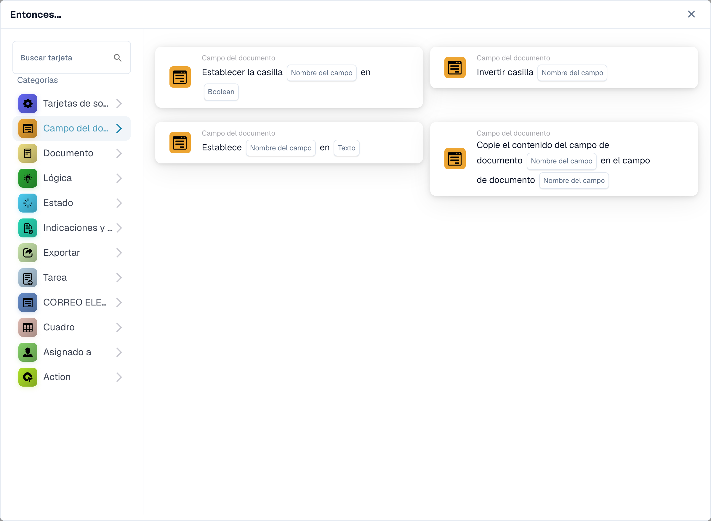
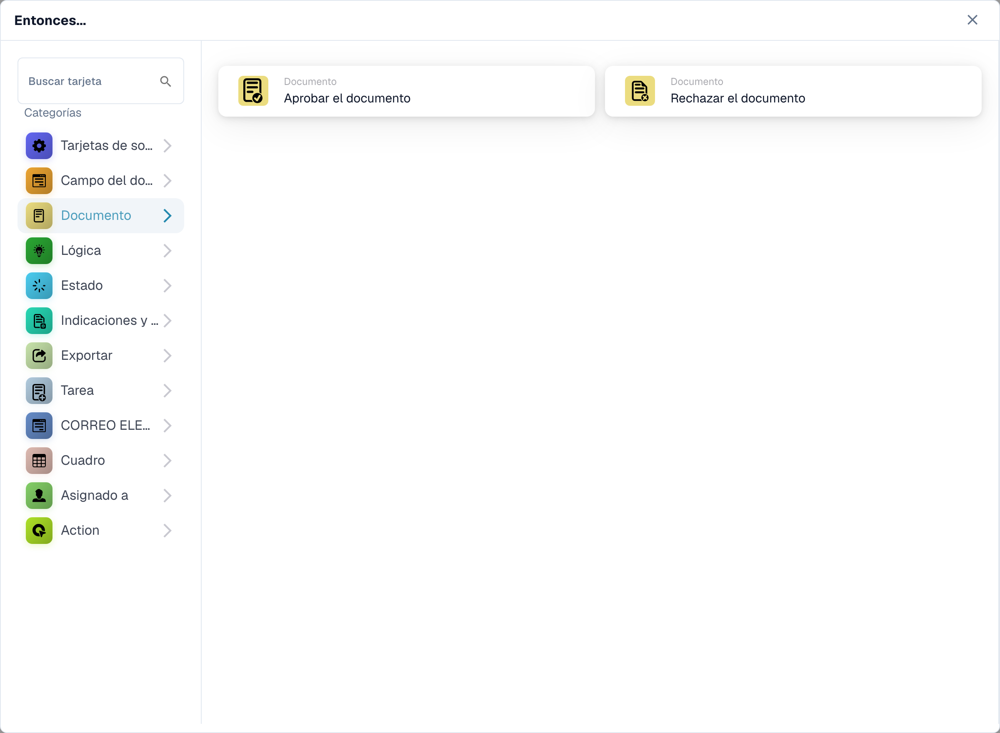
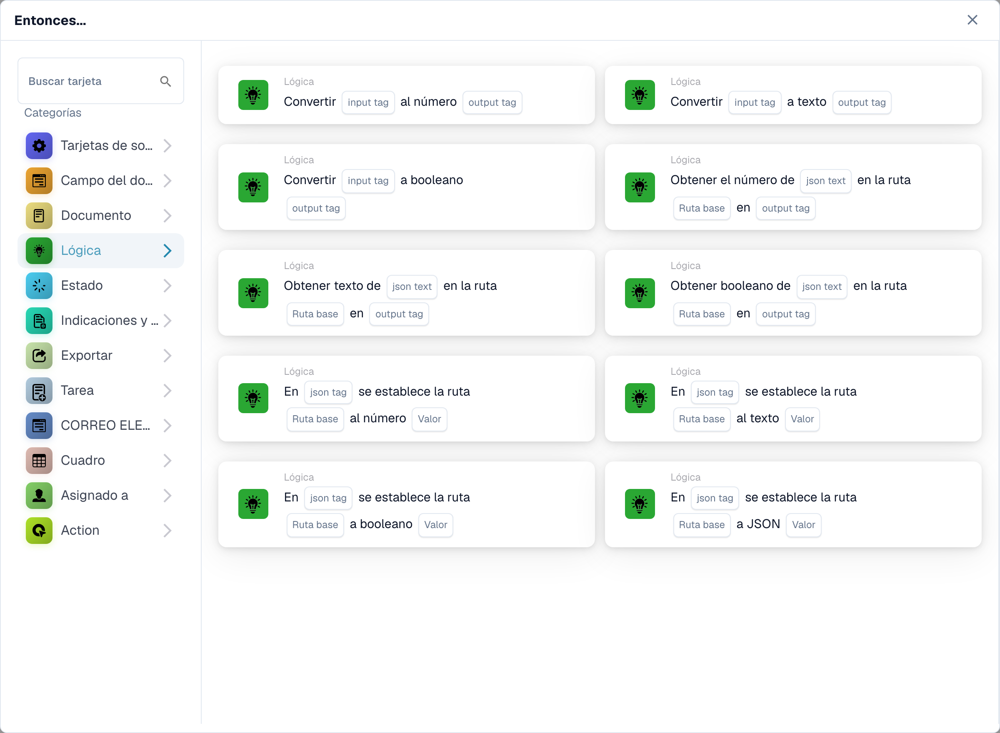
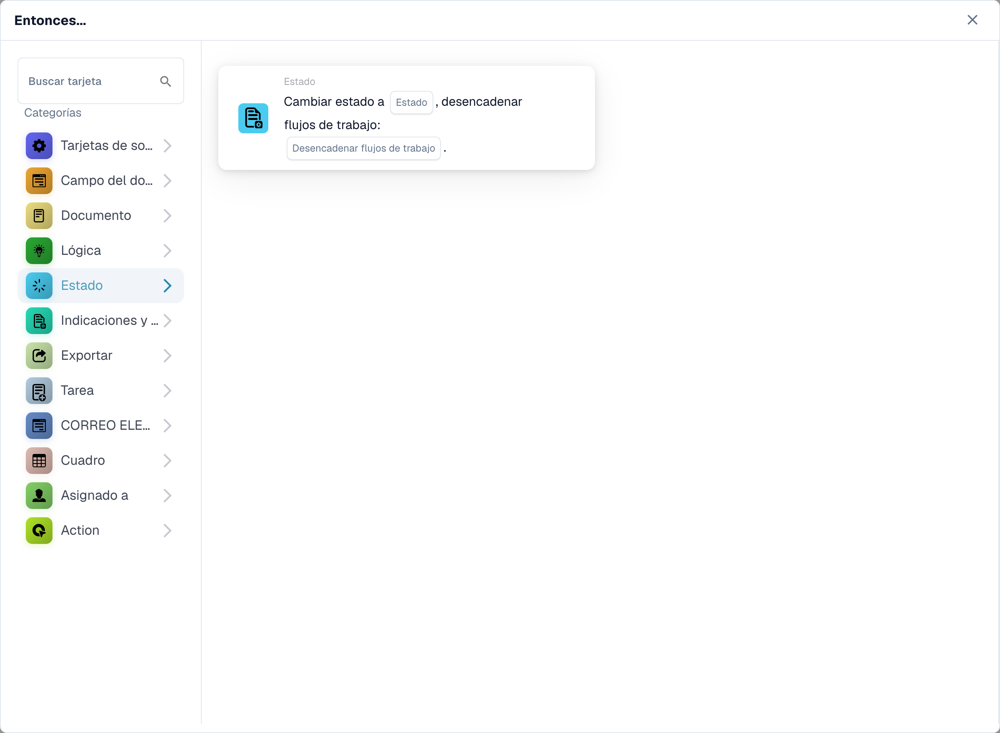
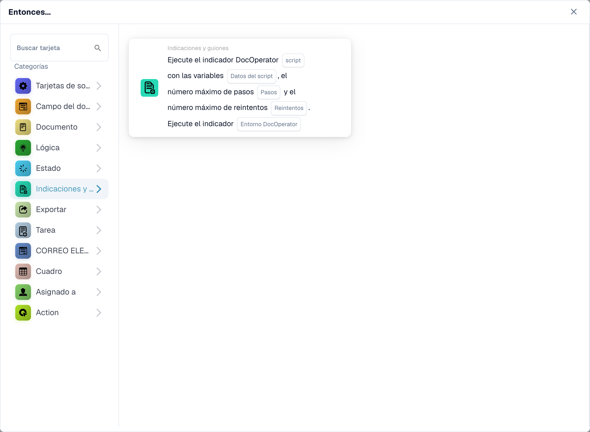
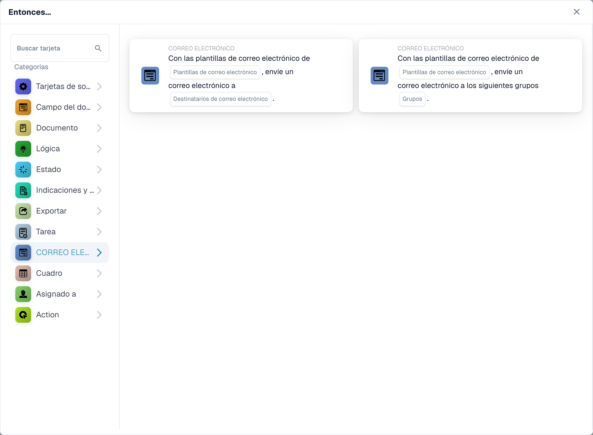
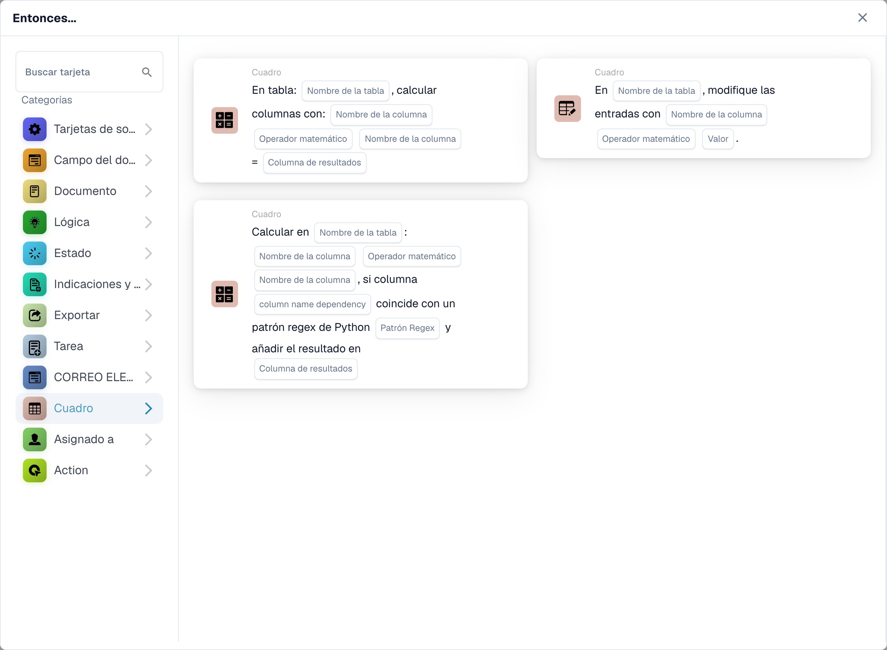
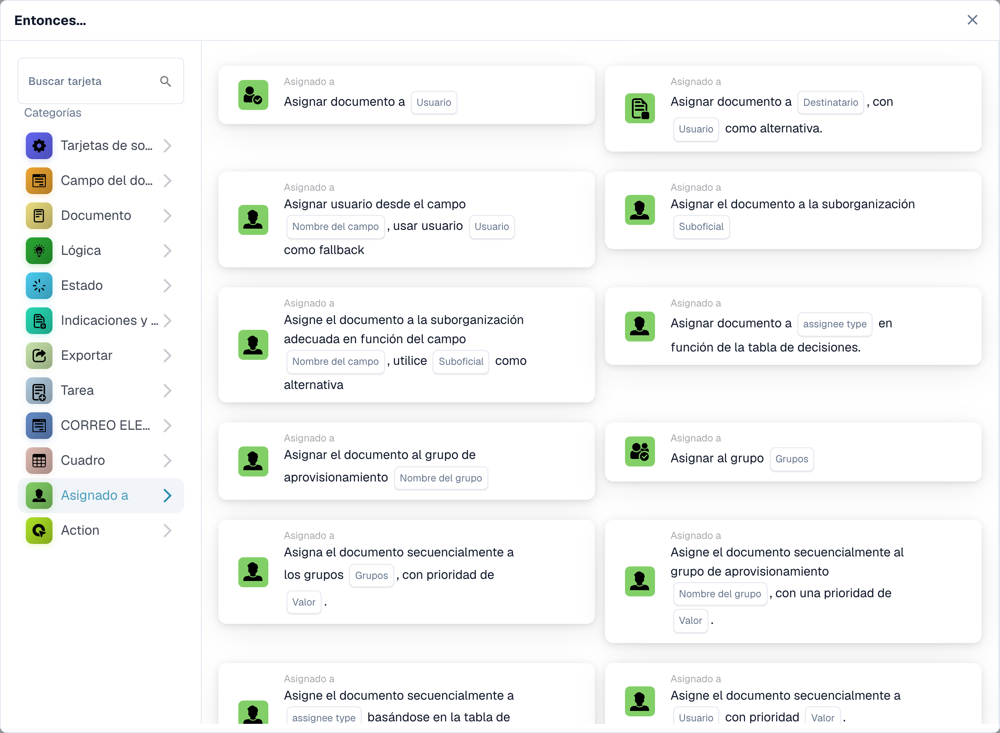
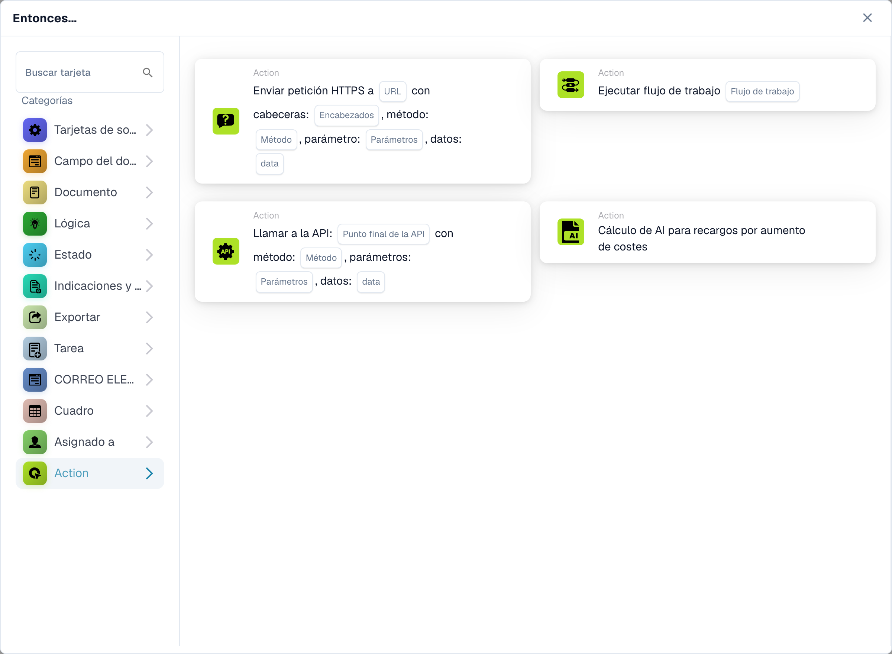

# Entonces

Una tarjeta **Entonces** le indica a un flujo de trabajo qué hacer después de su activador **Cuando** y cualquier condición **Y**. En **Generador de flujo de trabajo**, seleccione **Añadir tarjeta** en **Entonces...**. Elija una categoría a la izquierda o escriba un nombre en **Buscar tarjeta**. Seleccione una vista previa de la tarjeta para agregarla, complete los campos que se muestran en la tarjeta y guarde el flujo de trabajo. Desplázate dentro del selector para ver más tarjetas. Seleccione **×** para cerrarlo sin agregar una tarjeta. Consulte [Flujo de trabajo](..) para ver la secuencia completa.

Las vistas previas a continuación muestran las acciones disponibles, no las configuraciones completadas. Elija la acción que coincida con el resultado que desea.

## Campo de documento

Configure o invierta una casilla de verificación, coloque texto en un campo o copie un campo en otro. Elija los nombres de los campos y el valor solicitado por la tarjeta. Consulte [Campo de documento](document-field).

<figure><figcaption>
Tarjetas disponibles en la categoría seleccionada. Configure los campos antes de utilizarlas.
</figcaption></figure>

## Documento

Elija **Aprobar el documento** o **Rechazar el documento** cuando el flujo de trabajo deba tomar esa decisión. Utilice primero una condición **Y** si la aprobación depende de una verificación. Consulte el [Documento](document).

<figure><figcaption>
Tarjetas disponibles en la categoría seleccionada. Configure los campos antes de utilizarlas.
</figcaption></figure>

## Lógica

Utilice estas tarjetas para convertir valores entre formatos numéricos, de texto y booleanos, o leer un valor de JSON. Elija los campos de entrada y salida en la tarjeta seleccionada.

<figure><figcaption>
Tarjetas disponibles en la categoría seleccionada. Configure los campos antes de utilizarlas. Algunas etiquetas de esta versión de la tarjeta todavía tienen una traducción incompleta o incorrecta en la interfaz. Las explicaciones de esta página utilizan los términos correctos.
</figcaption></figure>

## Estado

Elija **Cambiar estado** para mover el documento a un estado seleccionado. La tarjeta también puede desencadenar otro flujo de trabajo. Consulte [Estado](status).

<figure><figcaption>
Tarjetas disponibles en la categoría seleccionada. Configure los campos antes de utilizarlas.
</figcaption></figure>

## Indicaciones y guiones

Elija esta categoría para ejecutar un script de solicitud de DocOperator. Seleccione el script y las variables que solicita la tarjeta. La tarjeta también ofrece configuraciones de ejecución, como reintentos.

<figure><figcaption>
Tarjetas disponibles en la categoría seleccionada. Configure los campos antes de utilizarlas.
</figcaption></figure>

## Exportar

Inicie una exportación, exporte con una configuración elegida o ponga en cola una exportación final. Elija la configuración de exportación y la opción de tarea pendiente que se muestran en su tarjeta. Consulte [Exportar](export).

<figure><figcaption>
Tarjetas disponibles en la categoría seleccionada. Configure los campos antes de utilizarlas.
</figcaption></figure>

## Tarea

Cree una tarea o notificación y asígnela a un usuario o grupo. Ingrese la configuración de título, descripción, prioridad y notificación solicitada por la tarjeta. Algunas tarjetas se asignan secuencialmente. Consulte [Tarea](task).

<figure><figcaption>
Tarjetas disponibles en la categoría seleccionada. Configure los campos antes de utilizarlas. Algunas etiquetas de esta versión de la tarjeta todavía tienen una traducción incompleta o incorrecta en la interfaz. Las explicaciones de esta página utilizan los términos correctos.
</figcaption></figure>

## Correo electrónico

Envíe un correo electrónico utilizando una plantilla seleccionada, ya sea a destinatarios o a grupos. Elija la plantilla y el destino en la tarjeta.

<figure><figcaption>
Tarjetas disponibles en la categoría seleccionada. Configure los campos antes de utilizarlas.
</figcaption></figure>

## Tabla

Cambie entradas o calcule valores en una tabla de documentos. Seleccione la tabla, columnas, operador y columna de resultados solicitada por la tarjeta. Consulte la [Tabla](table).

<figure><figcaption>
Tarjetas disponibles en la categoría seleccionada. Configure los campos antes de utilizarlas. Algunas etiquetas de esta versión de la tarjeta todavía tienen una traducción incompleta o incorrecta en la interfaz. Las explicaciones de esta página utilizan los términos correctos.
</figcaption></figure>

## Responsable

Asigne el documento a un usuario, grupo, destinatario o suborganización. Algunas tarjetas utilizan un campo o una tabla de decisiones y ofrecen un recurso alternativo. Configure el destino correcto y el comportamiento alternativo en la tarjeta seleccionada. Consulte [Responsable](assignee).

<figure><figcaption>
Tarjetas disponibles en la categoría seleccionada. Configure los campos antes de utilizarlas. Algunas etiquetas de esta versión de la tarjeta todavía tienen una traducción incompleta o incorrecta en la interfaz. Las explicaciones de esta página utilizan los términos correctos.
</figcaption></figure>

## Acción

Ejecute otro flujo de trabajo, envíe una solicitud HTTPS, llame a una API o utilice la tarjeta de cálculo de aumento de costos. Estas acciones pueden afectar a otros sistemas; pregúntele a su administrador qué punto final y configuración usar. Consulte [Acción](action).

<figure><figcaption>
Tarjetas disponibles en la categoría seleccionada. Configure los campos antes de utilizarlas.
</figcaption></figure>

[Campos detallados de tarjetas lógicas, rutas JSON, activadores y pruebas](../cards-overview/logic-cards-guide.md).
