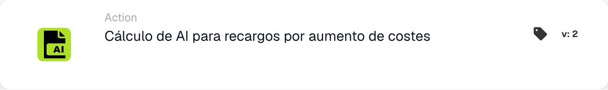

# Cálculo de IA para recargos por aumento de costos

<figure><figcaption>
Campos de la tarjeta en la versión mostrada. Los campos aún no están configurados.
</figcaption></figure>

## Propósito:

La tarjeta de flujo de trabajo **"Cálculo de IA para recargos por aumento de costos"** utiliza IA para calcular automáticamente los importes de los recargos según los aumentos de coste. Garantiza cálculos de recargos coherentes y precisos, agilizando los flujos de trabajo y reduciendo el esfuerzo manual.

## Componentes de la tarjeta:

* **Factor de aumento de costos**
  * **Descripción:** El multiplicador o porcentaje que se aplica al coste base para calcular el recargo.
  * **Detalle:** Determina el importe del recargo según el aumento de coste (p. ej., un factor de 1,10 para un aumento del 10 %).
* **Campo de costo base**
  * **Descripción:** El campo que contiene el valor de coste original utilizado como base para el cálculo del recargo.
  * **Detalle:** Se selecciona automáticamente o se define dentro del flujo de trabajo como referencia durante el cálculo.
* **Campo de recargo**
  * **Descripción:** El campo donde se almacena el valor del recargo calculado por la IA.
  * **Detalle:** Este campo refleja el recargo calculado, dejándolo disponible para su procesamiento o generación de informes posteriores.

## Funcionalidad:

**Evaluación de la condición:**

* La tarjeta se activa solo si las condiciones de las secciones **"Donde"** y **"Y"** se evalúan como verdaderas.
* Si cualquiera de las condiciones se evalúa como falsa, no se realiza ningún cálculo de recargo.

**Cálculo impulsado por IA:**

* El sistema aplica el **Factor de aumento de costos** al **Campo de costo base** para calcular el recargo.
* El resultado se almacena en el **Campo de recargo**, garantizando su accesibilidad para los pasos posteriores del flujo de trabajo.

## Conclusión:

La tarjeta de flujo de trabajo **"Cálculo de IA para recargos por aumento de costos"** automatiza la aplicación de recargos según los aumentos de coste. Al aprovechar la IA para la precisión y la coherencia, esta tarjeta elimina los cálculos manuales, mejora la eficiencia y facilita una gestión de costes precisa en los flujos de trabajo automatizados.
