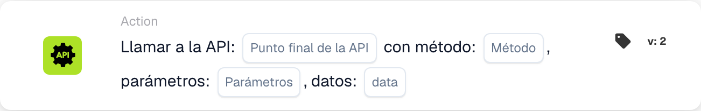

# Llamar API

<figure><figcaption>
Campos de la tarjeta en la versión mostrada. Los campos aún no están configurados.
</figcaption></figure>

## Propósito:

La tarjeta de flujo de trabajo **"Call API"** permite a los usuarios realizar solicitudes HTTP a los endpoints de API especificados directamente desde el flujo de trabajo. Esta tarjeta admite varios métodos HTTP y posibilita la interacción dinámica con sistemas externos enviando parámetros y datos. Agiliza la integración con servicios de terceros y API personalizadas, garantizando una comunicación fluida.

## Componentes de la tarjeta:

1. **Punto final API**
   * **Descripción:** El endpoint de destino de la **API de DocBits** con el que interactuará esta tarjeta.
   * **Detalle:** Un campo de texto donde los usuarios especifican el endpoint para la solicitud a la API.
2. **Método HTTP**
   * **Descripción:** El tipo de solicitud HTTP que se realizará.
   * **Opciones:**
     1. **GET:** Obtiene datos del endpoint especificado.
     2. **POST:** Envía datos al endpoint.
     3. **PUT:** Actualiza los datos existentes en el endpoint.
     4. **DELETE:** Elimina datos del endpoint.
3. **Parámetros**
   * **Descripción:** Parámetros de consulta que se incluirán en la solicitud a la API.
   * **Detalle:** Un campo de texto o una lista para introducir pares clave-valor para la URL de la solicitud.
4. **Datos**
   1. **Descripción:** La carga que se enviará en el cuerpo de la solicitud a la API (aplicable a los métodos POST y PUT).
   2. **Detalle:** Un campo para introducir los datos en JSON.

## Funcionalidad:

**Evaluación de la condición:** El sistema evalúa las condiciones definidas en las secciones "Where" y "And":

* Si ambas condiciones son **true**, la solicitud a la API se ejecuta tal como se ha configurado.
* Si cualquiera de las condiciones es **false**, la tarjeta no se ejecuta y no se realiza ninguna llamada a la API.

**Ejecución de la solicitud a la API:**

* La tarjeta envía la solicitud HTTP al endpoint especificado usando el método seleccionado.
* Los parámetros proporcionados se añaden a la URL y los datos se incluyen en el cuerpo de la solicitud (si procede).

## Configuración:

1. **Definir el punto final API:**\
   Introduzca la URL de la API que desea llamar.
2. **Seleccionar el HTTP Method:**\
   Elija uno de los métodos admitidos (GET, POST, PUT, DELETE) según los requisitos de su API.
3. **Proporcionar parámetros:**\
   Añada los parámetros de consulta necesarios como pares clave-valor.
4. **Incluir datos (si procede):**\
   Para los métodos POST o PUT, especifique los datos que se enviarán en el cuerpo de la solicitud.
5. **Configuración de la condición:**\
   Configure las secciones "Where" y "And" para definir cuándo debe realizarse la llamada a la API.

## Conclusión:

La tarjeta de flujo de trabajo **"Call API"** mejora la automatización del flujo de trabajo al posibilitar la interacción directa con sistemas externos. Al proporcionar configuraciones flexibles para endpoints, métodos y datos, garantiza que los flujos de trabajo puedan integrarse sin problemas con API de terceros o backends personalizados. La capacidad de ejecutar llamadas a la API de forma condicional garantiza precisión y eficiencia en la automatización de las comunicaciones externas.

***

<!-- workflow-card-practical-example-20261021 -->

## Ejemplo práctico

**Cuándo utilizar:** Solicite una validación adicional a un servicio externo configurado.

**Configuración:** Seleccione el punto final de API de demostración configurado y el método HTTP. Proporcione los parámetros y el cuerpo JSON requeridos por ese punto final.

**Resultado esperado y contraejemplo:** Para una respuesta simulada `200`, verifique el manejo de respuesta esperado por las siguientes tarjetas. Pruebe también `500`; iniciar la llamada no establece que la verificación comercial haya sido exitosa.

Esta es una configuración ilustrativa y un resultado esperado. Utilice campos, usuarios y grupos configurados en su organización de prueba; no es una afirmación de que este ejemplo haya sido ejecutado.
