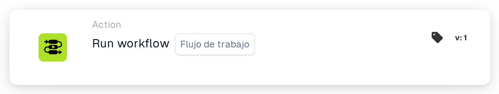
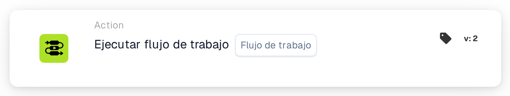

# Ejecutar flujo de trabajo

<figure><figcaption>
Versión 1
</figcaption></figure>

<figure><figcaption>
Versión 2
</figcaption></figure>

## Propósito:

La tarjeta **"Ejecutar flujo de trabajo"** permite a los usuarios ejecutar dinámicamente un flujo de trabajo seleccionado de una lista de flujos de trabajo disponibles. Esta tarjeta es útil para automatizar procesos en los que varios flujos de trabajo están interconectados, posibilitando operaciones más ágiles.

## Componentes de la tarjeta:

1. **Flujo de trabajo**
   * **Descripción:** Especifica el flujo de trabajo que se ejecutará cuando las condiciones se evalúen como verdaderas.
   * **Detalle:** Se proporciona una lista desplegable de todos los flujos de trabajo disponibles para su selección.

## Funcionalidad:

* **Evaluación de la condición:** La tarjeta ejecuta el flujo de trabajo seleccionado solo si las secciones **"Cuando"** y **"Y"** se evalúan como verdaderas.
  * Si cualquiera de las condiciones es falsa, no se realiza ninguna acción y el flujo de trabajo permanece sin disparar.
* **Ejecución del flujo de trabajo:**
  * Cuando se cumplen las condiciones, el flujo de trabajo especificado se dispara automáticamente.
  * Si no se cumplen las condiciones, no se ejecuta ningún flujo de trabajo.

## Configuración:

1. **Seleccionar el flujo de trabajo:** Elija el flujo de trabajo que se disparará de la **lista desplegable** de flujos de trabajo disponibles.
2. **Definir las condiciones:** Configure las secciones **"Cuando"** y **"Y"** para especificar los criterios que deben cumplirse para que se ejecute el flujo de trabajo.

## Conclusión:

La tarjeta **"Ejecutar flujo de trabajo"** ofrece una forma cómoda y eficiente de vincular flujos de trabajo, automatizando procesos de varios pasos con facilidad. Al garantizar que se cumplan las condiciones de las secciones **"Cuando"** y **"Y"**, los usuarios pueden ejecutar flujos de trabajo de forma dinámica y reducir la intervención manual.

<!-- workflow-card-practical-example-20261021 -->

## Ejemplo práctico

**Cuándo usarlo:** Reutilizar un flujo de trabajo de validación existente.

**Configuración:** Seleccione un flujo de trabajo secundario de demostración configurado que establezca `routing_result` en `checked`.

**Resultado esperado y contraejemplo:** El flujo de trabajo seleccionado se invoca en su contexto de ejecución admitido. Verifique su propio registro y resultado de campo; no lo vincule nuevamente al padre en un bucle.

Esta es una configuración ilustrativa y un resultado esperado. Utilice campos, usuarios y grupos configurados en su organización de prueba; no es una afirmación de que este ejemplo haya sido ejecutado.
