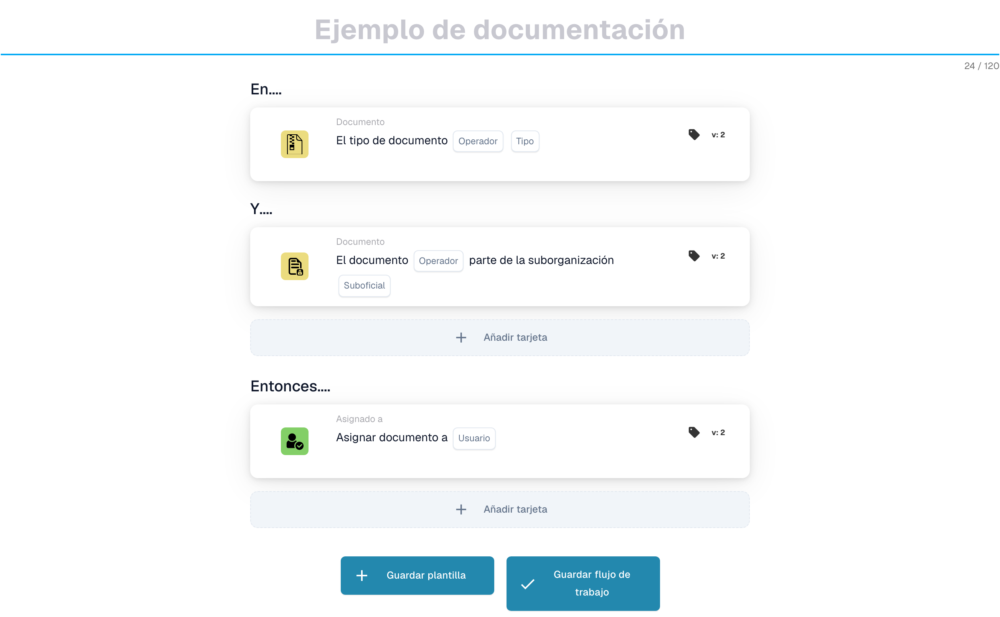

# Enviar correo electrónico a grupos

***

Agregue esta tarjeta al grupo **Entonces** del Generador de flujo de trabajo: las acciones que se ejecutan una vez que coinciden las condiciones Cuándo/Y:

<figure><figcaption><p>Ejemplo sin guardar con tarjetas Cuando, Y y Entonces. Configure todos los campos antes de ejecutarlo. Algunas etiquetas de esta versión de la tarjeta todavía tienen una traducción incompleta o incorrecta en la interfaz. Las explicaciones de esta página utilizan los términos correctos.</p></figcaption></figure>

***

## 📌 Información de versión

**Estado:** ✅ Versión única (sin cambios importantes) **Última versión:** v1 (Activo) **Nota:** Esta tarjeta utiliza un modelo de versión única con soporte en varios idiomas a través de claves de traducción.

📖 [Base de datos de tarjetas completa](../../cards-overview/export-cards-guide.md)

***

## Propósito

Esta tarjeta envía automáticamente notificaciones por correo electrónico a grupos de usuarios. En lugar de asignar trabajo a personas individuales, envía el mensaje a un grupo y todos los miembros de ese grupo lo reciben.

**Ejemplo del mundo real:** Cuando llega una factura de alto valor, envía automáticamente una notificación por correo electrónico a todos los miembros del grupo "Equipo de finanzas" para que sepan que es necesario revisarla.

***

## Cuándo utilizar esta tarjeta

Utilice esta tarjeta cuando necesite:

* Notificar a varias personas a la vez
* Enviar alertas a grupos de equipo
* Transmitir actualizaciones a los departamentos
* Notificar a los grupos sobre cambios en el estado de los documentos
* Enviar recordatorios a los miembros del grupo

**Escenarios comunes:**

* Notificar al equipo de adquisiciones sobre nuevos proveedores.
* Alertar al equipo financiero sobre facturas de alto valor
* Notificar al equipo del almacén sobre los envíos.
* Cambios de estado de documentos de difusión

***

## Cómo funciona

1. **Verificación de condición**: El flujo de trabajo verifica las condiciones "Dónde" y "Y"
2. **Preparar correo electrónico**: el sistema prepara el correo electrónico usando una plantilla
3. **Obtener miembros del grupo**: el sistema encuentra todos los miembros del grupo especificado
4. **Enviar**: el correo electrónico se envía a cada miembro del grupo
5. **Log**: Se registra el envío de correo electrónico

***

## Parámetros explicados

### Plantilla de correo electrónico

El mensaje de correo electrónico a enviar

**Opciones:**

* Elija entre plantillas existentes
* Cada plantilla tiene tema, cuerpo y formato predefinidos.
* Las plantillas pueden incluir marcadores de posición como {document\_number}, {supplier\_name}

**Plantilla de ejemplo:**

```
Subject: Document {document_number} requires review

Body:
Dear Team,

A new invoice has arrived and requires review:
- Document: {document_number}
- Supplier: {supplier_name}
- Amount: {amount} {currency}
- Date: {date}

Please login to DocBits to review.

Best regards,
DocBits Automation
```

### grupo

El grupo de usuarios al que enviar el correo electrónico

**Grupos de ejemplo:**

* Equipo de finanzas
* Equipo de adquisiciones
* Equipo de almacén
* Comité de aprobación
* Grupo de gestión

***

## Pasos de configuración

### Paso 1: elija la plantilla de correo electrónico

1. Haga clic en "Seleccionar plantilla de correo electrónico"
2. Elija una plantilla de la lista
3. Verificar tema y contenido

### Paso 2: seleccione grupo

1. Haga clic en "Seleccionar grupo"
2. Elige el grupo al que quieres notificar
3. Verificar los miembros del grupo (normalmente muestra el recuento)

### Paso 3: establecer condiciones

1. Agregar condición: "Cuando \[condición] es verdadera"
2. Ejemplo: "Cuando el importe de la factura es superior a 5000€"

### Paso 4: prueba

1. Prueba con documento de muestra
2. Verificar envíos de correo electrónico al grupo
3. Comprobar la representación de la plantilla

***

## Ejemplos de plantillas de correo electrónico

### Plantilla 1: Alerta de factura de alto valor

```
Subject: High-Value Invoice Alert - {document_number}

Body:
Team,

An invoice exceeding €10,000 has been received:

Document Number: {document_number}
Supplier: {supplier_name}
Amount: {amount} EUR
Received Date: {date}
Status: {status}

This requires immediate review and approval.

---
Sent automatically by DocBits
```

### Plantilla 2: Cambio de estado del proveedor

```
Subject: Supplier Status Update - {supplier_name}

Body:
Procurement Team,

The following supplier's status has been updated:

Supplier: {supplier_name}
Supplier Code: {supplier_code}
New Status: {status}
Effective Date: {date}

Please update your systems accordingly.

---
Sent automatically by DocBits
```

### Plantilla 3: Documento listo para exportar

```
Subject: Document Approved for Export - {document_number}

Body:
Export Team,

The following document has been approved and is ready for export:

Document Number: {document_number}
Invoice Number: {invoice_number}
Supplier: {supplier_name}

Please proceed with export to {destination_system}.

---
Sent automatically by DocBits
```

***

## Casos de uso comunes

### Caso de uso 1: alertas de control de calidad

**Activador:** Cuando se encuentra discrepancia entre la factura y la orden de compra

**Grupo de correo electrónico:** Equipo de calidad

**Contenido:**

```
Invoice {number} has quality issues:
- Unit Price variance: 12% (exceeds 5% tolerance)
- Please review and take action
```

### Caso de uso 2: notificaciones de aprobación

**Activador:** Cuando el documento alcanza cierto estado

**Grupo de correo electrónico:** Comité de aprobación

**Contenido:**

```
Document {number} is awaiting approval:
- Amount: {amount}
- Supplier: {supplier_name}
- Please login to approve/reject
```

### Caso de uso 3: notificaciones de excepciones

**Activador:** Cuando no se cumplen las condiciones

**Grupo de correo electrónico:** Gerentes

**Contenido:**

```
Exception alert for document {number}:
- Supplier code missing
- Delivery date invalid
- Manual review required
```

### Caso de uso 4: Actualizaciones de estado

**Activador:** Cuando cambia el estado del documento

**Grupo de correo electrónico:** Equipo responsable del siguiente paso

**Contenido:**

```
Document {number} status changed to: {status}
Assigned to: {assigned_user}
Next steps: {next_steps}
```

***

## Solución de problemas

### "Correo electrónico no recibido"

**Posibles causas:**

* [] Los usuarios del grupo no tienen direcciones de correo electrónico
* [ ] Correo electrónico bloqueado por filtro de spam
* [] La dirección de correo electrónico del grupo es incorrecta
* [] El grupo no tiene miembros

**Soluciones:**

1. Verificar que todos los miembros del grupo tengan direcciones de correo electrónico
2. Revisar la carpeta de spam/basura
3. Verificar que la membresía del grupo sea correcta
4. Agregar usuarios al grupo si faltan
5. Verifique con TI que el servicio de correo electrónico esté funcionando

### "La plantilla no se representa correctamente"

**Causa:** No se encontraron variables de marcador de posición

**Solución:**

* [] Verificar que los nombres de los campos coincidan exactamente
* [] Compruebe si el campo tiene un valor en el documento
* [] Utilice el formato de marcador de posición correcto: {field\_name}
* [] Pruebe con un documento de muestra que tenga todos los campos

### "Algunas personas reciben correo electrónico, otras no"

**Causa:** Membresía de grupo incompleta o correos electrónicos no válidos

**Soluciones:**

* [] Verificar que todos los miembros tengan un correo electrónico válido
* [] Compruebe si algunos usuarios han optado por no participar
* [] Verificar que la membresía del grupo esté actualizada
* [] Póngase en contacto con TI para validar direcciones de correo electrónico

### "Quiero agregar/eliminar personas del grupo"

**Solución:**

* Contacta con tu administrador
* Los grupos se administran en la configuración del sistema.
* No se puede cambiar desde esta tarjeta
* Solicitar cambios de membresía de grupo en TI

***

## Personalización de plantillas de correo electrónico

### Marcadores de posición disponibles

```
{document_number} - Document ID
{invoice_number} - Invoice ID
{supplier_name} - Supplier name
{supplier_code} - Supplier code
{amount} - Invoice amount
{currency} - Currency (EUR, USD, etc.)
{date} - Document date
{status} - Current status
{assigned_user} - Assigned person
{assigned_group} - Assigned group
{next_steps} - What needs to happen next
{reason} - Reason for exception/alert
{comment} - Comments or notes
```

### Crear marcadores de posición personalizados

Si necesita datos adicionales en correos electrónicos:

1. Contacta con tu administrador
2. Solicitar nuevo marcador de posición
3. Agregar el campo necesario al documento
4. Actualizar plantilla de correo electrónico

***

## Mejores prácticas

✅ **Hacer:**

* Mantenga el contenido del correo electrónico breve y claro
* Incluya elementos de acción (¿qué deberían hacer los destinatarios?)
* Incluir enlace o instrucciones para acceder al documento.
* Plantilla de prueba con datos de muestra
* Enviar al grupo correcto (no notificar demasiado)
* Utilice plantillas para mantener la coherencia

❌ **No:**

* Enviar demasiados correos electrónicos (fatiga de notificaciones)
* Incluir datos confidenciales en los correos electrónicos
* Enviar a grupos que no necesitan información
* Utilice líneas de asunto poco claras
* Olvídate de incluir cómo actuar
* Enviar correos electrónicos a individuos (use grupo en su lugar)

***

## Notas de rendimiento

* Cada correo electrónico tarda \~1 segundo en enviarse
* Los grupos grandes pueden llevar tiempo (100 personas = \~100 segundos)
* No cree bucles que envíen miles de correos electrónicos
* Monitorear la capacidad del servicio de correo electrónico
* Considere el procesamiento por lotes si hay muchos documentos

***

## Tarjetas relacionadas

* **ACTION\_SEND\_EMAIL** - Enviar a persona individual
* **ACTION\_ASSIGN\_TASK\_TO\_PROCUREMENT\_GROUP**: asigna tarea en lugar de simplemente notificar
* **ACTION\_CREATE\_TASK\_FOR\_GROUP\_SEQUENTIAL** - Crear tarea y notificación
* **STAUS\_CHANGE** - Cambiar estado y notificar

***

## Ejemplo típico de flujo de trabajo

```
Document Arrives
    ↓
Check Condition: "Is amount > €10,000?"
    ↓
YES: Send Email to Finance Team
     "High value invoice alert"
    ↓
Send Email to Procurement Team
     "New invoice from supplier"
    ↓
Workflow Continues
```

***

## Preguntas frecuentes

**P: ¿Puedo enviar a varios grupos?** R: Crear tarjetas separadas para cada grupo

**P: ¿Qué pasa si el correo electrónico de alguien rebota?** R: El correo electrónico se registra como fallido, TI puede solucionar el problema

**P: ¿Puedo cambiar la plantilla de correo electrónico?** R: Comuníquese con su administrador para modificar las plantillas

**P: ¿Puedo enviar según las condiciones?** R: ¡Sí! Utilice las condiciones "Dónde" y "Y" para controlar cuándo se envían los correos electrónicos

**P: ¿Cómo sé si se recibió un correo electrónico?** R: Verifique los registros de correo electrónico en DocBits para conocer el estado del envío
