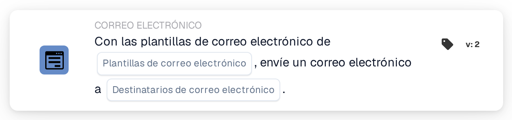

# Enviar correo electrónico

<figure><figcaption>
Versión 2
</figcaption></figure>

## Propósito:

Esta tarjeta de flujo de trabajo envía un correo electrónico basado en una o varias plantillas de correo electrónico. Los destinatarios no se introducen como direcciones fijas: se eligen por su función en el flujo de trabajo, por ejemplo el usuario o el grupo al que está asignado el documento, o los usuarios y grupos devueltos por una tabla de decisión. Así el flujo de trabajo sigue siendo válido cuando cambian las personas que ocupan estas funciones.

Para enviar un correo electrónico a grupos de usuarios seleccionados, se puede utilizar la tarjeta **Send Email to Groups**; véase [Send Email to Groups](send-email-groups-guide.md).

## Componentes de la tarjeta:

1. **Plantillas de correo electrónico**
   * **Descripción:** Las plantillas de correo electrónico utilizadas para el correo electrónico.
   * **Detalle:** Se pueden seleccionar una o varias plantillas de correo electrónico de la organización. Cada plantilla seleccionada se envía a cada destinatario. Cuando el flujo de trabajo se ejecuta para un documento, una plantilla configurada para un tipo de documento concreto solo se envía si el documento tiene ese tipo de documento.
2. **Destinatarios de correo electrónico**
   * **Descripción:** Quién recibe el correo electrónico.
   * **Opciones:** Se pueden seleccionar una o varias de las siguientes:
     * **Usuario/grupo de documento asignado:** El usuario o el grupo al que está asignado actualmente el documento.
     * **Usuario/grupo devuelto de la tabla de decisiones:** Los usuarios y grupos devueltos por una tabla de decisión evaluada antes en el mismo flujo de trabajo, por ejemplo con la tarjeta **Decision Table has Returns**.
     * **Usuario asignado al proveedor:** El usuario asignado del proveedor, en flujos de trabajo iniciados por un cambio de estado de un proveedor.
     * **Referente del proveedor:** El referente del proveedor, en flujos de trabajo iniciados por un cambio de estado de un proveedor.

## Funcionalidad:

* **Recopilación de los destinatarios:** La tarjeta recopila los destinatarios de todas las opciones seleccionadas. Un destinatario que resulta de más de una opción recibe el correo electrónico solo una vez.
* **Ejecución de la acción:** El correo electrónico se envía con las plantillas seleccionadas. Cuando el flujo de trabajo se ejecuta para un documento, las plantillas pueden utilizar los valores de los campos del documento. El resultado se anota en el registro del flujo de trabajo junto con los nombres de los destinatarios.
* **Sin documento:** La tarjeta también puede ejecutarse en flujos de trabajo que no se inician para un documento, por ejemplo flujos de trabajo iniciados por un cambio de estado de un proveedor. En un flujo de trabajo de este tipo, la opción **Usuario/grupo de documento asignado** no añade ningún destinatario.
* **Datos que faltan:**
  * Si no hay ninguna plantilla de correo electrónico o ninguna opción de destinatario seleccionada en la tarjeta, la tarjeta no se ejecuta y registra los datos que faltan en el registro del flujo de trabajo.
  * Si una opción seleccionada no lleva a nadie, por ejemplo porque el documento no tiene ningún usuario asignado o la tabla de decisión no ha devuelto a nadie, esa opción no añade ningún destinatario.
* **Errores:** Si el servicio de correo electrónico rechaza la solicitud o no responde a tiempo, la tarjeta termina con un error.

## Configuración:

* Las plantillas de correo electrónico deberían configurarse en la organización antes de poder seleccionarlas en la tarjeta.
* La tarjeta se puede añadir desde la categoría **CORREO ELECTRÓNICO**. A continuación se seleccionan una o varias plantillas en **Plantillas de correo electrónico** y una o varias opciones en **Destinatarios de correo electrónico**.
* Para la opción **Usuario/grupo devuelto de la tabla de decisiones**, debería evaluarse una tabla de decisión antes en el mismo flujo de trabajo.

## Conclusión:

La tarjeta de flujo de trabajo «Send Email» informa automáticamente a las personas que participan en un proceso de documentos o de proveedores mediante plantillas preparadas. Como los destinatarios se eligen por su función, el mismo flujo de trabajo sigue llegando a las personas adecuadas cuando cambian las asignaciones.
