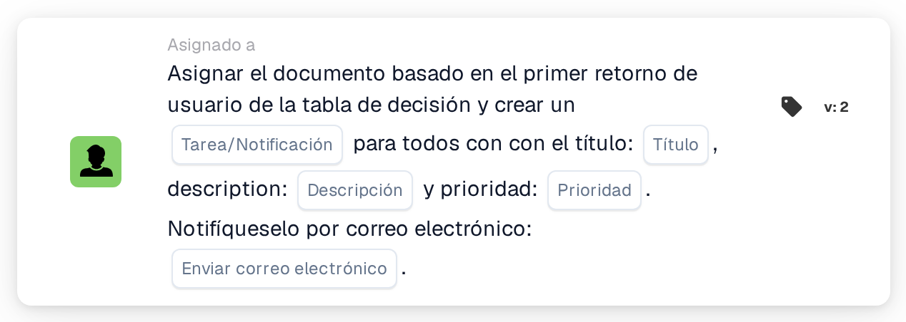

# Asignar documento al primer usuario de la tabla de decisión y crear tareas

<figure><figcaption>
Versión 2
</figcaption></figure>

## Propósito:

Esta tarjeta de flujo de trabajo utiliza de dos formas los usuarios devueltos por una tabla de decisión: el documento se asigna al primer usuario devuelto, y cada usuario devuelto, incluido el primero, recibe una tarea o una notificación sobre el documento. De este modo, una persona pasa a ser responsable del documento mientras que las demás quedan informadas o también se les pide que actúen.

Los usuarios proceden de una tabla de decisión que se evalúa antes en el mismo flujo de trabajo, por ejemplo con la tarjeta **Decision Table has Returns**, configurada para utilizar los datos devueltos en las tarjetas posteriores.

## Componentes de la tarjeta:

1. **Tarea/Notificación**
   * **Descripción:** Define si se crea una tarea o una notificación para los usuarios devueltos.
   * **Opciones:**
     * **Tarea:** Se crea una tarea para cada usuario.
     * **Notificación:** Se crea una notificación para cada usuario.
2. **Título**
   * **Descripción:** El título de la tarea o de la notificación.
   * **Detalle:** Un texto breve que identifica la tarea o la notificación.
3. **Descripción**
   * **Descripción:** Más detalles sobre la tarea o la notificación.
   * **Detalle:** Un texto que describe qué debería hacerse o por qué se informa a los usuarios.
4. **Prioridad**
   * **Descripción:** La urgencia de la tarea o de la notificación.
   * **Opciones:**
     * **alto peso:** La tarea o la notificación se crea con prioridad alta.
     * **peso medio:** La tarea o la notificación se crea con prioridad media.
     * **bajo peso:** La tarea o la notificación se crea con prioridad baja.
5. **Enviar correo electrónico**
   * **Descripción:** Define si también se informa a los usuarios de la tarea o la notificación por correo electrónico.
   * **Opciones:**
     * **Verdadero:** Se envía una notificación por correo electrónico.
     * **Falso:** No se envía ninguna notificación por correo electrónico.

## Funcionalidad:

* **Lectura de la tabla de decisión:** La tarjeta lee los usuarios devueltos por la tabla de decisión anteriormente en el flujo de trabajo. Solo se tienen en cuenta los usuarios devueltos, no los grupos.
* **Asignación del documento:** El documento se asigna al primer usuario devuelto.
* **Creación de tareas:** Para cada usuario devuelto se crea una tarea o una notificación con el título, la descripción y la prioridad de la tarjeta. Cada usuario recibe su propia tarea. Las tareas se crean aunque la asignación del documento no haya tenido éxito; el registro del flujo de trabajo muestra el resultado de la asignación y de cada tarea.
* **Valores predeterminados:** Si no se ha definido ninguna prioridad, se utiliza **peso medio**. Si **Enviar correo electrónico** no está definido, no se envía ningún correo electrónico. Si **Tarea/Notificación** no está definido, se crea una tarea y el registro del flujo de trabajo indica el ajuste que falta.
* **Datos que faltan:**
  * Si la tabla de decisión no ha devuelto ningún usuario, no se asigna nada y la tarjeta registra los datos que faltan en el registro del flujo de trabajo.
  * Si el título o la descripción están vacíos, el documento no se asigna, no se crea ninguna tarea y la tarjeta registra los datos que faltan.

## Configuración:

* Una tabla de decisión que devuelva usuarios debería evaluarse antes en el flujo de trabajo, por ejemplo con la tarjeta **Decision Table has Returns**. El orden de los usuarios devueltos es importante, porque el primero recibe el documento.
* La tarjeta se puede añadir desde la categoría **Asignado a**. A continuación se pueden configurar el tipo (**Tarea** o **Notificación**), el título, la descripción, la prioridad y el ajuste de correo electrónico.

## Conclusión:

La tarjeta de flujo de trabajo «Assign Document to First Decision Table User and Create Tasks» combina una responsabilidad clara sobre el documento con información para todas las personas que indica la tabla de decisión. Resulta útil cuando una persona debería hacerse cargo del documento mientras que otras necesitan participar o mantenerse al día.
