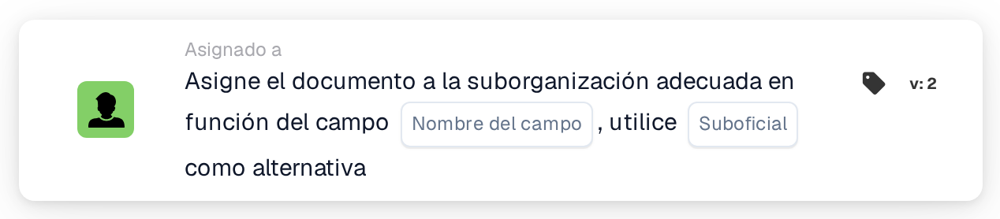

# Asignar documento a la suborganización coincidente

<figure><figcaption>
Versión 2
</figcaption></figure>

## **Propósito:**

La tarjeta de flujo de trabajo **"Asignar documento a una suborganización coincidente según el campo"** asigna un documento a una suborganización de forma dinámica, según un campo especificado del documento. Si no se encuentra ninguna suborganización coincidente, la tarjeta utiliza una suborganización alternativa predefinida.

## **Componentes de la tarjeta:**

1. **Nombre de campo**
   * **Descripción:** Especifica el campo del documento que se utilizará para determinar la suborganización coincidente.
   * **Detalle:** La tarjeta busca un valor en el campo especificado para hacerlo coincidir con una suborganización disponible.
2. **Suborganización (alternativa)**
   * **Descripción:** Define la suborganización alternativa que se utilizará si no se encuentra ninguna coincidencia en el campo especificado.
   * **Detalle:** Si el valor del campo no coincide con ninguna suborganización, el documento se asignará a la suborganización alternativa seleccionada.

## **Funcionalidad:**

* **Evaluación de la condición:**\
  La tarjeta solo ejecuta su acción si las secciones **"Cuando"** y **"Y"** se evalúan como verdaderas.
* **Asignación dinámica:**\
  La tarjeta comprueba el valor del campo especificado y asigna el documento a la suborganización que coincide con este valor.
* **Mecanismo alternativo:**\
  Si no se encuentra ninguna suborganización coincidente, el documento se asigna a la suborganización alternativa.

## **Configuración:**

* **Seleccionar el Field Name:**\
  Elija el campo del documento que contiene el valor que se hará coincidir con una suborganización.
* **Seleccionar la suborganización alternativa:**\
  Elija la suborganización que se utilizará si no se encuentra ninguna coincidencia en el campo del documento.

## **Conclusión:**

La tarjeta de flujo de trabajo **"Asignar documento a una suborganización coincidente según el campo"** ofrece flexibilidad al enrutar dinámicamente los documentos a la suborganización adecuada, con una opción alternativa añadida para garantizar que ningún documento quede sin asignar.

<!-- workflow-card-practical-example-20261021 -->

## Ejemplo práctico

**Cuándo utilizar:** Elija una unidad de negocio de un campo de enrutamiento extraído.

**Configuración:** Establezca el campo de enrutamiento `business_unit` en el nombre de la suborganización configurada `Demo North` y elija `Demo Default` como respaldo.

**Resultado esperado y contraejemplo:** Un valor de campo coincidente selecciona `Demo North`. Un nombre desconocido usa `Demo Default`; Pruebe el respaldo antes de habilitar el flujo de trabajo.

Esta es una configuración ilustrativa y un resultado esperado. Utilice campos, usuarios y grupos configurados en su organización de prueba; no es una afirmación de que este ejemplo haya sido ejecutado.
