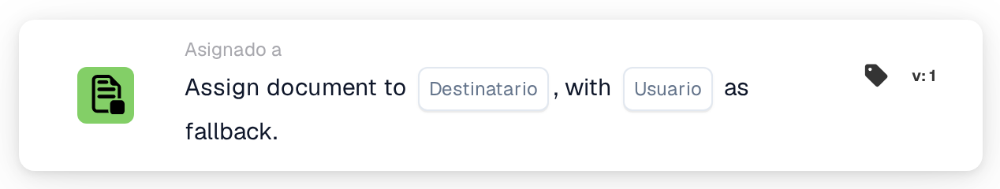
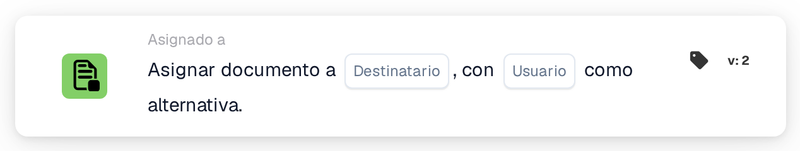

# Asignar documento al destinatario

<figure><figcaption>
Versión 1
</figcaption></figure>

<figure><figcaption>
Versión 2
</figcaption></figure>

## Propósito

La tarjeta asigna un **documento** al destinatario que se resuelva según su configuración y permite indicar un usuario alternativo. La versión 2 mostrada contiene los campos **Destinatario** y **Usuario** como alternativa; ambos están sin configurar en la imagen.

## Componentes de la tarjeta

* **Destinatario:** seleccione la opción que corresponda al flujo de su organización y compruebe cómo se resuelve en los documentos de prueba. La captura no muestra una selección ni una lista de opciones abierta.
* **Usuario como alternativa:** configure un usuario autorizado para la ruta de respaldo. La tarjeta no selecciona por sí sola un administrador universal para todos los casos.

## Configuración y comprobación

1. Sitúe la acción en la ruta del flujo donde deba realizarse la asignación.
2. Configure el destinatario principal y el usuario alternativo.
3. Pruebe un documento que permita resolver al destinatario principal.
4. Pruebe por separado un documento cuyo destinatario principal no pueda resolverse y compruebe el respaldo configurado.
5. Revise la asignación almacenada y los registros. Si ninguna ruta proporciona un usuario válido, corrija la configuración; la presencia de un campo alternativo no garantiza una asignación correcta en cualquier situación.

La acción se evalúa cuando el flujo alcanza su ruta configurada. Asignar un documento es independiente de aprobarlo, completar una tarea o exportarlo.

<!-- workflow-card-practical-example-20261021 -->

## Ejemplo práctico

**Cuándo usarlo:** Dirija un documento a su destinatario resuelto y prepare una ruta de respaldo.

**Configuración:** Seleccione el origen del destinatario y el usuario alternativo `Demo Reviewer A`.

**Resultado esperado y contraejemplo:** Un destinatario que se puede resolver recibe el documento. Si no puede resolverse, pruebe que se utiliza el usuario alternativo configurado. Un usuario inexistente o sin acceso no constituye un respaldo válido.

Esta es una configuración ilustrativa y un resultado esperado. Utilice campos, usuarios y grupos de su organización de prueba; este ejemplo no afirma que se haya ejecutado una asignación.
