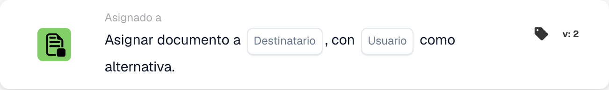

# Asignar documento al destinatario

<figure><figcaption>
Campos de la tarjeta en la versión mostrada. Los campos aún no están configurados.
</figcaption></figure>

## **Propósito:**

La tarjeta de flujo de trabajo **"Asignar documento al disponente/comprador"** asigna un documento a un **Disponent** o a un **Comprador**. Si no se encuentra ningún usuario válido, se selecciona un usuario alternativo para garantizar que el documento siempre se asigne a alguien.

## **Componentes de la tarjeta:**

1. **Disponente / Comprador**
   * **Descripción:** Especifica si el documento se asignará a un Disponent o a un Purchaser.
   * **Opciones:**
     * **Disponent:** Asigna el documento al Disponent.
     * **Comprador:** Asigna el documento al Comprador.
2. **Usuario alternativo**
   * **Descripción:** Especifica un usuario alternativo en caso de que el documento no pueda asignarse al Disponent o Purchaser seleccionado.
   * **Detalle:** La lista desplegable de usuarios disponibles le permite elegir un usuario alternativo para garantizar que el documento se asigne aunque no se pueda determinar el usuario principal.

## **Funcionalidad:**

* **Evaluación de la condición:**\
  La tarjeta solo ejecuta su acción si las secciones **"Cuando"** y **"Y"** se evalúan como verdaderas.
* **Asignación del documento:**\
  La tarjeta asigna el documento al **Disponent** o al **Comprador** según lo seleccionado. Si la persona seleccionada no está disponible o no es válida, el documento se asigna al usuario alternativo.

## **Configuración:**

* **Seleccionar Disponent / Purchaser:**\
  Elija si asignar el documento al **Disponent** o al **Comprador**.
* **Seleccionar el usuario alternativo:**\
  Elija un usuario alternativo de la lista desplegable que recibirá el documento si la asignación principal no es posible.

## **Conclusión:**

La tarjeta de flujo de trabajo **"Asignar documento al disponente/comprador"** garantiza que el documento siempre se asigne, ya sea al Disponent/Purchaser seleccionado o, si es necesario, al usuario alternativo. Esto minimiza las interrupciones del flujo de trabajo y garantiza que el procesamiento de documentos continúe sin problemas.

<!-- workflow-card-practical-example-20261021 -->

## Ejemplo práctico

**Cuándo usarlo:** Asigne un documento a su destinatario resuelto, con un respaldo seguro.

**Configuración:** Seleccione el origen del destinatario y el usuario alternativo `Demo Reviewer A`.

**Resultado esperado y contraejemplo:** Un destinatario que se puede resolver recibe la tarea. Si el destinatario no se puede resolver, se utiliza el respaldo configurado. Verifique ambas rutas.

Esta es una configuración ilustrativa y un resultado esperado. Utilice campos, usuarios y grupos configurados en su organización de prueba; no es una afirmación de que este ejemplo haya sido ejecutado.
