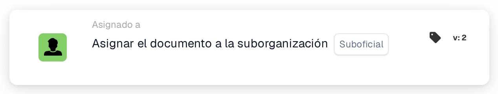

# Asignar documento a la suborganización.

<figure><figcaption>
Versión 2
</figcaption></figure>

## **Propósito:**

La tarjeta de flujo de trabajo **"Asignar documento a la suborganización"** asigna un documento a una suborganización específica dentro del sistema, garantizando que se enrute a la unidad organizativa adecuada para su procesamiento.

## **Componentes de la tarjeta:**

1. **Suborganización**
   * **Descripción:** Especifica la suborganización a la que se asignará el documento.
   * **Detalle:** Se proporciona una lista desplegable de suborganizaciones disponibles para seleccionar la suborganización de destino.

## **Funcionalidad:**

* **Evaluación de la condición:**\
  La tarjeta solo ejecuta su acción si las secciones **"Cuando"** y **"Y"** se evalúan como verdaderas.
* **Asignación del documento:**\
  La tarjeta asigna el documento a la suborganización seleccionada de la lista desplegable.

## **Configuración:**

* **Seleccionar la Sub-Organization:**\
  Elija la suborganización adecuada de la lista desplegable a la que debe asignarse el documento.

## **Conclusión:**

La tarjeta de flujo de trabajo **"Asignar documento a la suborganización"** garantiza que los documentos se enruten a la suborganización correcta, agilizando el proceso de gestión de documentos al asignar la responsabilidad según la estructura organizativa.

<!-- workflow-card-practical-example-20261021 -->

## Ejemplo práctico

**Cuándo utilizar:** Enrutar un documento a una unidad de negocio conocida.

**Configuración:** Seleccione la suborganización configurada `Demo North`.

**Resultado esperado y contraejemplo:** El documento pertenece a la suborganización seleccionada después de la acción. Confirme el destino antes de habilitar el flujo de trabajo porque las reglas de acceso de la suborganización pueden diferir.

Esta es una configuración ilustrativa y un resultado esperado. Utilice campos, usuarios y grupos configurados en su organización de prueba; no es una afirmación de que este ejemplo haya sido ejecutado.
