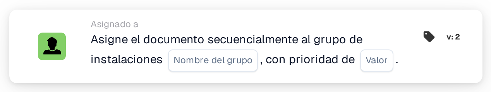

# Asignar secuencialmente al grupo de instalación

<figure><figcaption>
Versión 2
</figcaption></figure>

## Propósito:

Esta tarjeta de flujo de trabajo añade el grupo responsable de la instalación de la orden de compra del documento a la asignación secuencial del documento. Al igual que **Assign Document to Facility Group**, encuentra el grupo a través del código de instalación de las órdenes de compra emparejadas. En lugar de asignar el documento de inmediato, añade el grupo al orden de aprobadores con una prioridad, de modo que varias tarjetas secuenciales de un flujo de trabajo pueden formar una cadena de asignaciones.

## Componentes de la tarjeta:

1. **Nombre del grupo**
   * **Descripción:** La parte del nombre que tienen en común los grupos de instalación.
   * **Detalle:** Un texto que se compara con los nombres de los grupos de usuarios de la organización. Un grupo coincide si su nombre contiene este texto y el código de instalación de la orden de compra. La comparación no distingue entre mayúsculas y minúsculas. Por ejemplo, con el nombre de grupo **Approver** y una orden de compra de la instalación **1000**, coincidiría un grupo llamado **Approver 1000**.
2. **Valor**
   * **Descripción:** La prioridad del grupo dentro de la asignación secuencial.
   * **Detalle:** Un número entero. Los números más bajos van primero, y 0 es la prioridad más alta. Si no se introduce ningún valor, o se introduce un valor negativo, se utiliza la prioridad 1.

## Funcionalidad:

* **Determinación de la instalación:** La tarjeta lee las órdenes de compra con las que está emparejado el documento y recoge el código de instalación (la ubicación de la orden de compra) de cada una de ellas.
* **Determinación del grupo:** Para cada código de instalación, la tarjeta busca grupos de usuarios cuyo nombre contenga tanto el **Nombre del grupo** de la tarjeta como el código de instalación. Los códigos de instalación para los que no se encuentra ningún grupo se indican en el registro del flujo de trabajo.
* **Ejecución de la acción:** Cada grupo coincidente se añade a la asignación secuencial con la prioridad del campo **Valor**. La asignación en sí se realiza al final de la ejecución del flujo de trabajo: primero se asigna la entrada con el número de prioridad más bajo, y todas las entradas, incluida la primera, se guardan en el documento como sus solicitudes de aprobación. Los pasos siguientes de la secuencia se toman de ellas en orden ascendente de prioridad. Si otra tarjeta ya ha asignado el documento directamente en la misma ejecución, se omite esta primera asignación secuencial.
* **Datos que faltan:**
  * Si no se ha introducido ningún nombre de grupo en la tarjeta, la tarjeta no se ejecuta y registra los datos que faltan en el registro del flujo de trabajo.
  * Si el documento no está emparejado con ninguna orden de compra, la tarjeta registra los datos que faltan en lugar de añadir un grupo.
  * Si ningún grupo coincide con ninguno de los códigos de instalación, no se añade ningún grupo y el registro del flujo de trabajo indica que no se ha encontrado ningún grupo coincidente.

## Configuración:

* Los grupos de usuarios deberían nombrarse de forma que cada nombre contenga la parte común del nombre y el código de instalación, por ejemplo **Approver 1000**, **Approver 2000**.
* La tarjeta se puede añadir desde la categoría **Asignado a**. A continuación se introduce la parte común del nombre de los grupos en el campo **Nombre del grupo** y la prioridad en el campo **Valor**.
* Para formar una cadena de aprobadores, se pueden combinar varias tarjetas secuenciales en el flujo de trabajo, cada una con su propia prioridad, por ejemplo el grupo de instalación con prioridad 1 y un grupo central con prioridad 2.

## Conclusión:

La tarjeta de flujo de trabajo «Assign Sequentially to Facility Group» sitúa al equipo responsable de la instalación en una posición definida dentro de una aprobación secuencial. Junto con otras tarjetas secuenciales, permite cadenas de aprobación en las que el equipo de la instalación es uno de varios pasos.
