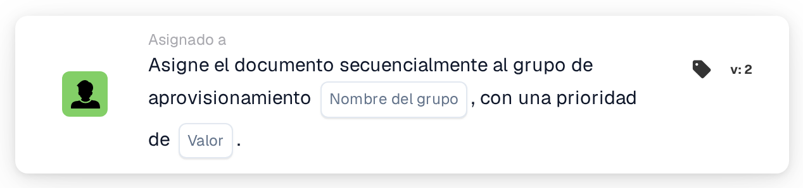

# Asignar secuencialmente al grupo de adquisiciones

<figure><figcaption>
Versión 2
</figcaption></figure>

## **Propósito**

La tarjeta de flujo de trabajo "**Asignar el documento secuencialmente al grupo de adquisiciones**" posibilita la asignación secuencial de documentos a un grupo de compras especificado. El valor de prioridad determina el orden de asignación, donde los números más bajos representan una mayor prioridad.

## **Componentes de la tarjeta**

1. **Grupo**
   * **Descripción**: Un campo de entrada de texto donde se puede introducir el nombre del grupo de compras.
   * **Detalle**: Especifica el grupo de compras al que se asignará el documento.
2. **Prioridad (Valor)**
   * **Descripción**: Un campo de entrada numérico donde se puede establecer el nivel de prioridad del grupo.
   * **Detalle**: Los números más bajos indican una mayor prioridad, garantizando que los documentos se asignen a los grupos en orden ascendente de prioridad.

## **Funcionalidad**

* **Asignación del documento**:\
  La tarjeta asigna los documentos al grupo de compras especificado de forma secuencial.\
  Los valores de prioridad determinan el orden de asignación, procesándose primero los números más bajos.

## **Configuración**

1. Añada la tarjeta **Asignar el documento secuencialmente** a su flujo de trabajo.
2. Configure el campo **grupo**:
   * Introduzca el nombre del grupo de compras en el campo de texto.
3. Configure el campo **Prioridad (Valor)**:
   * Introduzca un valor numérico para establecer la prioridad de asignación.
4. Guarde y active el flujo de trabajo para aplicar la configuración.

## **Conclusión**

La tarjeta de flujo de trabajo "Assign the Document Sequentially to the Procurement Group" garantiza una asignación eficaz de documentos a los grupos de compras según la prioridad. Esto mejora la eficiencia organizativa y la gestión de tareas.

<!-- workflow-card-practical-example-20261021 -->

## Ejemplo práctico

**Cuándo utilizar:** Priorizar un grupo de adquisiciones dentro de la revisión de documentos.

**Configuración:** Seleccione `Demo Procurement` y prioridad `10`.

**Resultado esperado y contraejemplo:** El documento recibe la asignación del grupo de adquisiciones con prioridad `10`. Compruebe que las tareas posteriores utilicen las prioridades numéricas más altas previstas.

Esta es una configuración ilustrativa y un resultado esperado. Utilice campos, usuarios y grupos configurados en su organización de prueba; no es una afirmación de que este ejemplo haya sido ejecutado.
