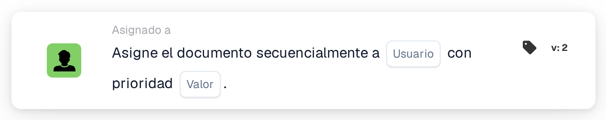

# Asignar secuencialmente al usuario

<figure><figcaption>
Versión 2
</figcaption></figure>

## **Propósito**

La tarjeta de flujo de trabajo "**Asignar secuencialmente al usuario**" automatiza la asignación de documentos a un usuario seleccionado de forma secuencial. El valor de prioridad determina el orden de asignación, donde los números más bajos representan una mayor prioridad.

## **Componentes de la tarjeta**

1. **Usuario**
   * **Descripción**: Al usuario seleccionado se le asignará el documento según la secuencia del flujo de trabajo.
   * **Detalle**: Un menú desplegable que enumera todos los usuarios disponibles para la asignación.
2. **Prioridad (Valor)**
   * **Descripción**: Un campo de entrada numérico donde se puede establecer el nivel de prioridad del usuario.
   * **Detalle**: Los números más bajos indican una mayor prioridad. Los documentos se asignan a los usuarios en orden ascendente de prioridad.

## **Funcionalidad**

* **Asignación del documento**:\
  La tarjeta asigna los documentos al usuario seleccionado de forma secuencial, teniendo en cuenta el nivel de prioridad.\
  Si varios usuarios tienen la misma prioridad, los documentos se asignan en el orden en que aparecen los usuarios en el menú desplegable.

## **Configuración**

1. Añada la tarjeta **Asignar el documento secuencialmente** a su flujo de trabajo.
2. Configure el campo **Usuario**:
   * Seleccione un usuario del menú desplegable.
3. Configure el campo **Prioridad (Valor)**:
   * Introduzca un valor numérico para establecer la prioridad de asignación.
4. Guarde y active el flujo de trabajo para aplicar la configuración.

## **Conclusión**

La tarjeta de flujo de trabajo "Assign the Document Sequentially to User" garantiza una distribución organizada de los documentos al asignarlos en una secuencia priorizada. Esto mejora la gestión de tareas y reduce los retrasos en el procesamiento.

<!-- workflow-card-practical-example-20261021 -->

## Ejemplo práctico

**Cuándo usarlo:** Agregue un usuario a una secuencia priorizada de aprobación de documentos.

**Configuración:** Seleccione `Demo Reviewer A` y prioridad `10`. Agregue una tarea separada con prioridad `20` cuando se necesite un revisor posterior.

**Resultado esperado y contraejemplo:** Las asignaciones llevan las prioridades configuradas; el valor numérico más bajo tiene mayor prioridad. Verifique la secuencia de las tareas, no solo el orden de las tarjetas en el lienzo.

Esta es una configuración ilustrativa y un resultado esperado. Utilice campos, usuarios y grupos configurados en su organización de prueba; no es una afirmación de que este ejemplo haya sido ejecutado.
