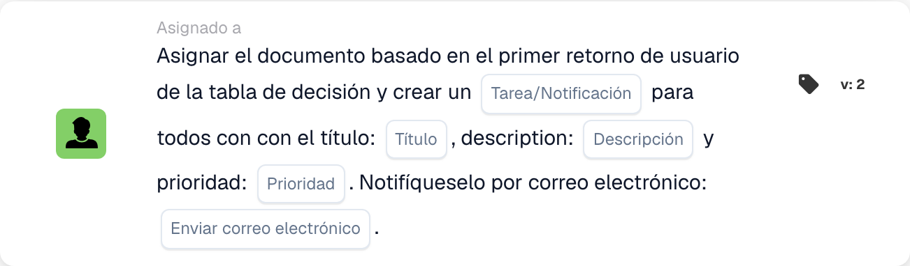
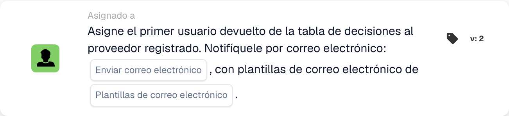

# Asignación de documentos y tarjetas de usuario

## Asignación de documentos y tarjetas de usuario: guía completa

**Cubiertas:** 13 tarjetas de asignación y relacionadas con el usuario

***

Las tarjetas de esta página van en el grupo **Entonces** del Generador de flujo de trabajo: las acciones que se ejecutan una vez que coinciden las condiciones Cuándo/Y:

<figure><figcaption><p>Ejemplo sin guardar con tarjetas Cuando, Y y Entonces. Configure todos los campos antes de ejecutarlo. Algunas etiquetas de esta versión de la tarjeta todavía tienen una traducción incompleta o incorrecta en la interfaz. Las explicaciones de esta página utilizan los términos correctos.</p></figcaption></figure>

***

### 📌 Información de versión

**Tarjetas multiversión:** DOC\_USER\_ASSIGN (v2 más reciente, v3 en desuso), DOC\_GROUP\_ASSIGN (v2 más reciente, v3 en desuso), OC\_ASSIGN\_DOC (v2)

**Importante:** Las versiones v3 agregaron soporte para árboles de decisión pero ahora están obsoletas **Recomendación:** Use v2 tanto para DOC\_USER\_ASSIGN como para DOC\_GROUP\_ASSIGN

📖 [Historial de versiones completo](../../release.md) | [Versiones de tarjetas y comportamiento](../../cards-overview/card-versions-guide.md)

***

## Asignación de documentos básicos

### Tarjeta: DOC\_USER\_ASSIGN / Asignar documento al usuario

#### Propósito

Asigna documento a una persona específica para su acción.

#### Cuando usar

* El documento necesita la revisión de una persona específica.
* Traspaso a un miembro individual del equipo
* Seguimiento de rendición de cuentas
* Asignar trabajo a una persona designada

#### Cómo funciona

```
Document is "assigned to" = John Smith
Only John can see it as assigned to him
John is responsible for this document
```

#### Ejemplo

```
Invoice arrives
    ↓
Assign Document to: John Smith (Finance Manager)
    ↓
Only John sees "Assigned to Me"
John must take action on it
```

#### Parámetros

```
User: [Select which person]
```

#### Nota

Asignar significa:

* El documento aparece como "asignado a mí" para esa persona
* esa persona es responsable
* Otros aún pueden ver el documento (pero no como se les asignó)
* Una tarea a la vez por documento

***

### Tarjeta: DOC\_GROUP\_ASSIGN / Asignar Documento al Grupo

#### Propósito

Asigna un documento a un grupo (todos los miembros lo ven como asignado a ellos)

#### Cuando usar

* Documento para equipo, no individual.
* Varias personas pueden manejar
* Responsabilidad compartida
* Distribución de la carga de trabajo del equipo

#### Cómo funciona

```
Document is "assigned to" = Finance Team (10 people)
All 10 team members see "Assigned to My Group"
Any team member can take action
```

#### Ejemplo

```
New vendor invoice
    ↓
Assign Document to: Procurement Team
    ↓
All procurement team members see it
First available person handles it
```

#### Parámetros

```
Group: [Select which group]
```

#### diferencia

```
Individual Assignment:
- One person responsible
- That person sees "Assigned to Me"
- Others don't see assignment

Group Assignment:
- Team responsible
- All members see "Assigned to My Group"
- Anyone can claim/process
```

***

### Tarjeta: ACTION\_ASSIGN\_DOC\_BASED\_ON\_DECISION\_TABLE

#### Propósito

Asigna documentos según la lógica de la tabla de decisiones.

#### Cuando usar

* Diferentes proveedores necesitan diferentes manejadores
* Asignación en función del importe
* Lógica de enrutamiento compleja
* Múltiples condiciones para la asignación

#### Cómo funciona

```
Decision Table Logic:
  If Supplier = "ABC Corp" → Assign to: Procurement Team
  If Supplier = "XYZ Inc" → Assign to: Direct Manager
  If Amount > €10000 → Assign to: Finance Director

Document arrives
    ↓
Check: Which condition matches?
    ↓
Assign accordingly
```

#### Ejemplo: asignación basada en importe

```
Invoice: €2000 from ABC Corp

Decision Table checks:
  Is amount > €10000? NO
  Is amount > €5000? NO
  Is amount > €1000? YES

Result: Assign to: Finance Manager
```

#### Ejemplo: asignación basada en proveedores

```
Invoice from: Preferred Supplier

Decision Table:
  If preferred supplier → Finance Team
  If new supplier → Procurement Manager
  If blacklisted → Director Review

Result: Assign to: Finance Team
```

#### Parámetros

```
Decision Table: [Select decision table]
(Decision table contains assignment logic)
```

***

### Tarjeta: ACTION\_ASSIGN\_DOC\_DECISION\_TABLE\_SEQUENTIAL

#### Propósito

Asigna documentos secuencialmente basándose en una tabla de decisiones con prioridades.

#### Cuando usar

* Múltiples aprobaciones secuenciales
* Diferentes personas en diferentes niveles.
* Cadena de aprobación según monto
* Ruta de escalada

#### Cómo funciona

```
First Decision: Who approves first?
    ↓
Assign to: Person 1
    ↓
Person 1 approves
    ↓
Second Decision: Who approves next?
    ↓
Assign to: Person 2
    ↓
Person 2 approves (final)
    ↓
Document Complete
```

#### Sistema de Prioridad

```
Priority 1: First assignment
Priority 2: Second assignment
Priority 3: Third assignment
(etc.)

Each must complete before next begins
```

#### Ejemplo: aprobación multinivel

```
Invoice: €50,000

Decision Table:
  €1k-€5k → Assign to: Finance Manager (Priority 1)
  €5k-€20k → Then: Assign to: Finance Director (Priority 2)
  €20k+ → Then: Assign to: CFO (Priority 3)

Invoice Flow:
1. Finance Manager reviews → approves
2. Finance Director reviews → approves
3. CFO reviews → approves final

Each step depends on previous completion
```

#### Parámetros

```
Decision Table: [Select]
Priority Order: [Determined by decision table]
```

***

### Tarjeta: ACTION\_ASSIGN\_DOC\_TO\_USER\_SEQUENTIAL

#### Propósito

Asigna documento al usuario con prioridad secuencial

#### Cuando usar

* El documento necesita una persona específica.
* Procesamiento secuencial claro
* Asignación única con pedido

#### Cómo funciona

```
Assign Document to: User A (Priority 1)
    ↓
User A processes
    ↓
Then: Assign to User B (Priority 2)
    ↓
User B processes
```

#### Ejemplo

```
Invoice processing:
1. Assign to: Accounts Payable Clerk
2. Then: Assign to: Finance Manager
3. Then: Assign to: Director

Each person has their turn
```

***

### Tarjeta: ACTION\_ASSIGN\_DOC\_TO\_GROUP\_SEQUENTIAL

#### Propósito

Asigna documentos secuencialmente a grupos.

#### Cuando usar

* Aprobaciones de múltiples grupos
* Diferentes departamentos en cada etapa.
* Procesamiento secuencial basado en equipos

#### Cómo funciona

```
Step 1: Assign to Group A (Quality Team)
        Quality verifies
    ↓
Step 2: Assign to Group B (Finance Team)
        Finance reviews
    ↓
Step 3: Assign to Group C (Procurement)
        Procurement approves
```

#### Ejemplo

```
New Supplier Onboarding:

Step 1: Quality Team
  - Evaluate supplier capability
  - Check certifications

Step 2: Finance Team
  - Check payment terms
  - Verify pricing

Step 3: Procurement Team
  - Approve supplier
  - Set up in system

Document passes through all three
```

***

### Tarjeta: ACTION\_ASSIGN\_DOC\_TO\_FACILITY\_GROUP

<!-- workflow-facility-example-direct-20261022 -->

Esta acción del workflow asigna un documento a un grupo según las ubicaciones de sus pedidos de compra vinculados. En la versión 2, `group_name` es un fragmento de texto que se busca en los nombres de los grupos.

Ejemplo: un documento sintético está vinculado al pedido `DEMO-PO-100`, con `location_id=BERLIN`. Los grupos configurados son `Receiving BERLIN` y `Receiving MUNICH`. Introduzca `Receiving` en `group_name`. El nombre del grupo debe contener tanto ese fragmento como la ubicación del pedido; la comparación no distingue mayúsculas de minúsculas.

Resultado esperado: el documento se asigna directamente a `Receiving BERLIN`, siempre que su estado permita la asignación. Sin un pedido vinculado o un grupo coincidente, la asignación no es correcta; revise los registros del workflow. Evite nombres ambiguos: si coinciden varios grupos, esta tarjeta no garantiza un orden de selección fijo.

Es una configuración ilustrativa; no se ha ejecutado ningún workflow.

***

### Tarjeta: ACTION\_ASSIGN\_DOC\_TO\_FACILITY\_GROUP\_SEQUENTIAL

<!-- workflow-facility-example-sequential-20261022 -->

Esta acción del workflow añade los grupos de ubicación coincidentes a la cola de asignación secuencial con una prioridad configurada. No representa el traslado de mercancías entre fábricas o almacenes.

Ejemplo: utilice el mismo pedido sintético, ubicación y grupos del ejemplo anterior. Establezca `group_name=Receiving` y la prioridad `value=10`. La versión 2 lee la ubicación del pedido vinculado y encuentra `Receiving BERLIN`.

Resultado esperado: se añade a la cola una solicitud de asignación para ese grupo con prioridad `10`. Si coinciden varios grupos, todos reciben la misma prioridad; sus nombres no determinan el orden de procesamiento. Compruebe por separado la cola y la aprobación posterior. Sin coincidencias, no se crea una asignación correcta.

Es una configuración ilustrativa; no se ha ejecutado ningún workflow.

***

### Tarjeta: ACTION\_ASSIGN\_DOC\_TO\_PROCUREMENT\_GROUP

#### Propósito

Asigna documento al departamento de adquisiciones.

#### Cuando usar

* Manejo del equipo de adquisiciones.
* Trabajo relacionado con proveedores
* Orden de compra relacionada

#### Ejemplo

```
Vendor evaluation document
    ↓
Assign to: Procurement Group
    ↓
Procurement team evaluates vendor
```

***

### Tarjeta: ACTION\_ASSIGN\_DOC\_TO\_PROCUREMENT\_GROUP\_SEQUENTIAL

#### Propósito

Asignación secuencial dentro de adquisiciones

#### Cuando usar

* Proceso de adquisición de varios pasos
* Cadena de aprobación en adquisiciones

#### Ejemplo

```
Purchase Requisition:

Step 1: Buyer (Creates PO)
Step 2: Approver (Reviews)
Step 3: Director (Final sign-off)

Each step in sequence
```

***

### Tarjeta: ACTION\_CHANGE\_DOC\_SUBORG / Cambiar Documento Suborganización

#### Propósito

Asigna documento a diferente suborganización.

#### Cuando usar

* Organización equivocada seleccionada
* Necesita pasar al departamento correcto
* Reestructuración organizacional

#### Cómo funciona

```
Current Sub-Org: Finance Department
    ↓
Change to: Accounting Department
    ↓
Document now belongs to Accounting
```

#### Ejemplo

```
Document for: Berlin Office
    ↓
Realize should be: Munich Office
    ↓
Change Sub-Organization to: Munich Office
```

***

### Tarjeta: ACTION\_CHANGE\_DOC\_SUBORG\_BY\_FIELD\_TEXT

#### Propósito

Cambia la suborganización según el valor del campo del documento

#### Cuando usar

* Suborganización almacenada en el campo
* Hacer coincidir la ubicación del documento con el campo
* Asignación automática de organización

#### Cómo funciona

```
Document Field: "Delivery_Location" = "Berlin"
    ↓
Decision Table:
  If location = "Berlin" → Assign to: Berlin Sub-Org
  If location = "Munich" → Assign to: Munich Sub-Org

    ↓
Document assigned to: Berlin Sub-Org
```

#### Ejemplo

```
Invoice field: "Cost Center: CC-Berlin-001"
    ↓
System recognizes: Berlin location
    ↓
Change document to: Berlin Sub-Organization
```

***

### Tarjeta: ACTION\_ASSIGN\_USER\_FROM\_FIELD\_WITH\_FALLBACK

#### Propósito

Asigna un documento al usuario desde el campo, con respaldo si no se encuentra el usuario

#### Cuando usar

* Nombre de usuario almacenado en el campo del documento
* Puede no existir en el sistema
* Necesita copia de seguridad si el usuario no está disponible

#### Cómo funciona

```
Document Field: "Approver: John Smith"
    ↓
Try to assign to: John Smith
    ↓
If John doesn't exist:
    ↓
Use Fallback: Sarah Johnson (Manager)
    ↓
Document assigned to: Sarah Johnson
```

#### Parámetros

```
Source Field: [Field containing user name]
Fallback User: [If source user not found]
```

#### Ejemplo

```
Invoice has field: "Contact Person: Mike Johnson"

Try to assign to: Mike Johnson
    ↓
If Mike not in system:
    ↓
Fallback to: Finance Manager (Robert)
```

***

### Tarjeta: ACTION\_ASSIGN\_USER\_TO\_SUPPLIER

#### Propósito

Asigna documento al usuario que gestiona ese proveedor.

#### Cuando usar

* Usuario vinculado al proveedor
* Responsable de cuentas de proveedores
* Dueño de la relación con proveedores

#### Cómo funciona

```
Document Supplier: ABC Corp
    ↓
System checks: Who manages ABC Corp?
    ↓
Assign to: John Smith (ABC Corp Account Manager)
```

***

## Árboles de decisión de asignaciones

### Ejemplo 1 de tabla de decisiones: basada en cantidades

```
Amount ≤ €1000
  → Assign to: Finance Team

Amount €1000-€5000
  → Assign to: Finance Manager

Amount €5000-€20000
  → Assign to: Finance Director

Amount > €20000
  → Assign to: CFO
```

### Ejemplo 2 de tabla de decisiones: basada en proveedores

```
Supplier Type = "Preferred"
  → Assign to: Account Manager

Supplier Type = "New"
  → Assign to: Procurement Manager

Supplier Type = "Problem"
  → Assign to: Procurement Director
```

### Ejemplo 3 de tabla de decisiones: basado en el tipo de documento

```
Document Type = "Invoice"
  → Assign to: Accounts Payable Team

Document Type = "Credit Memo"
  → Assign to: Finance Manager

Document Type = "PO"
  → Assign to: Procurement Team
```

***

## Ejemplos de flujo de trabajo de tareas

### Ejemplo 1: enrutamiento simple

```
Document Arrives
    ↓
Check: Supplier = "ABC Corp"? YES
    ↓
Assign to: John Smith
(John handles ABC Corp)
    ↓
John reviews and approves
```

### Ejemplo 2: Aprobación secuencial

```
Document Arrives
    ↓
Assign to: Finance Manager (Step 1)
    ↓
Manager reviews
    ↓
Passes to: Finance Director (Step 2)
    ↓
Director reviews
    ↓
Passes to: CFO (Step 3)
    ↓
CFO approves final
```

### Ejemplo 3: ruta basada en cantidad

```
Invoice: €50,000
    ↓
Decision Table: Amount > €20k?
    ↓
YES → Assign to: CFO
    ↓
CFO approves directly
```

### Ejemplo 4: basado en instalaciones

```
Shipment for: Berlin Office
    ↓
Assign to: Berlin Warehouse Team
    ↓
Then assign to: Berlin Distribution Team
    ↓
Both teams process in sequence
```

***

## Mejores prácticas de asignación

✅ **Hacer:**

* Mantenga las tablas de decisiones simples
* Pruebe la lógica de enrutamiento con ejemplos
* Asegúrese de que todos los caminos conduzcan a alguna parte
* Tener respaldo para usuarios perdidos
* Decisiones de enrutamiento de documentos

❌ **No:**

* Crear asignaciones circulares (A→B→A)
* Asignar a usuarios inexistentes (sin respaldo)
* Hacer que el enrutamiento sea demasiado complejo
* Olvídese de probar la ruta
* Asignar a personas no disponibles

***

## Tarea de solución de problemas

### "Documento no asignado"

**Causa:** Condición no cumplida o el usuario no existe

**Solución:**

* La condición de verificación es verdadera
* Verificar que el usuario existe en el sistema
* Verifique la configuración alternativa
* Revisar la lógica de la tabla de decisiones

### "Persona equivocada asignada"

**Causa:** La tabla de decisiones o la lógica de enrutamiento son incorrectas

**Solución:**

* tabla de decisiones de prueba
* Consultar condiciones
* Verificar asignación de usuarios
* Revisar valores de campo

### "La tarea parece saltarse a alguien"

**Causa:** Orden secuencial incorrecto

**Solución:**

* Verificar números de prioridad
* Verificar que la secuencia sea correcta
* Prueba con muestra
* Revisar el orden de la tabla de decisiones

***

## Comparación de tarjetas de tareas

| tarjeta                                                    | Asigna a               | Tipo de ruta  | Caso de uso                   |
| ------------------------------------------------------- | ------------------------ | ----------- | -------------------------- |
| DOC\_USER\_ASSIGN                                       | individuo               | directo      | tarea sencilla          |
| DOC\_GROUP\_ASSIGN                                      | grupo                    | directo      | Asignación de equipo            |
| ACTION\_ASSIGN\_DOC\_BASED\_ON\_DECISION\_TABLE         | Resultado de la decisión          | Condicional | Enrutamiento complejo            |
| ACTION\_ASSIGN\_DOC\_DECISION\_TABLE\_SEQUENTIAL        | Múltiple (Secuencial)    | Condicional | Cadena de aprobación             |
| ACTION\_ASSIGN\_DOC\_TO\_USER\_SEQUENTIAL               | Usuario (Secuencial)        | ordenado     | Pasos de usuario secuenciales      |
| ACTION\_ASSIGN\_DOC\_TO\_GROUP\_SEQUENTIAL              | Grupos (Secuencial)      | ordenado     | Pasos grupales secuenciales     |
| ACTION\_ASSIGN\_DOC\_TO\_FACILITY\_GROUP                | Grupo de instalaciones           | directo      | Específico de la instalación          |
| ACTION\_ASSIGN\_DOC\_TO\_FACILITY\_GROUP\_SEQUENTIAL    | Instalaciones (Secuencial)  | ordenado     | Instalaciones múltiples             |
| ACTION\_ASSIGN\_DOC\_TO\_PROCUREMENT\_GROUP             | Adquisiciones              | directo      | Flujo de trabajo de adquisiciones       |
| ACTION\_ASSIGN\_DOC\_TO\_PROCUREMENT\_GROUP\_SEQUENTIAL | Adquisiciones (Secuencial) | ordenado     | Cadena de aprobación de adquisiciones |
| ACTION\_CHANGE\_DOC\_SUBORG                             | Suborganización         | directo      | cambio de departamento          |
| ACTION\_CHANGE\_DOC\_SUBORG\_BY\_FIELD\_TEXT            | Suborganización por campo         | Condicional | Asignación basada en campo     |
| ACTION\_ASSIGN\_USER\_FROM\_FIELD\_WITH\_FALLBACK       | Campo/Reserva           | Condicional | Asignación dinámica de usuarios    |

***

## Tarjetas relacionadas

* **ACTION\_CREATE\_TASK\_FOR\_USER** - Asignar tarea a la misma persona
* **ACTION\_SEND\_EMAIL** - Notificar a la persona asignada
* **CONDITION\_USER\_IS\_ISNOT** - Verifique si se asignó la persona correcta
* **CONDITION\_GROUP\_IS\_ISNOT** - Verifique si se asignó el grupo correcto

<!-- workflow-card-example-action_assign_doc_to_first_user_and_tasks-20261021 -->

### Asigne el documento al primer usuario devuelto y cree tareas.

<figure><figcaption><p>Campos de la tarjeta en la versión mostrada. Los campos aún no están configurados.</p></figcaption></figure>

`ACTION_ASSIGN_DOC_TO_FIRST_USER_AND_TASKS` · versión 2

Utilice una regla de tabla de decisiones de demostración que devuelva los usuarios configurados `Demo Reviewer A` y `Demo Reviewer B` en ese orden. Seleccione la opción de tarea/notificación, título `Review invoice`, descripción, prioridad y preferencia de correo electrónico. El primer usuario devuelto es el destino de la asignación de documentos y las tareas/notificaciones configuradas se dirigen a los usuarios devueltos. Verifique ambas salidas; una declaración vacía no debe tratarse como una cesión.

<!-- workflow-card-example-action_assign_supplier_user_first_return_of_dt-20261021 -->

### Asignar el primer usuario devuelto al proveedor.

<figure><figcaption><p>Campos de la tarjeta en la versión mostrada. Los campos aún no están configurados.</p></figcaption></figure>

`ACTION_ASSIGN_SUPPLIER_USER_FIRST_RETURN_OF_DT` · versión 2

Utilice un proveedor de demostración registrado y una regla de tabla de decisiones cuyo primer resultado de usuario sea `Demo Supplier Owner`. Seleccione la tabla de decisiones y, si es necesario, plantillas de correo electrónico. La asociación proveedor-usuario utiliza el primer usuario devuelto; No es la misma operación que asignar el documento. Verifique el resultado del proveedor por separado y pruebe una devolución de regla vacía.
