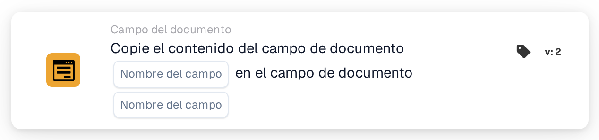

# Copiar campo del documento en campo del documento

<figure><figcaption>
Versión 2
</figcaption></figure>

## Propósito:

Esta tarjeta de flujo de trabajo copia el contenido de un campo del documento en otro campo del mismo documento. Puede utilizarse, por ejemplo, para rellenar un campo necesario para una exportación o para una tarjeta posterior con un valor que ya se extrajo en otro campo.

## Componentes de la tarjeta:

1. **Nombre del campo** (primero)
   * **Descripción:** El campo del documento cuyo contenido se copia.
   * **Detalle:** El nombre de un campo del documento. El nombre se compara de forma exacta, distinguiendo entre mayúsculas y minúsculas. El campo en sí no se modifica.
2. **Nombre del campo** (segundo)
   * **Descripción:** El campo del documento en el que se copia el contenido.
   * **Detalle:** El nombre de un campo del documento. Su contenido actual se sustituye por el contenido copiado.

## Funcionalidad:

* **Lectura del valor:** La tarjeta busca el primer campo entre los campos del documento y lee su valor. El valor encontrado se anota en el registro del flujo de trabajo.
* **Ejecución de la acción:** El valor se escribe en el segundo campo y el documento se guarda. El valor copiado se adopta tal cual, sin conversión. Si el segundo campo todavía no existe en el documento, se añade. Tras una copia correcta, las tarjetas posteriores del flujo de trabajo trabajan con el nuevo valor.
* **Datos que faltan:**
  * Si uno de los dos nombres de campo no está definido en la tarjeta, la tarjeta no se ejecuta y registra los datos que faltan en el registro del flujo de trabajo.
  * Si el documento no tiene ningún campo con el primer nombre, no se copia nada y la tarjeta indica que el campo no se ha encontrado en el documento.
* **Errores:** Si el documento no puede guardarse, por ejemplo porque su estado actual no permite cambios, la tarjeta termina con un error y el segundo campo conserva su contenido anterior.

## Configuración:

* La tarjeta se puede añadir desde la categoría **Campo del documento**. A continuación se define el campo de origen en la primera posición **Nombre del campo** y el campo de destino en la segunda.
* Como el valor se copia sin conversión, los dos campos deberían contener el mismo tipo de datos, por ejemplo texto en texto o una fecha en una fecha.

## Conclusión:

La tarjeta de flujo de trabajo «Copy Document Field into Document Field» transfiere valores entre campos sin trabajo manual. Mantiene coherentes los campos relacionados y permite que los pasos posteriores de un flujo de trabajo utilicen un valor con el nombre de campo que esperan.
