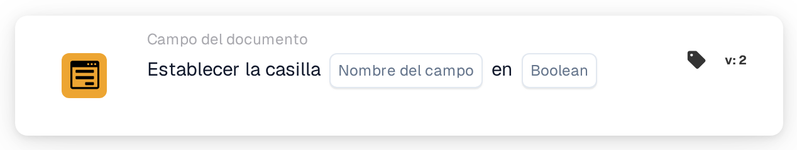

# Establezca la casilla de verificación en

<figure><figcaption>
Versión 2
</figcaption></figure>

## **Propósito:**

Esta tarjeta de flujo de trabajo está diseñada para establecer un campo de casilla de verificación a un valor especificado (true o false) según las condiciones definidas en las secciones **"Cuando"** y **"Y"**. Proporciona una forma sencilla pero eficaz de automatizar las actualizaciones de las casillas de verificación cuando se cumplen ciertos criterios, garantizando un procesamiento de documentos ágil.

## **Componentes de la tarjeta:**

1. **Nombre de campo:**
   * **Descripción**: Especifica el campo donde se establecerá la casilla de verificación.
   * **Detalle**: El campo de casilla de verificación que se actualizará se identifica por el nombre del campo.
2. **booleano**
   * **Descripción**: Define el valor al que se establecerá el campo de casilla de verificación cuando las condiciones de las secciones **donde** y **Y** sean ambas verdaderas.
   * **Opciones**:
     * **True**: La casilla se establecerá en **true** si se cumplen las condiciones.
     * **False**: La casilla se establecerá en **false** si se cumplen las condiciones.

## **Funcionalidad:**

* **Evaluación de la condición**: El sistema evalúa las condiciones de las secciones **"Cuando"** y **"Y"**.
* **Ejecución de la acción**: Si las secciones **"Cuando"** y **"Y"** se evalúan como verdaderas, el campo de casilla de verificación se actualizará al valor especificado (true o false). Si cualquiera de las condiciones es falsa, no se realiza ninguna acción y la casilla permanece como estaba.

## **Configuración:**

Para configurar esta tarjeta, los usuarios deben:

1. **Especificar el campo de casilla de verificación de destino** que se establecerá en true o false cuando se cumplan las condiciones.
2. **Elegir el valor (verdadero o falso)** al que se establecerá la casilla tras la evaluación de la condición.
3. La tarjeta solo ejecuta su acción si ambas condiciones de las secciones **"Cuando"** y **"Y"** se evalúan como verdaderas.

## **Conclusión:**

La tarjeta de flujo de trabajo **"Set Checkbox"** es una herramienta de automatización sencilla y eficaz para actualizar los campos de casilla de verificación según condiciones específicas. Al garantizar que se cumplan las secciones **"Cuando"** y **"Y"**, permite a los usuarios automatizar procesos y reducir la intervención manual, garantizando un procesamiento de documentos más fluido y eficiente.

<!-- workflow-card-practical-example-20261021 -->

## Ejemplo práctico

**Cuándo usar:** Marque una validación exitosa con un indicador explícito.

**Configuración:** Seleccione el campo de casilla de verificación `review_complete` y configúrelo en `true`.

**Resultado esperado y contraejemplo:** El campo queda marcado. Ejecute la acción con `false` en una prueba separada cuando necesite borrar la bandera.

Esta es una configuración ilustrativa y un resultado esperado. Utilice campos, usuarios y grupos configurados en su organización de prueba; no es una afirmación de que este ejemplo haya sido ejecutado.
