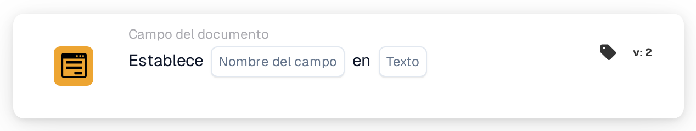

# Establecer en

<figure><figcaption>
Versión 2
</figcaption></figure>

## **Propósito:**

Esta tarjeta de flujo de trabajo está diseñada para establecer automáticamente un campo especificado del documento a un valor de texto predefinido según las condiciones definidas en las secciones **"Cuando"** y **"Y"**. Permite a los usuarios agilizar la entrada de datos garantizando que los campos se completen con valores coherentes cuando se cumplen ciertos criterios.

## **Componentes de la tarjeta:**

1. **Nombre de campo**
   * **Descripción**: Especifica el campo que se actualizará con el valor de texto.
   * **Detalle**: El campo seleccionado se actualizará con el valor de texto especificado si se cumplen las condiciones de las secciones **"Cuando"** y **"Y"**.
2. **Texto**
   * **Descripción**: Define el valor de texto que se establecerá en el campo de destino cuando las condiciones se evalúen como verdaderas.
   * **Detalle**: Puede ser un mensaje personalizado, un estado o un valor predefinido que el usuario desee escribir en el campo. El texto debe ajustarse al formato de entrada esperado del campo (p. ej., alfanumérico, fecha u otros tipos de información textual).

## **Funcionalidad:**

* **Evaluación de la condición**: El sistema evalúa las condiciones de las secciones **"Cuando"** y **"Y"**:
  * Si **ambas condiciones son verdaderas**, se ejecutarán las acciones definidas en la **sección "Then"**. En concreto, el campo de destino (Field Name) se completará con el texto especificado.
  * Si **la sección "Where" o la "And" es falsa**, no se realiza ninguna acción y el campo permanece sin cambios. Las acciones de la **sección "Then"** se omiten por completo si cualquiera de las condiciones es falsa.
* **Ejecución de la acción**: Si se cumplen ambas condiciones de las secciones **"Cuando"** y **"Y"**, el sistema completa automáticamente el campo especificado con el valor de texto elegido. Si no se cumplen las condiciones, no se realiza ningún cambio en el campo.

## **Configuración:**

Para configurar esta tarjeta:

1. **Seleccione el campo** (Field Name) que se actualizará con el valor de texto. Los campos disponibles en el documento se enumeran para su selección.
2. **Especifique el valor de texto** que se escribirá en el campo de destino cuando las condiciones sean verdaderas.
3. La acción solo se ejecutará si las condiciones de las secciones **"Cuando"** y **"Y"** se evalúan como verdaderas.

## **Conclusión:**

La tarjeta de flujo de trabajo **"Establecer campo en texto"** ofrece una forma sencilla de automatizar la introducción de valores de texto en campos de documento específicos según condiciones predefinidas. Esto reduce la entrada manual de datos y garantiza la coherencia en el procesamiento de documentos, lo que la convierte en una herramienta útil para automatizar flujos de trabajo y mejorar la eficiencia.

<!-- workflow-card-practical-example-20261021 -->

## Ejemplo práctico

**Cuándo usarlo:** Escriba el resultado de una ruta en un campo del documento.

**Configuración:** Seleccione el campo de texto `routing_result` y establezca el texto en `manual review`.

**Resultado esperado y contraejemplo:** El campo contiene exactamente `manual review`. Una condición igual posterior puede utilizar ese valor; es un campo de documento en lugar de una variable de organización.

Esta es una configuración ilustrativa y un resultado esperado. Utilice campos, usuarios y grupos configurados en su organización de prueba; no es una afirmación de que este ejemplo haya sido ejecutado.
