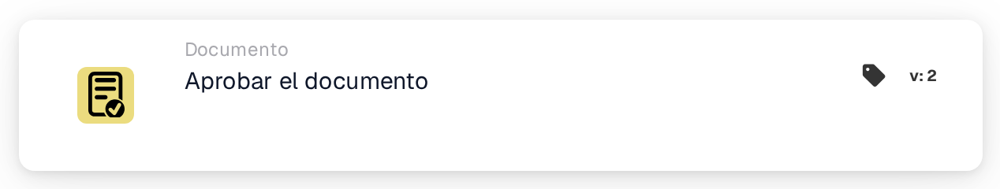

# Aprobar el documento

<figure><figcaption>
Versión 1
</figcaption></figure>

<figure><figcaption>
Versión 2
</figcaption></figure>

## **Propósito:**

La tarjeta de flujo de trabajo **"Aprobar el documento"** se utiliza para marcar un documento como aprobado. Permite que el documento avance a la siguiente etapa del flujo de trabajo, posibilitando la ejecución de flujos de trabajo de procesamiento o aprobación automatizados. Esta tarjeta ayuda a agilizar los procesos de gestión de documentos, garantizando que solo los documentos aprobados avancen para acciones adicionales.

## **Componentes de la tarjeta:**

1. **Estado de aprobación**
   * **Descripción**: Este componente marca el documento como aprobado.
   * **Detalle**: Cuando se dispara esta tarjeta, el estado de aprobación del documento se actualiza para indicar la aprobación. Esta acción se puede establecer según las condiciones definidas en las secciones **"Cuando"** y **"Y"**.

## **Funcionalidad:**

* **Evaluación de la condición**: El sistema evalúa las condiciones establecidas en las secciones **"Cuando"** y **"Y"**.
  * Si **ambas condiciones son verdaderas**, el documento se marcará como aprobado.
  * Si **cualquiera de las condiciones es falsa**, la tarjeta no se ejecutará y el estado de aprobación del documento permanecerá sin cambios.
* **Ejecución de la acción**: Cuando se cumplen las condiciones, el documento se aprueba. Este cambio se refleja en el estado del documento, permitiéndole continuar avanzando en el flujo de trabajo.

## **Conclusión:**

La tarjeta de flujo de trabajo **"Aprobar el documento"** es un componente clave para automatizar la aprobación de documentos en los flujos de trabajo de negocio. Al garantizar que solo se aprueben los documentos que cumplen criterios específicos, ayuda a mantener la coherencia, reduce la supervisión manual y posibilita un procesamiento de documentos más fluido.

<!-- workflow-card-practical-example-20261021 -->

## Ejemplo práctico

**Cuándo utilizar:** Aprobar un documento después de que hayan pasado todas las condiciones de revisión requeridas.

**Configuración:** Coloque esta acción después de las condiciones de revisión en la rama exitosa. Utilice un documento de demostración en espera de aprobación.

**Resultado esperado y contraejemplo:** La acción aprueba ese documento. Un documento que no cumpla una condición anterior nunca llega a esta acción; la aprobación por sí sola no es prueba de una exportación de ERP completa.

Esta es una configuración ilustrativa y un resultado esperado. Utilice campos, usuarios y grupos configurados en su organización de prueba; no es una afirmación de que este ejemplo haya sido ejecutado.
