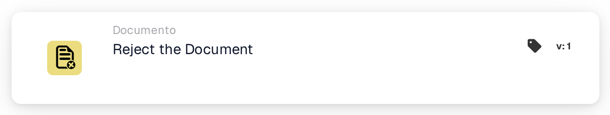
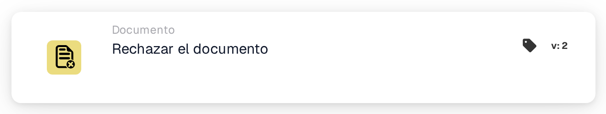

# Rechazar el documento

<figure><figcaption>
Versión 1
</figcaption></figure>

<figure><figcaption>
Versión 2
</figcaption></figure>

## **Propósito:**

La tarjeta de flujo de trabajo **"Rechazar el documento"** se utiliza para marcar un documento como rechazado dentro de un flujo de trabajo. Esta acción detiene el avance del documento y le impide pasar a la siguiente etapa del flujo de trabajo. Garantiza que los documentos que no cumplen las condiciones o los criterios necesarios se señalen y se impida su procesamiento adicional.

## **Componentes de la tarjeta:**

1. **Estado de rechazo**
   * **Descripción**: Este componente marca el documento como rechazado, indicando que no cumplió las condiciones requeridas para la aprobación.
   * **Detalle**: Cuando se dispara, esta tarjeta actualiza el estado del documento a "rejected". Esta decisión se toma según las condiciones establecidas en las secciones **"Cuando"** y **"Y"**.

## **Funcionalidad:**

* **Evaluación de la condición**: El sistema evalúa las condiciones establecidas en las secciones **"Cuando"** y **"Y"**.
  * Si **ambas condiciones son verdaderas**, el documento se rechazará.
  * Si **cualquiera de las condiciones es falsa**, la tarjeta no se ejecutará y el estado del documento permanecerá sin cambios.
* **Ejecución de la acción**: Cuando se cumplen las condiciones, el documento se marca como rechazado. Esta acción garantiza que solo avancen los documentos que cumplen criterios específicos, mientras que los demás se señalan y se detienen para su revisión o corrección.

## **Conclusión:**

La tarjeta de flujo de trabajo **"Rechazar el documento"** es una herramienta esencial para controlar el flujo de documentos en los procesos automatizados. Al permitir el rechazo de documentos no conformes, garantiza que solo los documentos válidos y precisos continúen por el flujo de trabajo, mejorando la eficiencia y la precisión en la gestión de documentos.

<!-- workflow-card-practical-example-20261021 -->

## Ejemplo práctico

**Cuándo utilizar:** Rechazar un documento que cumpla con una regla de rechazo definida.

**Configuración:** Dirija un documento de demostración deliberadamente no válido a esta acción, por ejemplo, después de una decisión de rechazo explícita.

**Resultado esperado y contraejemplo:** Se rechaza el documento. Un documento válido debe seguir una rama diferente y no debe ejecutar esta acción.

Esta es una configuración ilustrativa y un resultado esperado. Utilice campos, usuarios y grupos configurados en su organización de prueba; no es una afirmación de que este ejemplo haya sido ejecutado.
