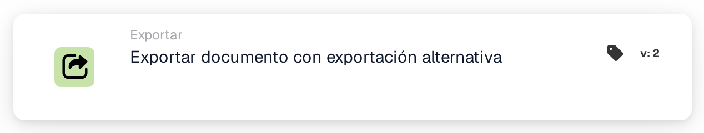

# Exportar con exportación alternativa

<figure><figcaption>
Versión 2
</figcaption></figure>

## Cuando usar esta tarjeta

Utilice esta acción Luego para la exportación alternativa configurada en el tipo de documento actual. Configure y valide esa ruta antes de agregar la acción.

## La configuración proviene del tipo de documento.

La tarjeta no tiene selector de configuración de exportación. Lee si la exportación alternativa está habilitada, la configuración de exportación alternativa y el estado después de la exportación desde la configuración del tipo de documento. Internamente estos son `DOC_ALTERNATE_EXPORT_SETTING`, `DOC_ALTERNATE_EXPORT_EXPORT_CONFIG` y `DOC_ALTERNATE_EXPORT_STATUS`.

Una exportación alternativa explícitamente deshabilitada produce una condición fallida. Los datos de activación faltantes, la configuración o el estado de los resultados se informan en lugar de sustituir silenciosamente la ruta predeterminada. La solicitud de exportación comprueba las tareas pendientes.

## Verificar el resultado

Inspeccione el registro de la tarjeta, el historial de exportaciones, el estado del documento y el destino de prueba autorizado. Una solicitud, un tiempo de espera o un cambio de estado por sí solos no establecen que los datos hayan llegado al destino. Verifique el historial de exportaciones antes de volver a intentar una operación que podría crear duplicados.

<!-- workflow-card-complete-example-20261021 action_alternate_export -->

### Ejemplo de exportación alternativo

**Configuración:** Prepare el tipo de documento sintético `DEMO_INVOICE` con la exportación alternativa habilitada, una configuración de exportación de prueba autorizada y el estado del resultado deseado en su configuración de tipo de documento. Agregue esta acción Luego después de las comprobaciones requeridas. Esta tarjeta lee esas configuraciones; no ofrece un selector de configuración de exportación.

**Resultado esperado y contraejemplo:** La acción solicita la exportación a través de esa configuración alternativa y verifica las tareas pendientes. Verifique el resultado de la exportación y el destino de la prueba por separado. La desactivación de la exportación alternativa provoca una condición fallida; una configuración o configuración de activación ausente no es una exportación exitosa. No ejecute este ejemplo en un destino de contabilidad.

Esta es una configuración de prueba ilustrativa y el resultado esperado; no fue ejecutado. Utilice datos y destinatarios configurados en su organización de prueba.
