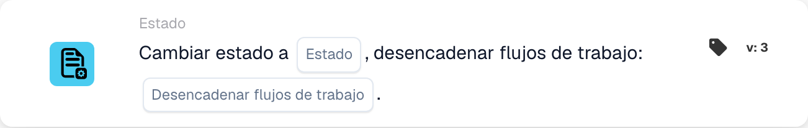

# Cambiar estado a

<figure><figcaption>
Campos de la tarjeta en la versión mostrada. Los campos aún no están configurados.
</figcaption></figure>

## **Propósito:**

La tarjeta de flujo de trabajo **"Change Status"** se utiliza para cambiar el estado de un documento a uno de los estados predefinidos —**Error, Rechazado, Listo para Validación, Pendiente de Aprobación, Pendiente de Segunda Aprobación**— y, opcionalmente, disparar flujos de trabajo asociados según el cambio de estado. Esta tarjeta automatiza el proceso de actualización de estados y disparadores de flujo de trabajo, garantizando una gestión eficiente de documentos y un manejo de errores.

## **Componentes de la tarjeta:**

1. **Estado**
   * **Descripción**: Especifica el nuevo estado que se aplicará al documento.
   * **Opciones**:
     * **Error**: Marca el documento como que ha encontrado un error.
     * **Rechazado**: Indica que el documento ha sido rechazado y no continuará.
     * **Listo para la validación**: Establece el documento para que sea revisado y validado por el siguiente usuario o proceso del sistema.
     * **Pendiente de aprobación**: Coloca el documento en estado pendiente de aprobación.
     * **Pendiente de segunda aprobación**: Pone el documento en espera de un segundo nivel de aprobación si procede.
2. **Activar flujos de trabajo**
   * **Descripción**: Determina si deben dispararse flujos de trabajo posteriores tras el cambio de estado.
   * **Opciones**:
     * **True**: Inicia los flujos de trabajo pertinentes según el cambio de estado.
     * **False**: Impide la ejecución de flujos de trabajo tras el cambio de estado.

## **Funcionalidad:**

* **Evaluación de la condición**: El sistema evalúa las condiciones establecidas en las secciones **"Donde"** y **"Y"**. Si estas condiciones son verdaderas, la tarjeta continúa para cambiar el estado del documento al valor seleccionado.
* **Actualización del estado**: Una vez que se cumplen las condiciones, el estado del documento se actualiza a una de las opciones predefinidas (Error, Rejected, Ready for Validation, Pending Approval, Pending Second Approval), según la selección del usuario.
* **Acción de disparar el flujo de trabajo**: Si **Activar flujos de trabajo** se establece en **True**, el sistema inicia automáticamente cualquier flujo de trabajo asociado tras la actualización del estado. Si se establece en **False**, no se disparan flujos de trabajo adicionales y el proceso finaliza con el cambio de estado.

## **Configuración:**

Para configurar esta tarjeta, los usuarios deben:

1. Especificar el **Estado** deseado al que se establecerá el documento tras la evaluación de la condición (Error, Rejected, Ready for Validation, Pending Approval o Pending Second Approval).
2. Elegir si **Activar flujos de trabajo** tras el cambio de estado seleccionando **True** o **False**.
3. La tarjeta solo ejecuta su acción si ambas condiciones de las secciones **"Donde"** y **"Y"** se evalúan como verdaderas.

## **Conclusión:**

La tarjeta de flujo de trabajo **"Change Status"** ofrece un enfoque ágil para gestionar los estados de los documentos y disparar flujos de trabajo relacionados. Garantiza que los documentos se enruten automáticamente al estado correcto y que se tomen las acciones necesarias, según el cambio de estado. Al establecer condiciones claras para la ejecución, reduce el esfuerzo manual y mejora la eficiencia del flujo de trabajo.
