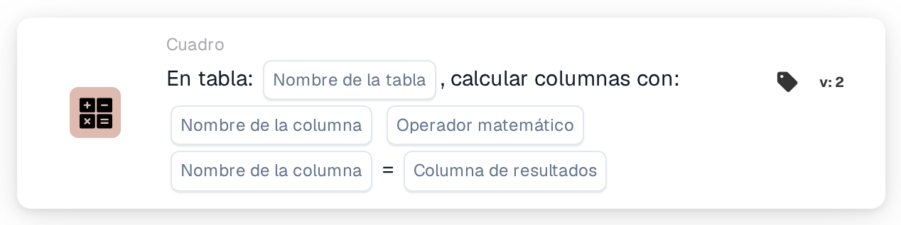

# Calcular columnas con

<figure><figcaption>
Versión 1
</figcaption></figure>

<figure><figcaption>
Versión 2
</figcaption></figure>

## Propósito:

Esta tarjeta de flujo de trabajo calcula, fila por fila, un valor a partir de dos columnas de una tabla del documento y guarda el resultado en una columna de resultado. Se puede utilizar, por ejemplo, para calcular los totales de línea a partir de la cantidad y el precio unitario.

## Vídeo de administración:



[Reproducir el vídeo con subtítulos en español](https://docbits-videos.fra1.cdn.digitaloceanspaces.com/settings-assistant/workflow-card-calc-columns-admin/v1/es.html) · [Leer la transcripción](https://docbits-videos.fra1.cdn.digitaloceanspaces.com/settings-assistant/workflow-card-calc-columns-admin/v1/es.txt)

## Componentes de la tarjeta:

1. **Tabla**
   * **Descripción:** La tabla del documento en la que se realiza el cálculo.
2. **Primera columna**
   * **Descripción:** La columna con el primer valor de cada fila.
3. **Operación**
   * **Opciones:**
     * **+** suma el segundo valor al primero.
     * **-** resta el segundo valor del primero.
     * **\*** multiplica los dos valores.
     * **/** divide el primer valor entre el segundo.
4. **Segunda columna**
   * **Descripción:** La columna con el segundo valor de cada fila.
5. **Columna de resultado**
   * **Descripción:** La columna en la que se guarda el resultado de cada fila.
   * **Detalle:** El nombre se guarda en mayúsculas y los espacios se sustituyen por guiones bajos (`total amount` pasa a ser `TOTAL_AMOUNT`). Si la columna todavía no existe, la tarjeta la añade; si existe, sus valores se sustituyen.

Las versiones 1 y 2 de la tarjeta tienen los mismos ajustes y funcionan de la misma manera.

## Funcionalidad:

* **Cálculo:** Para cada fila de la tabla, la tarjeta lee las dos columnas (las mayúsculas y minúsculas de los nombres de columna no importan), aplica la operación y escribe el resultado en la columna de resultado. Los resultados se redondean a cuatro decimales. A continuación, el documento se guarda con los nuevos valores.
  * Un valor vacío o que falta cuenta como `0`. Si los dos valores de una fila están vacíos, el resultado de esa fila queda vacío.
  * Una división entre cero deja vacío el resultado de esa fila.
  * Con **+**, dos valores que no son números se unen con un espacio en lugar de sumarse. Con las demás operaciones, un valor que no es un número provoca un error y no se guarda ningún resultado.
* **Ejecución de la acción:** Si el cálculo y el guardado se realizan correctamente, el flujo de trabajo continúa con las siguientes tarjetas. Si la tabla no existe en el documento, si no se puede calcular un valor o si no se puede guardar el documento, la tarjeta informa de un error en el registro del flujo de trabajo.
* **Tarjeta de prueba:** Cuando la tarjeta se ejecuta con **Tarjeta de prueba**, el cálculo solo se simula y el documento no se modifica.

## Configuración:

* La tarjeta se puede añadir como acción Then desde la categoría **Cuadro**. A continuación se seleccionan la tabla, las dos columnas, la operación y la columna de resultado.
* **Ejemplo:** Tabla `INVOICE_TABLE`, `QUANTITY` **\*** `UNIT_PRICE`, columna de resultado `TOTAL_AMOUNT`. Una fila con cantidad 2 y precio unitario 10 obtiene 20; una fila con 3 y 4 obtiene 12.
* Como un valor vacío cuenta como `0`, un precio que falta da un resultado de `0`. Comprobar que las columnas de entrada estén rellenas, por ejemplo con una condición antes de esta tarjeta, puede ayudar a evitar totales incorrectos.
* En la resta y la división, el orden de las dos columnas es importante.

## Conclusión:

La tarjeta de flujo de trabajo «Calculate Columns with» añade automáticamente valores calculados a las filas de la tabla. Los totales de línea y valores similares están disponibles para las tarjetas siguientes y para la exportación sin cálculo manual.
