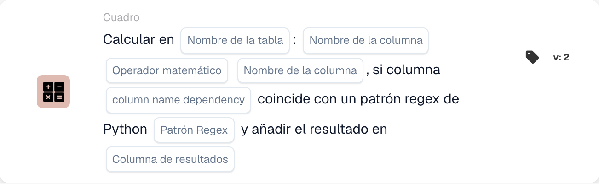

# Calcular en

<figure><figcaption>
Campos de la tarjeta en la versión mostrada. Los campos aún no están configurados. Algunas etiquetas de esta versión de la tarjeta todavía tienen una traducción incompleta o incorrecta en la interfaz. Las explicaciones de esta página utilizan los términos correctos.
</figcaption></figure>

## **Propósito:**

La tarjeta de flujo de trabajo **"Calcular con dependencia de expresiones regulares"** permite a los usuarios realizar cálculos entre columnas de una tabla seleccionada, con una condición añadida basada en un patrón de expresión regular (regex) aplicado a una columna de dependencia. Si el patrón coincide, se realiza el cálculo y el resultado se almacena en la columna de resultado especificada.

## **Componentes de la tarjeta:**

1. **Nombre de la tabla**
   * **Descripción:** Especifica la **tabla** en la que se calcularán las columnas.
   * **Detalle:** Se proporciona una lista desplegable de todas las **tablas** disponibles para su selección.
2. **Column Name (1ª columna)**
   * **Descripción:** Especifica la **primera columna** que participa en el cálculo.
   * **Detalle:** Se proporciona una lista de todas las **columnas** disponibles para su selección.
3. **Operación**
   * **Descripción:** Define la operación matemática que se aplicará entre las columnas seleccionadas.
   * **Opciones:**
     * **Add (+):** Suma el valor de la segunda columna al valor de la primera columna.
     * **Restar (-):** Resta el valor de la segunda columna del de la primera columna.
     * **Multiply (\*):** Multiplica el valor de la primera columna por el valor de la segunda columna.
     * **Dividir (/):** Divide el valor de la primera columna por el de la segunda columna.
4. **Column Name (2ª columna)**
   * **Descripción:** Especifica la **segunda columna** que participa en el cálculo.
   * **Detalle:** Se proporciona una lista de todas las **columnas** disponibles para su selección.
5. **Nombre de columna (Dependencia)**
   * **Descripción:** Especifica la **columna de dependencia** a la que se aplicará el patrón regex.
   * **Detalle:** Se proporciona una lista de todas las **columnas** disponibles para la coincidencia de patrones.
6. **Patrón de expresiones regulares**
   * **Descripción:** Define el **patrón regex** que se utilizará para comparar con la columna de dependencia.
   * **Detalle:** Si el valor de la columna de dependencia coincide con el patrón regex, se realizará el cálculo.
7. **Columna de resultados**
   * **Descripción:** Especifica la **columna de resultado** donde se almacenará el resultado del cálculo.
   * **Detalle:** Puede ser una columna nueva o existente donde se almacenará el valor calculado.

## **Funcionalidad:**

* **Evaluación de la condición:**
  * La tarjeta solo ejecuta su acción si las secciones **"Cuando"** y **"Y"** se evalúan como verdaderas.
  * La tarjeta solo ejecuta su acción si el valor de la columna de dependencia coincide con el **patrón regex** proporcionado.
* **Cálculo de columnas:**\
  Si el patrón regex coincide, la tarjeta realiza la operación matemática seleccionada entre las dos columnas elegidas.
* **Almacenamiento del resultado:**\
  El resultado del cálculo se almacena en la **columna de resultado** seleccionada.

## **Configuración:**

* **Seleccionar la Table:**\
  Elija la **tabla** donde se calcularán las columnas.
* **Elegir las columnas:**\
  Seleccione la **primera columna** y la **segunda columna** que se usarán en el cálculo.
* **Seleccionar la Operation:**\
  Elija la operación matemática (**Add (+)**, **Restar (-)**, **Multiply (\*)**, **Divide (/)**) que se aplicará entre las columnas.
* **Seleccionar la columna de dependencia:**\
  Elija la **columna de dependencia** donde se aplicará el patrón regex.
* **Definir el Regex Pattern:**\
  Introduzca el **patrón regex** con el que debe coincidir la columna de dependencia.
* **Seleccionar la Result Column:**\
  Elija la **columna de resultado** donde se almacenará el valor calculado.

## **Conclusión:**

La tarjeta de flujo de trabajo **"Calcular con dependencia de expresiones regulares"** proporciona una forma potente de realizar cálculos con lógica condicional basada en un patrón regex. Esto garantiza que solo las filas en las que la columna de dependencia coincide con el patrón especificado se sometan al cálculo indicado, y el resultado se almacena en la columna de resultado elegida.

<!-- workflow-card-practical-example-20261021 -->

## Ejemplo práctico

**Cuándo usarlo:** Calcula solo las filas de la tabla seleccionadas.

**Configuración:** Utilice la tabla de demostración `lines` con columnas numéricas `quantity` y `unit_price`. Seleccione filas coincidentes a través de la columna de dependencia y la expresión regular, multiplique las columnas numéricas y escriba en `line_total`.

**Resultado esperado y contraejemplo:** Una fila seleccionada con `2` y `10` recibe `20`. Una fila que no coincida se debe verificar por separado para confirmar que no fue seleccionada para el cálculo.

Esta es una configuración ilustrativa y un resultado esperado. Utilice campos, usuarios y grupos configurados en su organización de prueba; no es una afirmación de que este ejemplo haya sido ejecutado.
