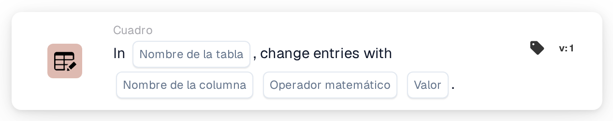
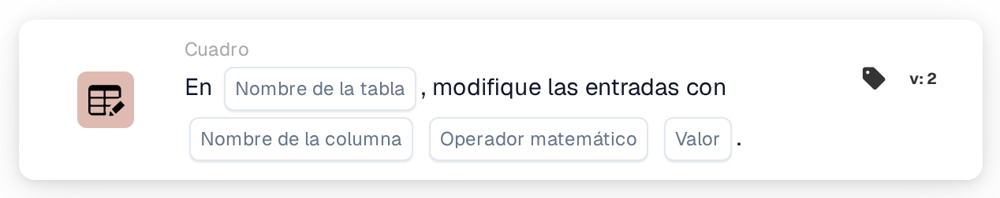

# Cambiar entradas con

<figure><figcaption>
Versión 1
</figcaption></figure>

<figure><figcaption>
Versión 2
</figcaption></figure>

## **Propósito:**

La tarjeta de flujo de trabajo **"Change Entries in Table"** se utiliza para actualizar las entradas de una tabla de base de datos especificada. Le permite seleccionar una **tabla** y una **columna**, y a continuación realizar operaciones matemáticas (suma, resta, multiplicación o división) sobre los valores de esa columna, usando un valor especificado.

## **Componentes de la tarjeta:**

1. **Nombre de la tabla**
   * **Descripción:** Especifica la **tabla** en la que se actualizarán las entradas.
   * **Detalle:** Se proporciona una lista desplegable de **tablas** disponibles, lo que le permite seleccionar la tabla de destino para actualizar las entradas.
2. **Nombre de columna**
   * **Descripción:** Especifica la **columna** dentro de la tabla seleccionada que se actualizará.
   * **Detalle:** Se proporcionará una lista de todas las **columnas** disponibles para su selección.
3. **Operación**
   * **Descripción:** Define la operación matemática que se realizará sobre los valores de la **columna**.
   * **Opciones:**
     * **Add (+):** Suma un **valor** especificado al valor actual de la columna seleccionada.
     * **Restar (-):** Resta un **valor** especificado del valor actual de la columna seleccionada.
     * **Multiply (\*):** Multiplica el valor actual de la columna seleccionada por un **valor** especificado.
     * **Dividir (/):** Divide el valor actual de la columna seleccionada por un **valor** especificado.
4. **Valor**
   * **Descripción:** Especifica el **valor** que se utilizará en la operación seleccionada.
   * **Detalle:** Es el número que se sumará, restará, multiplicará o dividirá con las entradas de la columna seleccionada.

## **Funcionalidad:**

* **Evaluación de la condición:**\
  La tarjeta solo ejecuta su acción si las secciones **"Cuando"** y **"Y"** se evalúan como verdaderas.
* **Actualización de las entradas de la tabla:**\
  La tarjeta realiza la operación seleccionada (**+**, **-**, **\*** o **/**) sobre los valores de la **columna** elegida de la **tabla** seleccionada, usando el **valor** especificado.

## **Configuración:**

* **Seleccionar la Table:**\
  Elija la **tabla** donde se aplicarán los cambios.
* **Elegir la columna:**\
  Seleccione la **columna** de la tabla que desea actualizar.
* **Seleccionar la Operation:**\
  Elija la operación matemática (**+**, **-**, **\***, **/**) que se aplicará a los valores de la columna seleccionada.
* **Introducir el Value:**\
  Proporcione el **valor** que se utilizará en la operación seleccionada.

## **Conclusión:**

La tarjeta de flujo de trabajo **"Change Entries in Table"** posibilita actualizaciones automatizadas de las entradas de la base de datos seleccionando una **tabla**, una **columna** y la **operación matemática** deseada. Esta tarjeta es esencial para realizar modificaciones masivas de datos o cálculos dentro de su base de datos.

<!-- workflow-card-practical-example-20261021 -->

## Ejemplo práctico

**Cuándo usarlo:** Aplicar un ajuste numérico a una columna de tabla existente.

**Configuración:** Seleccione la tabla de demostración `lines`, columna numérica `quantity`, suma y valor `1`.

**Resultado esperado y contraejemplo:** Una cantidad existente de `2` se convierte en `3`. Repetir esta acción produce `4`, así que úselo solo cuando pretenda realizar sumas repetidas.

Esta es una configuración ilustrativa y un resultado esperado. Utilice campos, usuarios y grupos configurados en su organización de prueba; no es una afirmación de que este ejemplo haya sido ejecutado.
