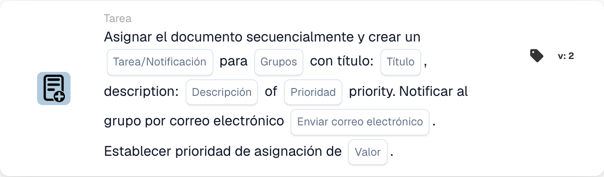

# Asignar documento y crear tarea/notificación para grupo

<figure><figcaption>
Campos de la tarjeta en la versión mostrada. Los campos aún no están configurados.
</figcaption></figure>

## **Propósito**

La tarjeta de flujo de trabajo "**Asignar documento y crear tarea/notificación para grupo**" asigna un documento a un grupo especificado, crea una tarea o notificación con detalles personalizables y, opcionalmente, envía una notificación por correo electrónico al grupo. Esta tarjeta también admite la asignación de un valor de prioridad numérico para determinar el orden de ejecución.

## **Componentes de la tarjeta**

1. **Nombre del grupo**
   * **Descripción:** Especifica el grupo que recibirá la tarea o notificación.
   * **Detalle:** Un desplegable para elegir el nombre del grupo al que se asignarán el documento y la tarea/notificación.
2. **Tarea/Notificación**
   * **Descripción:** Especifica el tipo de acción que se creará para el grupo.
   * **Detalle:** Un desplegable para seleccionar "Task" o "Notification" según la acción deseada.
3. **Título**
   * **Descripción:** Proporciona el título de la tarea o notificación.
   * **Detalle:** Un campo para añadir un título conciso y descriptivo para la tarea o notificación.
4. **Descripción**
   * **Descripción:** Describe con más detalle la tarea o notificación.
   * **Detalle:** Un campo para proporcionar detalles adicionales sobre el propósito de la tarea o el contenido de la notificación.
5. **Prioridad**
   * **Descripción:** Define el nivel de urgencia de la tarea o notificación.
   * **Opciones:**
     * **High:** Requiere atención inmediata.
     * **Medio:** Importante pero no urgente.
     * **Low:** Puede abordarse más adelante.
6. **Enviar correo**
   * **Descripción:** Configura si se envía una notificación por correo electrónico al grupo.
   * **Opciones:**
     * **True:** Envía una notificación por correo electrónico.
     * **False:** No envía ningún correo electrónico.
7. **Valor**
   * **Descripción:** Establece la prioridad numérica para la asignación del documento.
   * **Detalle:** Un campo para introducir un valor numérico, donde un número más bajo indica una mayor prioridad.

## **Funcionalidad**

* **Evaluación de la condición:**\
  La tarjeta ejecuta sus acciones solo si se cumplen las condiciones del flujo de trabajo configuradas.
* **Asignación del documento y creación de tarea/notificación:**\
  El documento se asigna al grupo especificado en el campo "Group Name". Se crea una tarea o notificación con el título, la descripción y el nivel de prioridad configurados.
* **Notificación por correo electrónico:**\
  Si "Send Mail" se establece en True, se envía una notificación por correo electrónico al grupo para informarle sobre la tarea o notificación.

## **Configuración**

1. **Definir el nombre del grupo:**
   * Introduzca el nombre del grupo en el campo Group Name.
2. **Seleccionar Tarea/Notificación:**
   * Elija "Tarea" o "Notificación" en el menú desplegable Tarea/Notificación.
3. **Establecer los detalles de la tarea/notificación:**
   * Introduzca el Title y la Description de la tarea o notificación.
   * Seleccione la Prioridad en el desplegable (Alta, Media o Baja).
4. **Habilitar la notificación por correo electrónico:**
   * Configure la opción Send Mail en True o False, según si debe enviarse una notificación por correo electrónico.
5. **Asignar la prioridad numérica:**
   * Introduzca un valor numérico en el campo Value para determinar la prioridad de la asignación, donde los valores más bajos tienen preferencia.
6. Guarde la configuración de la tarjeta y active el flujo de trabajo.

## **Conclusión**

La tarjeta de flujo de trabajo "Assign Document and Create Task/Notification for Group" garantiza que los documentos se asignen al grupo adecuado a la vez que crea tareas o notificaciones con opciones personalizables de prioridad y notificación por correo electrónico. Esto agiliza la gestión de documentos y mejora la eficiencia del flujo de trabajo.
