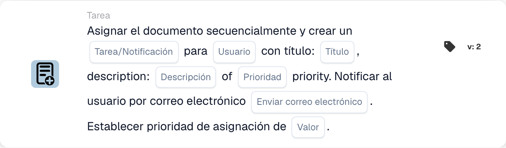

# Asignar documento y crear tarea/notificación para usuario

<figure><figcaption>
Campos de la tarjeta en la versión mostrada. Los campos aún no están configurados.
</figcaption></figure>

## **Propósito**

La tarjeta de flujo de trabajo "**Asignar documento y crear tarea/notificación para usuario**" asigna un documento a un usuario especificado, crea una tarea o notificación con detalles configurables y, opcionalmente, envía una notificación por correo electrónico al usuario. Esta tarjeta también posibilita establecer un valor de prioridad numérico para determinar el orden de ejecución.

## **Componentes de la tarjeta**

1. **Usuario**
   * **Descripción:** Especifica el usuario que recibirá la tarea o notificación.
   * **Detalle:** Un menú desplegable para seleccionar el usuario al que se asignarán el documento y la tarea/notificación.
2. **Tarea/Notificación**
   * **Descripción:** Especifica el tipo de acción que se creará para el usuario.
   * **Detalle:** Un desplegable para elegir "Task" o "Notification" según la acción prevista.
3. **Título**
   * **Descripción:** El título de la tarea o notificación.
   * **Detalle:** Un campo para proporcionar un título conciso y descriptivo para la tarea o notificación.
4. **Descripción**
   * **Descripción:** Detalles adicionales sobre la tarea o notificación.
   * **Detalle:** Un campo para describir el propósito de la tarea o proporcionar contexto para la notificación.
5. **Prioridad**
   * **Descripción:** Define el nivel de urgencia de la tarea o notificación.
   * **Opciones:**
     * **High:** Requiere atención inmediata.
     * **Medio:** Importante pero no urgente.
     * **Low:** Puede abordarse más adelante.
6. **Enviar correo**
   * **Descripción:** Configura si se envía una notificación por correo electrónico al usuario.
   * **Opciones:**
     * **True:** Envía una notificación por correo electrónico al usuario.
     * **False:** No se envía ninguna notificación por correo electrónico.
7. **Valor**
   * **Descripción:** Establece la prioridad numérica para la asignación del documento.
   * **Detalle:** Un campo para introducir un valor numérico, donde los números más bajos indican una mayor prioridad.

## **Funcionalidad**

* **Evaluación de la condición:**\
  La tarjeta ejecuta sus acciones solo si se cumplen las condiciones del flujo de trabajo configuradas.
* **Asignación del documento y creación de tarea/notificación:**\
  El documento se asigna al usuario especificado en el campo "User". Se crea una tarea o notificación con el título, la descripción y el nivel de prioridad proporcionados.
* **Notificación por correo electrónico:**\
  Si "Send Mail" se establece en True, se envía un correo electrónico al usuario para informarle sobre la tarea o notificación.

## **Configuración**

1. **Seleccionar el User:**
   * Elija el usuario en el menú desplegable Usuario.
2. **Configurar los detalles de la tarea/notificación:**
   * Seleccione "Tarea" o "Notificación" en el menú desplegable Tarea/Notificación.
   * Introduzca el Title y la Description de la tarea o notificación.
   * Establezca la Priority seleccionando High, Medium o Low en el desplegable.
3. **Habilitar la notificación por correo electrónico:**
   * Configure la opción Send Mail en True o False, según si debe enviarse una notificación por correo electrónico.
4. **Establecer la prioridad numérica:**
   * Introduzca un valor numérico en el campo Value para determinar la prioridad de la asignación, donde los valores más bajos se procesan primero.
5. Guarde la configuración de la tarjeta y active el flujo de trabajo.

## **Conclusión**

La tarjeta de flujo de trabajo "Assign Document and Create Task/Notification for User" garantiza que los documentos se asignen al usuario adecuado a la vez que crea tareas o notificaciones con prioridades definidas y notificaciones opcionales por correo electrónico. Esta tarjeta ayuda a agilizar la delegación de tareas y mejora la eficiencia del flujo de trabajo.

<!-- workflow-card-practical-example-20261021 -->

## Ejemplo práctico

**Cuándo usarlo:** Cree una tarea de revisión de usuario junto con la asignación de documentos priorizados.

**Configuración:** Seleccione `Demo Reviewer A`, título de la tarea `Review invoice`, prioridad de la tarea y prioridad de la asignación.

**Resultado esperado y contraejemplo:** Verificar que tanto la asignación del documento como la tarea/notificación existen para el usuario seleccionado, con las prioridades previstas.

Esta es una configuración ilustrativa y un resultado esperado. Utilice campos, usuarios y grupos configurados en su organización de prueba; no es una afirmación de que este ejemplo haya sido ejecutado.
