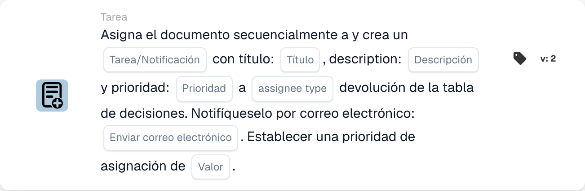

# Asignar documento y crear tarea/notificación

<figure><figcaption>
Campos de la tarjeta en la versión mostrada. Los campos aún no están configurados. Algunas etiquetas de esta versión de la tarjeta todavía tienen una traducción incompleta o incorrecta en la interfaz. Las explicaciones de esta página utilizan los términos correctos.
</figcaption></figure>

## **Propósito**

La tarjeta de flujo de trabajo "**Asignar documento y crear tarea/notificación según la tabla de decisiones**" asigna un documento y crea una tarea o notificación con detalles configurables. El asignatario se determina por el resultado de una tabla de decisión, y la tarjeta permite establecer prioridades y enviar notificaciones por correo electrónico.

## **Componentes de la tarjeta**

1. **Tipo de responsable**
   * **Descripción:** Especifica si el resultado de la tabla de decisión asigna el documento y la tarea/notificación a un usuario o a un grupo.
   * **Detalle:** Un campo para configurar el tipo de asignatario como "User" o "Group" según el resultado de la tabla de decisión.
2. **Tarea/Notificación**
   * **Descripción:** Especifica el tipo de acción que se creará para el asignatario.
   * **Detalle:** Un desplegable para seleccionar "Task" o "Notification" según las necesidades del flujo de trabajo.
3. **Título**
   * **Descripción:** El título de la tarea o notificación.
   * **Detalle:** Un campo para proporcionar un título conciso que identifique la tarea o notificación.
4. **Descripción**
   * **Descripción:** Detalles adicionales sobre la tarea o notificación.
   * **Detalle:** Un campo para describir el propósito y el contexto de la tarea o notificación.
5. **Prioridad**
   * **Descripción:** Define el nivel de urgencia de la tarea o notificación.
   * **Opciones:**
     * **High:** Requiere atención inmediata.
     * **Medio:** Importante pero no urgente.
     * **Low:** Puede abordarse más adelante.
6. **Tipo de responsable**
   * **Descripción:** Este campo determina el tipo de asignatario (User o Group) al que se asignan el documento y la tarea/notificación.
   * **Detalle:** Un menú desplegable para seleccionar si la tarea/notificación se asigna a un usuario o a un grupo según el resultado de la tabla de decisión.
7. **Enviar correo**
   * **Descripción:** Configura si se envía una notificación por correo electrónico al asignatario.
   * **Opciones:**
     * **True:** Envía una notificación por correo electrónico.
     * **False:** No se envía ninguna notificación por correo electrónico.
8. **Valor**
   * **Descripción:** Establece la prioridad numérica para la asignación del documento.
   * **Detalle:** Un campo para introducir un valor numérico, donde los números más bajos indican una mayor prioridad.

## **Funcionalidad**

* **Evaluación de la condición:**\
  La tarjeta ejecuta sus acciones solo si se cumplen las condiciones del flujo de trabajo.
* **Evaluación de la tabla de decisión:**\
  La tabla de decisión determina si el documento y la tarea/notificación se asignan a un usuario o a un grupo.
* **Asignación del documento y creación de tarea/notificación:**\
  El documento se asigna al resultado de la tabla de decisión. Se crea una tarea o notificación con el título, la descripción y el nivel de prioridad especificados.
* **Notificación por correo electrónico:**\
  Si "Send Mail" se establece en True, se envía una notificación por correo electrónico al asignatario.

## **Configuración**

1. **Definir el Assignee Type:**
   * Configure el campo Assignee Type como "User" o "Group" según el resultado de la tabla de decisión.
2. **Seleccionar Tarea/Notificación:**
   * Elija "Tarea" o "Notificación" en el menú desplegable Tarea/Notificación.
3. **Establecer los detalles de la tarea/notificación:**
   * Introduzca el Title y la Description de la tarea o notificación.
   * Seleccione la Prioridad (Alta, Media o Baja) en el desplegable.
4. **Habilitar la notificación por correo electrónico:**
   * Establezca la opción Send Mail en True o False, según si debe enviarse una notificación por correo electrónico.
5. **Establecer la prioridad numérica:**
   * Introduzca un valor numérico en el campo Value para determinar la prioridad de la asignación, donde los números más bajos se procesan primero.
6. Guarde la configuración de la tarjeta y active el flujo de trabajo.

## **Conclusión**

La tarjeta de flujo de trabajo "Assign Document and Create Task/Notification Based on Decision Table" garantiza que las tareas o notificaciones se asignen dinámicamente al usuario o grupo adecuado según los resultados de la tabla de decisión. Esta tarjeta facilita una delegación de tareas eficiente, prioridades personalizables y notificaciones opcionales por correo electrónico para mejorar la capacidad de respuesta del flujo de trabajo.

<!-- workflow-card-practical-example-20261021 -->

## Ejemplo práctico

**Cuándo usarlo:** Utilice el resultado de una tabla de decisiones para asignar un documento y crear una tarea de revisión en secuencia.

**Configuración:** Seleccione la tabla de decisiones de demostración, el título de la tarea `Review invoice`, la descripción y la prioridad. Configure el formato de devolución del responsable y la opción de correo electrónico requeridos por la versión seleccionada.

**Resultado esperado y contraejemplo:** El responsable devuelto coincidente recibe la asignación del documento documentado y la tarea/notificación. Verifique ambos resultados; una devolución de tabla vacía no es una tarea exitosa.

Esta es una configuración ilustrativa y un resultado esperado. Utilice campos, usuarios y grupos configurados en su organización de prueba; no es una afirmación de que este ejemplo haya sido ejecutado.
