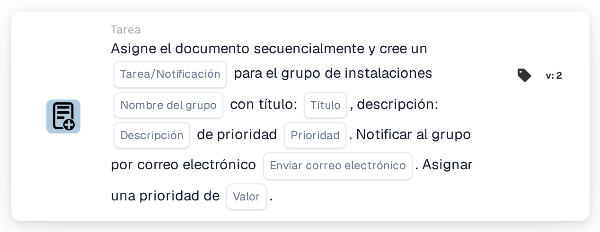

# Asignar al grupo de instalación y crear una tarea/notificación

<figure><figcaption>
Versión 2
</figcaption></figure>

## Propósito:

Esta tarjeta de flujo de trabajo añade el grupo responsable de la instalación de la orden de compra del documento a la asignación secuencial del documento y vincula una tarea o una notificación a este paso. La instalación se toma de las órdenes de compra con las que está emparejado el documento, y el grupo se encuentra por su nombre, que contiene tanto el nombre de grupo introducido en la tarjeta como el código de instalación. La tarea o la notificación pertenece al paso del grupo dentro de la secuencia.

## Componentes de la tarjeta:

1. **Tarea/Notificación**
   * **Descripción:** Define si se crea una tarea o una notificación para el grupo.
   * **Opciones:**
     * **Tarea:** Se crea una tarea.
     * **Notificación:** Se crea una notificación.
2. **Nombre del grupo**
   * **Descripción:** La parte del nombre que tienen en común los grupos de instalación.
   * **Detalle:** Un texto que se compara con los nombres de los grupos de usuarios de la organización. Un grupo coincide si su nombre contiene este texto y el código de instalación de la orden de compra. La comparación no distingue entre mayúsculas y minúsculas. Por ejemplo, con el nombre de grupo **Approver** y una orden de compra de la instalación **1000**, coincidiría un grupo llamado **Approver 1000**.
3. **Título**
   * **Descripción:** El título de la tarea o de la notificación.
   * **Detalle:** Un texto breve que identifica la tarea o la notificación.
4. **Descripción**
   * **Descripción:** Más detalles sobre la tarea o la notificación.
   * **Detalle:** Un texto que describe qué debería hacerse o por qué se informa al grupo.
5. **Prioridad**
   * **Descripción:** La urgencia de la tarea o de la notificación.
   * **Opciones:**
     * **alto peso:** La tarea o la notificación se crea con prioridad alta.
     * **peso medio:** La tarea o la notificación se crea con prioridad media.
     * **bajo peso:** La tarea o la notificación se crea con prioridad baja.
6. **Enviar correo electrónico**
   * **Descripción:** Define si también se informa al grupo de la tarea por correo electrónico.
   * **Opciones:**
     * **Verdadero:** Se envía una notificación por correo electrónico al grupo.
     * **Falso:** No se envía ninguna notificación por correo electrónico.
7. **Valor**
   * **Descripción:** La prioridad del grupo dentro de la asignación secuencial.
   * **Detalle:** Un número entero. Los números más bajos van primero, y 0 es la prioridad más alta. Si no se introduce ningún valor, o se introduce un valor negativo, se utiliza la prioridad 1.

## Funcionalidad:

* **Determinación de la instalación:** La tarjeta lee las órdenes de compra con las que está emparejado el documento y recoge el código de instalación (la ubicación de la orden de compra) de cada una de ellas.
* **Determinación del grupo:** Para cada código de instalación, la tarjeta busca grupos de usuarios cuyo nombre contenga tanto el **Nombre del grupo** de la tarjeta como el código de instalación. Los códigos de instalación para los que no se encuentra ningún grupo se indican en el registro del flujo de trabajo.
* **Ejecución de la acción:** Cada grupo coincidente se añade a la asignación secuencial con la prioridad del campo **Valor**, junto con la tarea o la notificación. La asignación en sí se realiza al final de la ejecución del flujo de trabajo: primero se asigna la entrada con el número de prioridad más bajo y se crea su tarea o notificación. Todas las entradas, incluida la primera, se guardan en el documento como sus solicitudes de aprobación, y los pasos siguientes de la secuencia se toman de ellas en orden ascendente de prioridad. Si otra tarjeta ya ha asignado el documento directamente en la misma ejecución, se omite esta primera asignación secuencial y su tarea o notificación no se crea en esta ejecución.
* **Valores predeterminados:** Si no se ha definido ninguna prioridad de tarea, se utiliza **peso medio**. Si **Enviar correo electrónico** no está definido, no se envía ningún correo electrónico. Si **Tarea/Notificación** no está definido, se crea una tarea y el registro del flujo de trabajo indica el ajuste que falta.
* **Datos que faltan:**
  * Si el nombre del grupo, el título o la descripción están vacíos, la tarjeta no se ejecuta y registra los datos que faltan en el registro del flujo de trabajo.
  * Si el documento no está emparejado con ninguna orden de compra, la tarjeta registra los datos que faltan en lugar de añadir un grupo.
  * Si ningún grupo coincide con ninguno de los códigos de instalación, no se añade ningún grupo y el registro del flujo de trabajo indica que no se ha encontrado ningún grupo coincidente.

## Configuración:

* Los grupos de usuarios deberían nombrarse de forma que cada nombre contenga la parte común del nombre y el código de instalación, por ejemplo **Approver 1000**, **Approver 2000**.
* La tarjeta se puede añadir desde la categoría **Tarea**. A continuación se pueden configurar el tipo (**Tarea** o **Notificación**), la parte común del nombre de los grupos, el título, la descripción, la prioridad de la tarea, el ajuste de correo electrónico y la posición en la secuencia (**Valor**).
* Para formar una cadena de aprobadores, se pueden combinar varias tarjetas secuenciales en el flujo de trabajo, cada una con su propio **Valor**.

## Conclusión:

La tarjeta de flujo de trabajo «Assign to Facility Group and Create a Task/Notification» sitúa al equipo responsable de la instalación en una posición definida dentro de una aprobación secuencial y le asigna una tarea clara para su paso. Una sola tarjeta cubre todas las instalaciones, siempre que los grupos de usuarios sigan un esquema de nombres coherente con el código de instalación en sus nombres.
