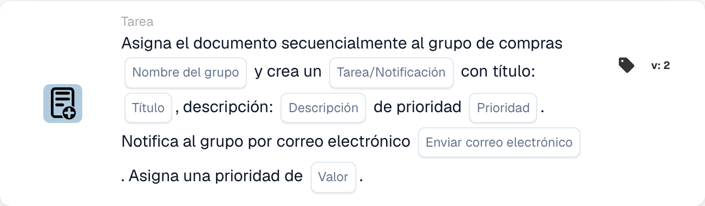

# Asignar al grupo de adquisiciones y crear una tarea/notificación

<figure><figcaption>
Campos de la tarjeta en la versión mostrada. Los campos aún no están configurados.
</figcaption></figure>

## **Propósito**

La tarjeta de flujo de trabajo "**Asignar documento al grupo de adquisiciones y crear tarea/notificación**" asigna un documento a un grupo de compras especificado, crea una tarea o notificación con detalles definidos y, opcionalmente, notifica al grupo por correo electrónico. Prioriza la ejecución de tareas según un valor de prioridad numérico configurable.

## **Componentes de la tarjeta**

1. **Nombre del grupo**
   * **Descripción:** Especifica el grupo de compras responsable de gestionar el documento.
   * **Detalle:** Un campo donde el usuario puede introducir manualmente el nombre del grupo de compras.
2. **Tarea/Notificación**
   * **Descripción:** Define si se crea una tarea o una notificación para el grupo.
   * **Detalle:** Un campo donde el usuario puede elegir entre crear una tarea o una notificación.
3. **Título**
   * **Descripción:** El título de la tarea o notificación creada para el grupo.
   * **Detalle:** Un campo para proporcionar un título conciso e identificable para la tarea o notificación.
4. **Descripción**
   * **Descripción:** Detalles adicionales sobre la tarea o notificación.
   * **Detalle:** Un campo para describir el propósito de la tarea y proporcionar contexto o instrucciones.
5. **Prioridad**
   * **Descripción:** Define el nivel de urgencia de la tarea o notificación.
   * **Opciones:**
     * **High:** La tarea requiere atención inmediata.
     * **Medio:** La tarea es importante pero no urgente.
     * **Low:** La tarea puede gestionarse más adelante.
6. **Enviar correo**
   * **Descripción:** Configura si debe enviarse una notificación por correo electrónico al grupo.
   * **Opciones:**
     * **True:** Envía una notificación por correo electrónico al grupo de compras.
     * **False:** No se envía ninguna notificación por correo electrónico.
7. **Valor**
   * **Descripción:** Establece la prioridad numérica para la ejecución de la tarea.
   * **Detalle:** Un campo para introducir un valor numérico, donde un número más bajo representa una mayor prioridad.

## **Funcionalidad**

* **Evaluación de la condición:**\
  La tarjeta realiza sus acciones solo si se cumplen las condiciones del flujo de trabajo definidas.
* **Asignación al grupo y creación de tarea/notificación:**\
  El documento se asigna al grupo de compras especificado. Se crea una tarea o notificación con el título, la descripción y la prioridad proporcionados.
* **Notificación por correo electrónico:**\
  Si "Send Mail" se establece en True, el grupo recibe un correo electrónico sobre la tarea o notificación.

## **Configuración**

1. **Definir el nombre del grupo:**
   * Introduzca el nombre del grupo de compras en el campo Group Name.
2. **Configurar los detalles de la tarea/notificación:**
   * Especifique el Title y la Description de la tarea o notificación.
   * Seleccione la Prioridad en el menú desplegable (Alta, Media o Baja).
3. **Habilitar la notificación por correo electrónico:**
   * Establezca "Send Mail" en True o False según si el grupo debe recibir un correo electrónico.
4. **Establecer la prioridad numérica:**
   * Introduzca un valor numérico en el campo Value para determinar la prioridad de la tarea, donde los valores más bajos se procesan primero.
5. Guarde la configuración de la tarjeta y active el flujo de trabajo.

## **Conclusión**

La tarjeta de flujo de trabajo "Assign Document to Procurement Group and Create Task/Notification" garantiza que los documentos se dirijan al grupo adecuado con instrucciones de tarea y niveles de prioridad claros. Al posibilitar notificaciones opcionales por correo electrónico, esta tarjeta mejora la visibilidad de las tareas y garantiza una ejecución fluida del flujo de trabajo.

<!-- workflow-card-practical-example-20261021 -->

## Ejemplo práctico

**Cuándo utilizar:** Combine la asignación de adquisiciones prioritarias con una tarea de revisión.

**Configuración:** Seleccione `Demo Procurement`, título `Review order variance`, prioridad de tarea y prioridad de asignación.

**Resultado esperado y contraejemplo:** El objetivo de adquisición configurado recibe la asignación y la tarea/notificación documentadas. Verifique ambos y sus prioridades en el resultado.

Esta es una configuración ilustrativa y un resultado esperado. Utilice campos, usuarios y grupos configurados en su organización de prueba; no es una afirmación de que este ejemplo haya sido ejecutado.
