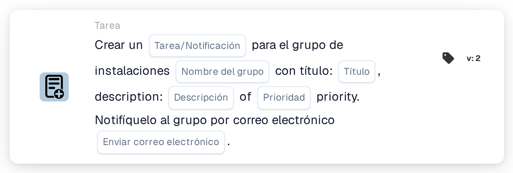

# Cree una nueva tarea y asígnela al grupo de instalación

<figure><figcaption>
Versión 2
</figcaption></figure>

## Propósito:

Esta tarjeta de flujo de trabajo crea una tarea o una notificación para el grupo responsable de la instalación de la orden de compra del documento. La instalación no se selecciona en la tarjeta: se toma de las órdenes de compra con las que está emparejado el documento. A continuación, la tarjeta busca un grupo de usuarios cuyo nombre contenga tanto el nombre de grupo introducido en la tarjeta como el código de instalación, y crea la tarea para ese grupo. El documento en sí no se reasigna.

Para una tarjeta que, además, asigna el documento al grupo de instalación como parte de una asignación secuencial, se puede utilizar **Assign to Facility Group and Create a Task/Notification**.

## Componentes de la tarjeta:

1. **Tarea/Notificación**
   * **Descripción:** Define si se crea una tarea o una notificación para el grupo.
   * **Opciones:**
     * **Tarea:** Se crea una tarea.
     * **Notificación:** Se crea una notificación.
2. **Nombre del grupo**
   * **Descripción:** La parte del nombre que tienen en común los grupos de instalación.
   * **Detalle:** Un texto que se compara con los nombres de los grupos de usuarios de la organización. Un grupo coincide si su nombre contiene este texto y el código de instalación de la orden de compra. La comparación no distingue entre mayúsculas y minúsculas. Por ejemplo, con el nombre de grupo **Warehouse** y una orden de compra de la instalación **1000**, coincidiría un grupo llamado **Warehouse 1000**.
3. **Título**
   * **Descripción:** El título de la tarea o de la notificación.
   * **Detalle:** Un texto breve que identifica la tarea o la notificación.
4. **Descripción**
   * **Descripción:** Más detalles sobre la tarea o la notificación.
   * **Detalle:** Un texto que describe qué debería hacerse o por qué se informa al grupo.
5. **Prioridad**
   * **Descripción:** La urgencia de la tarea o de la notificación.
   * **Opciones:**
     * **alto peso:** La tarea o la notificación se crea con prioridad alta.
     * **peso medio:** La tarea o la notificación se crea con prioridad media.
     * **bajo peso:** La tarea o la notificación se crea con prioridad baja.
6. **Enviar correo electrónico**
   * **Descripción:** Define si también se informa al grupo de la tarea por correo electrónico.
   * **Opciones:**
     * **Verdadero:** Se envía una notificación por correo electrónico al grupo.
     * **Falso:** No se envía ninguna notificación por correo electrónico.

## Funcionalidad:

* **Determinación de la instalación:** La tarjeta lee las órdenes de compra con las que está emparejado el documento y recoge el código de instalación (la ubicación de la orden de compra) de cada una de ellas.
* **Determinación del grupo:** Para cada código de instalación, la tarjeta busca grupos de usuarios cuyo nombre contenga tanto el **Nombre del grupo** de la tarjeta como el código de instalación. Los códigos de instalación para los que no se encuentra ningún grupo se indican en el registro del flujo de trabajo.
* **Creación de la tarea:** Se crea para el grupo coincidente una tarea o una notificación con el título, la descripción y la prioridad de la tarjeta, vinculada al documento. Si coinciden varios grupos, la tarea se crea solo para uno de ellos; la tarjeta no determina para cuál.
* **Valores predeterminados:** Si no se ha definido ninguna prioridad, se utiliza **peso medio**. Si **Enviar correo electrónico** no está definido, no se envía ningún correo electrónico. Si **Tarea/Notificación** no está definido, se crea una tarea y el registro del flujo de trabajo indica el ajuste que falta.
* **Datos que faltan:**
  * Si el nombre del grupo, el título o la descripción están vacíos, la tarjeta no se ejecuta y registra los datos que faltan en el registro del flujo de trabajo.
  * Si el documento no está emparejado con ninguna orden de compra, la tarjeta registra los datos que faltan en lugar de crear una tarea.
  * Si ningún grupo coincide con ninguno de los códigos de instalación, no se crea ninguna tarea y el registro del flujo de trabajo indica que no se ha encontrado ningún grupo coincidente.

## Configuración:

* Los grupos de usuarios deberían nombrarse de forma que cada nombre contenga la parte común del nombre y el código de instalación, por ejemplo **Warehouse 1000**, **Warehouse 2000**.
* La tarjeta se puede añadir desde la categoría **Tarea**. A continuación se pueden configurar el tipo (**Tarea** o **Notificación**), la parte común del nombre de los grupos, el título, la descripción, la prioridad y el ajuste de correo electrónico.

## Conclusión:

La tarjeta de flujo de trabajo «Create a New Task and assign it to Facility Group» incorpora al proceso al equipo de la instalación adecuada sin cambiar a quién está asignado el documento. Una sola tarjeta cubre todas las instalaciones, siempre que los grupos de usuarios sigan un esquema de nombres coherente con el código de instalación en sus nombres.
