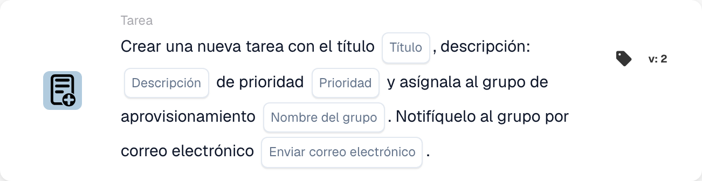

# Cree una nueva tarea y asígnela al grupo de adquisiciones

<figure><figcaption>
Campos de la tarjeta en la versión mostrada. Los campos aún no están configurados.
</figcaption></figure>

## **Propósito:**

La tarjeta de flujo de trabajo **"Crear tarea para grupo de adquisiciones"** crea una nueva tarea asignada dinámicamente al grupo de compras especificado en la configuración. Esta tarea puede asignarse con diferentes niveles de prioridad, y se puede enviar una notificación opcional por correo electrónico para informar al grupo sobre la tarea. Esta tarjeta garantiza que se avise al equipo adecuado según las condiciones del flujo de trabajo.

## **Componentes de la tarjeta:**

1. **Título**
   * **Descripción:** Especifica el título de la tarea.
   * **Detalle:** Este campo identifica la tarea que se está creando, proporcionando un título conciso para una fácil identificación.
2. **Descripción**
   * **Descripción:** Proporciona más detalles sobre la tarea.
   * **Detalle:** Este campo se utiliza para describir el objetivo de la tarea y cualquier contexto o instrucción necesarios.
3. **Prioridad**
   * **Descripción:** Define la urgencia de la tarea.
   * **Opciones:**
     * **High:** La tarea requiere atención inmediata.
     * **Medio:** La tarea es importante pero no urgente.
     * **Low:** La tarea puede gestionarse más adelante.
4. **Nombre del grupo**
   * **Descripción:** Especifica el grupo de compras al que se asignará la tarea.
   * **Detalle:** Este campo designa el grupo de compras responsable de la tarea. Garantiza que la tarea se dirija al equipo adecuado.
5. **Notificación por correo electrónico**
   * **Descripción:** Configura si debe enviarse una notificación por correo electrónico al grupo de compras asignado.
   * **Opciones:**
     * **True:** Envía una notificación por correo electrónico al grupo de compras.
     * **False:** No se envía ninguna notificación por correo electrónico.

## **Funcionalidad:**

* **Evaluación de la condición:**\
  La tarjeta solo ejecuta su acción si las secciones **"Cuando"** y **"Y"** se evalúan como verdaderas.
* **Creación de la tarea:**\
  La tarjeta crea una nueva tarea, asignándola al grupo de compras definido en el campo "Group Name". Esta tarea incluirá el título, la descripción y el nivel de prioridad especificados.
* **Notificación por correo electrónico:**\
  Si la opción de notificación por correo electrónico se establece en true, se envía un correo electrónico al grupo de compras informándole sobre la tarea.

## **Configuración:**

* **Definir los detalles de la tarea:**\
  Introduzca el título, la descripción y el nivel de prioridad de la tarea.
* **Seleccionar el grupo de compras:**\
  Elija el grupo de compras que será responsable de la tarea.
* **Habilitar la notificación por correo electrónico:**\
  Especifique si debe enviarse una notificación por correo electrónico al grupo tras la creación de la tarea.

## **Conclusión:**

La tarjeta de flujo de trabajo "Create Task for Procurement Group" garantiza que las tareas se asignen automáticamente al grupo de compras adecuado con prioridades definidas. Esta tarjeta también puede notificar al grupo por correo electrónico para garantizar que las tareas se atiendan con prontitud, mejorando la eficiencia del flujo de trabajo y la gestión de tareas.

<!-- workflow-card-practical-example-20261021 -->

## Ejemplo práctico

**Cuándo utilizar:** Solicite al equipo de compras que revise una excepción de factura.

**Configuración:** Seleccione `Demo Procurement`, título `Review order variance`, descripción y prioridad.

**Resultado esperado y contraejemplo:** Se crea una tarea para el grupo de adquisiciones seleccionado. Verifique el responsable de la tarea y su descripción; La creación por sí sola no confirma que la variación se haya resuelto.

Esta es una configuración ilustrativa y un resultado esperado. Utilice campos, usuarios y grupos configurados en su organización de prueba; no es una afirmación de que este ejemplo haya sido ejecutado.
