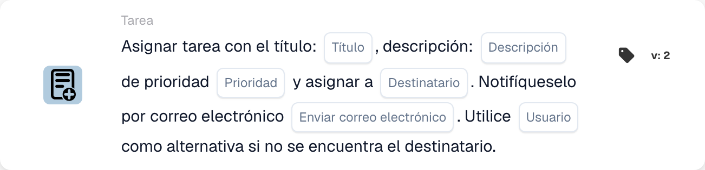

# Cree una nueva tarea y asígnela al destinatario

<figure><figcaption>
Campos de la tarjeta en la versión mostrada. Los campos aún no están configurados.
</figcaption></figure>

## **Propósito:**

La tarjeta de flujo de trabajo **"Crear tarea con respaldo"** garantiza una delegación de tareas eficiente al asignar tareas a roles específicos —disponent o purchaser— a la vez que incorpora un mecanismo alternativo para evitar fallos en la asignación de tareas. Esta tarjeta mejora la fiabilidad y la adaptabilidad del flujo de trabajo en escenarios dinámicos.

## **Componentes de la tarjeta:**

1. **Título**
   * **Descripción**: Especifica el título de la tarea que se está creando.
   * **Detalle**: Proporciona un identificador conciso para la tarea.
2. **Descripción**
   * **Descripción**: Describe el propósito o el contexto de la tarea.
   * **Detalle**: Aclara los detalles de la tarea.
3. **Prioridad**
   * **Descripción**: Establece el nivel de urgencia de la tarea.
   * **Opciones**:
     * **High**: Requiere atención inmediata.
     * **Medio**: Importante pero no urgente.
     * **Low**: Puede abordarse más adelante.
4. **Rol asignado**
   * **Descripción**: Especifica el rol principal al que se asigna la tarea.
   * **Opciones**:
     * **Disponent**: Asigna la tarea al disponent.
     * **Comprador**: Asigna la tarea al comprador.
5. **Notificación por correo electrónico**
   * **Descripción**: Posibilita notificar al usuario asignado por correo electrónico.
   * **Opciones**:
     * **True**: Envía una notificación por correo electrónico al usuario.
     * **False**: No se envía ninguna notificación por correo electrónico.
6. **Usuario alternativo**
   * **Descripción**: Proporciona una opción alternativa para la asignación de la tarea si no se encuentra el rol del destinatario.
   * **Detalle**: Permite seleccionar un usuario de una lista desplegable para garantizar la delegación de la tarea.

## **Funcionalidad:**

* **Evaluación de la condición**:\
  La tarjeta se ejecuta solo si se cumplen las condiciones de las secciones **"Donde"** y **"Y"**.
* **Asignación de la tarea**:
  * La tarea se asigna al rol seleccionado (disponent o purchaser).
  * Si no se encuentra el rol especificado, la tarea se asigna a un usuario de la lista desplegable alternativa.
* **Notificación por correo electrónico**:\
  Envía un correo electrónico al usuario asignado si la notificación por correo electrónico está habilitada.

## **Configuración:**

1. **Especificar los detalles de la tarea**: Introduzca el título, la descripción y la prioridad de la tarea.
2. **Seleccionar el rol principal**: Elija el rol al que se asignará la tarea (disponent o purchaser).
3. **Configurar el usuario alternativo**: Seleccione un usuario alternativo de la lista desplegable para garantizar la asignación de la tarea si no se encuentra el rol principal.
4. **Habilitar la notificación por correo electrónico**: Indique si el usuario asignado debe recibir una notificación por correo electrónico.

## **Conclusión:**

La tarjeta de flujo de trabajo **"Crear tarea con respaldo"** garantiza una delegación de tareas fluida al integrar un mecanismo alternativo. Al asignar tareas según los roles y proporcionar una opción de usuario alternativo, mejora la fiabilidad y la flexibilidad en los procesos de gestión de tareas.
