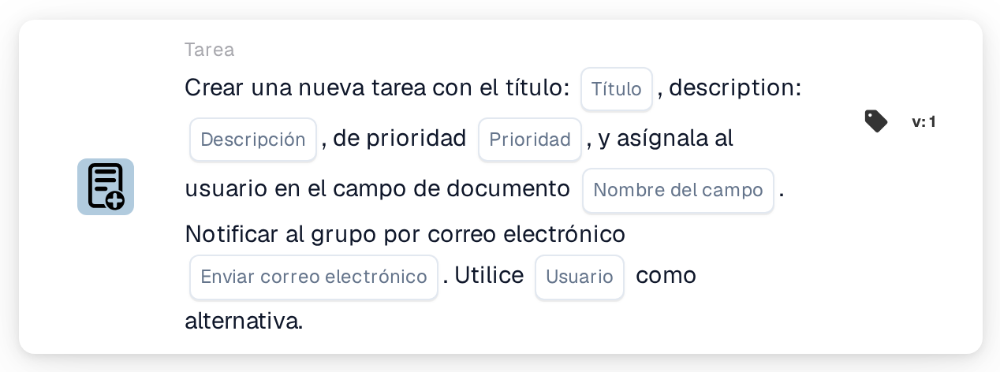
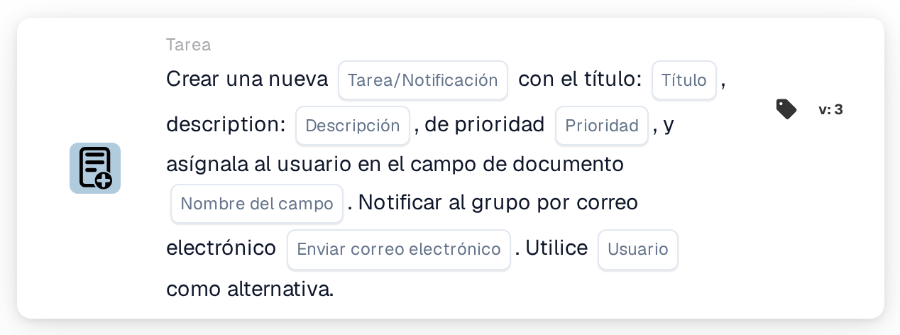

# Cree una nueva tarea y asígnela al usuario en el campo del documento

<figure><figcaption>
Versión 1
</figcaption></figure>

<figure><figcaption>
Versión 3
</figcaption></figure>

## **Propósito:**

La tarjeta de flujo de trabajo **"Crear tarea o notificación basada en campos"** se utiliza para crear tareas o notificaciones asignadas dinámicamente a los usuarios identificados dentro de campos de documento específicos. Esta tarjeta proporciona un mecanismo alternativo opcional para garantizar una ejecución fluida del flujo de trabajo incluso cuando el campo del documento no especifica un usuario válido.

## **Componentes de la tarjeta:**

1. **Título**
   * **Descripción**: Especifica el título de la tarea o notificación.
   * **Detalle**: Se utiliza para nombrar e identificar la tarea o notificación que se está creando.
2. **Descripción**
   * **Descripción**: Proporciona detalles adicionales sobre la tarea o notificación.
   * **Detalle**: Garantiza que el destinatario comprenda el propósito y el contexto de la tarea o notificación.
3. **Prioridad**
   * **Descripción**: Define la urgencia de la tarea o notificación.
   * **Opciones**:
     * **High**: Requiere atención inmediata.
     * **Medio**: Importante pero menos urgente.
     * **Low**: Puede abordarse más adelante.
4. **Nombre de campo**
   * **Descripción**: Especifica el campo del documento que se utilizará para asignar la tarea o notificación.
   * **Detalle**: El campo seleccionado determinará dinámicamente el usuario al que se asignará la tarea o notificación. Si el campo está vacío o no es válido, la tarea o notificación se asignará al usuario alternativo seleccionado de la lista desplegable.
5. **Notificación por correo electrónico**
   * **Descripción**: Configura si se notifica al usuario asignado por correo electrónico.
   * **Opciones**:
     * **True**: Envía una notificación por correo electrónico al usuario asignado.
     * **False**: No se envía ninguna notificación por correo electrónico.
6. **Usuario alternativo**
   * **Descripción**: Permite seleccionar un usuario de una lista desplegable para asignar la tarea o notificación cuando no se encuentra un usuario válido en el campo del documento.
   * **Detalle**: Garantiza que la tarea o notificación se asigne aunque el campo del documento esté vacío o no sea válido.

## **Componentes adicionales en la versión 3:**

1. **Tipo de notificación**
   * **Descripción**: Especifica si la tarjeta crea una tarea o una notificación.
   * **Opciones**:
     * **Tarea**: Crea una tarea asignada al usuario especificado.
     * **Notification**: Envía una notificación en lugar de crear una tarea.

## **Funcionalidad:**

* **Evaluación de la condición**:\
  La tarjeta solo ejecuta su acción si las secciones **"Cuando"** y **"Y"** se evalúan como verdaderas.
* **Creación de tarea o notificación**:
  * Asigna la tarea o notificación al usuario identificado en el campo del documento.
  * En la versión 3, permite crear una tarea o una notificación.
* **Mecanismo alternativo**:\
  Si el campo del documento no identifica un usuario válido, la tarjeta asigna la tarea o notificación al usuario alternativo seleccionado de la lista desplegable.
* **Notificación por correo electrónico**:\
  Envía una notificación por correo electrónico al usuario asignado si está configurado para ello.

## **Configuración:**

1. **Definir los detalles de la tarea o notificación**: Introduzca el título, la descripción y la prioridad.
2. **Seleccionar el campo del documento**: Elija el campo que especifica el usuario para la asignación de la tarea o notificación.
3. **Habilitar la notificación por correo electrónico**: Especifique si debe enviarse una notificación por correo electrónico al usuario asignado.
4. **Seleccionar el usuario alternativo**: Elija un usuario alternativo de la lista desplegable para la asignación si el campo del documento no identifica un usuario válido.
5. **Especificar el Notification Type (versión 3)**: Indique si la tarjeta crea una tarea o una notificación.

## **Conclusión:**

La tarjeta de flujo de trabajo **"Crear tarea o notificación basada en campos"** agiliza la gestión de tareas y notificaciones al asignar dinámicamente responsabilidades según los campos del documento. Su mecanismo de usuario alternativo y las opciones mejoradas de la versión 3 proporcionan flexibilidad, garantizando que las tareas o notificaciones siempre se asignen, incluso cuando los datos del documento están incompletos.

<!-- workflow-card-practical-example-20261021 -->

## Ejemplo práctico

**Cuándo usar:** Cree una tarea de revisión para el usuario nombrado en los datos del documento.

**Configuración:** Seleccione `reviewer_name`, usuario alternativo `Demo Reviewer A`, título `Review invoice` y prioridad.

**Resultado esperado y contraejemplo:** Un usuario que puede resolverse en el campo recibe la tarea. Un campo vacío o que no se puede resolver utiliza el respaldo configurado; Pruebe ambos caminos.

Esta es una configuración ilustrativa y un resultado esperado. Utilice campos, usuarios y grupos configurados en su organización de prueba; no es una afirmación de que este ejemplo haya sido ejecutado.
