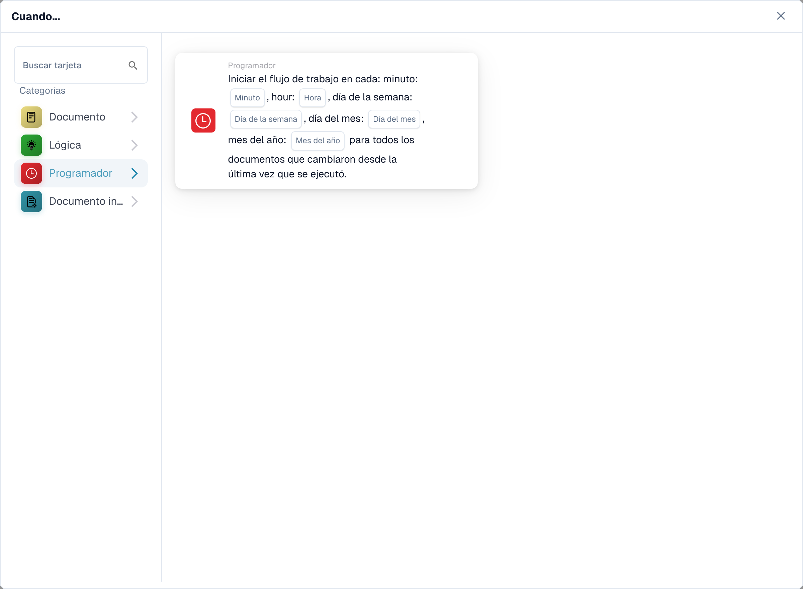

# Cuando

Las tarjetas de esta categoría, que se muestran en la biblioteca **Agregar tarjeta** del Workflow Builder:

<figure><figcaption>
Tarjetas disponibles en la categoría seleccionada. Configure los campos antes de utilizarlas.
</figcaption></figure>

#### Comprender el "cuándo" en las configuraciones de flujo de trabajo

**Propósito de "Cuando"**

* La sección "Cuándo" en una configuración de flujo de trabajo define las condiciones de activación que inician una acción de flujo de trabajo particular. Estas condiciones se basan en criterios específicos relacionados con los atributos del documento o las actividades del usuario dentro del sistema ERP.

**Cómo funciona**

* En su interfaz, "Cuándo" parece ser un punto de partida donde los usuarios pueden seleccionar diferentes tarjetas de activación. Cada tarjeta especifica las condiciones bajo las cuales se ejecutarán las acciones posteriores (definidas en la sección "Y").

**Tarjetas de condición de tipo de documento**

* Las tarjetas con el icono de documento que se muestran en la captura de pantalla son variaciones de las condiciones de "Tipo de documento", que se utilizan para activar flujos de trabajo según el tipo de documento que se procesa. A continuación se muestra un desglose de cada tipo de tarjeta de condición que se muestra:
  * **Tipo de documento (Operador) uno de (Tipo)**: esta tarjeta activa una acción cuando el tipo de un documento coincide con uno de los tipos especificados en una lista. El operador puede incluir opciones como "es" o "no es", permitiendo condiciones inclusivas o exclusivas.
  * **Tipo de documento (Operador) (Tipo)**: esta variante más simple se activa en función de una única condición de tipo de documento. Normalmente comprobaría si el tipo de documento "es" o "no es" un tipo específico, sin la opción de seleccionar entre varios tipos.
  *

**Latido de apio**

* La tarjeta con el icono de reloj en la captura de pantalla es una condición de "Celery Beat", que se utiliza para activar flujos de trabajo basados en la fecha y la hora.

#### Configurar una tarjeta de activación "Cuando"

1. **Selección de tipo de condición**: los usuarios comienzan seleccionando un tipo de condición que sea relevante para el flujo de trabajo que desean automatizar. En este caso, los tipos de documentos son el foco.
2. **Definición del operador**: los usuarios deben decidir el operador lógico, como "es" o "no es", que establece la base para comparar los tipos de documentos reales con las condiciones definidas.
3. **Especificación de tipos de documentos**: Dependiendo de la tarjeta, los usuarios pueden seleccionar uno o varios tipos de documentos que activarán el flujo de trabajo cuando se procesen documentos de esos tipos.
4. **Finalizar el activador**: una vez configurada la condición, se convierte en la base para activar acciones específicas definidas en el flujo de trabajo. Si un documento cumple con la condición establecida, las acciones definidas se iniciarán automáticamente.

#### Aplicación práctica

En la práctica, estas tarjetas de activación son cruciales para automatizar procesos como aprobaciones, notificaciones o cualquier trámite que dependa del tipo de documento que se esté manejando. Por ejemplo, si un tipo de documento "es" una "Factura" y coincide con las condiciones establecidas en la tarjeta "Cuándo", el flujo de trabajo podría enrutar automáticamente el documento para el procesamiento de pagos.

Esta configuración garantiza que los flujos de trabajo no solo sean eficientes sino que también se adapten a las necesidades operativas específicas de la organización, lo que reduce la supervisión manual y acelera los procesos de manejo de documentos.

En resumen, la parte "Cuándo" de la configuración de su flujo de trabajo trata de preparar el escenario para acciones automatizadas basadas en condiciones específicas y predefinidas. Es una herramienta poderosa para garantizar que su sistema ERP reaccione dinámicamente a las necesidades del negocio, mejorando tanto la productividad como la precisión en la gestión de documentos.

[Referencia de activación de evento de webhook y cambio de variable](../cards-overview/logic-cards-guide.md).
