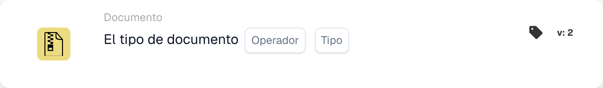
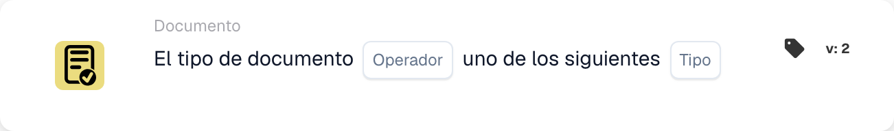

# Descripción de la tarjeta

## **Tarjetas When: Tipo de documento**

Un flujo de trabajo puede iniciarse con estas dos tarjetas. Aquí puede decidir con qué tipo de documento comienza el flujo de trabajo o si no debe afectar a determinados tipos de documento.

\\

<figure><figcaption>
Campos de la tarjeta en la versión mostrada. Los campos aún no están configurados.
</figcaption></figure>

<figure><figcaption>
Campos de la tarjeta en la versión mostrada. Los campos aún no están configurados.
</figcaption></figure>

Esta tarjeta también se puede utilizar para especificar varios tipos de documento que el flujo de trabajo debe afectar.
