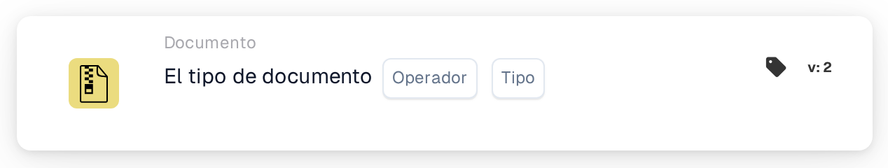

# Operación de Tipo de Documento

<figure><figcaption>
Versión 1
</figcaption></figure>

<figure><figcaption>
Versión 2
</figcaption></figure>

## **Propósito:**

Esta tarjeta de flujo de trabajo está diseñada específicamente para realizar operaciones predefinidas en documentos categorizados por tipo. Simplifica el manejo de diversas formas de documentos dentro de un sistema ERP, asegurando que cada tipo se procese de acuerdo con sus requisitos únicos y políticas organizativas.

## **Funcionalidad:**

* **Validación de Tipo de Documento**: Esta tarjeta verifica si un documento coincide con un tipo particular, permitiendo a los usuarios confirmar su categorización.
* **Operador**: Los usuarios pueden establecer condiciones para determinar el tipo de documento. Los operadores disponibles incluyen:
  * **Es**: Confirma que el documento coincide con el tipo de documento especificado.
  * **No es**: Asegura que el documento no coincide con el tipo de documento especificado.
* **Tipos de Documentos**: Los tipos de documentos admitidos incluyen:
  * **Factura**
  * **Nota de Débito**
  * **Nota de Crédito**
  * **Orden de Compra**
  * **Confirmación de Pedido**
  * **Aviso de Envío Anticipado**

## **Uso**:

Esta tarjeta es útil para los administradores de documentos y administradores que necesitan asegurarse de que los documentos estén clasificados correctamente para un procesamiento simplificado. Validar los tipos de documentos mejora la automatización del flujo de trabajo, permite acciones específicas de documentos y mantiene los registros organizados.

## **Escenario de Ejemplo**:

* Un usuario carga un documento etiquetado como "Nota de Débito". Utilizando el operador "Es", la tarjeta confirma que el tipo de documento es realmente "Nota de Débito", lo que permite que el sistema aplique reglas de procesamiento relevantes y lo categorice adecuadamente.

Al implementar la tarjeta "Tipo de Documento", las organizaciones pueden automatizar la clasificación de documentos, garantizar la consistencia en el manejo de documentos y mejorar la eficiencia de los flujos de trabajo de gestión de documentos.
