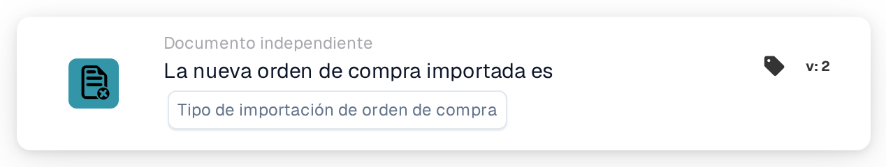

# Importación de orden de compra

<figure><figcaption>
Versión 2
</figcaption></figure>

## Propósito:

Esta tarjeta de flujo de trabajo inicia un flujo de trabajo (disparador) cuando se importa una orden de compra en DocBits. Puede reaccionar a órdenes de compra recién creadas, a actualizaciones de órdenes de compra existentes o a ambas. El flujo de trabajo se ejecuta sin documento, por lo que puede utilizarse para informar a personas o para llamar a otros sistemas cada vez que llegan datos de órdenes de compra.

## Componentes de la tarjeta:

1. **Tipo de importación de orden de compra**
   * **Descripción:** Define qué tipo de importación inicia el flujo de trabajo.
   * **Opciones:**
     * **una nueva orden de compra.** La orden de compra no existía antes y se ha creado con la importación.
     * **una actualización de una orden de compra existente.** Una orden de compra existente se ha actualizado con la importación.

     Se pueden seleccionar ambas opciones.

## Funcionalidad:

* **Cuándo se inicia el flujo de trabajo:** Cuando la importación de órdenes de compra procesa una orden de compra procedente del sistema ERP, el sistema registra si era nueva o una actualización. A continuación inicia todos los flujos de trabajo independientes del documento activos de la organización (excepto los flujos de trabajo de webhook y los programados) y les transmite esta información, junto con el ID y el número de la orden de compra. Esto solo ocurre si el módulo de flujos de trabajo está activo para la organización y existen flujos de trabajo activos. Una orden de compra que se omite porque la versión entrante no es más reciente que la almacenada no inicia flujos de trabajo.
* **Evaluación de la condición:** La tarjeta comprueba si el tipo de importación transmitido al flujo de trabajo es uno de los tipos seleccionados en la tarjeta.
* **Ejecución de la acción:**
  * **Condición verdadera:**\
    Si el tipo de importación coincide con una opción seleccionada, el flujo de trabajo continúa con las tarjetas siguientes.
  * **Condición falsa:**\
    Si el tipo de importación no coincide, o si el flujo de trabajo se ha iniciado por otro evento independiente del documento (por ejemplo, un cambio de estado de un proveedor), la tarjeta no se cumple y los pasos posteriores no se ejecutan.
* **Datos que faltan:** Si no hay ningún tipo de importación seleccionado en la tarjeta, la tarjeta no evalúa la condición. Registra la entrada que falta (o un error) en el registro del flujo de trabajo, y los pasos posteriores no se ejecutan.

## Configuración:

* La tarjeta se puede añadir desde el grupo **WHEN**, categoría **Documento independiente**. A continuación se seleccionan uno o ambos tipos de importación, se añaden las demás condiciones y acciones, y el flujo de trabajo se guarda y se activa.

## Conclusión:

La tarjeta «Purchase order import» permite que los flujos de trabajo reaccionen en cuanto se crean o actualizan datos de órdenes de compra, sin esperar a un documento. Así los procesos de seguimiento se mantienen al día con las órdenes de compra que llegan del sistema ERP.
