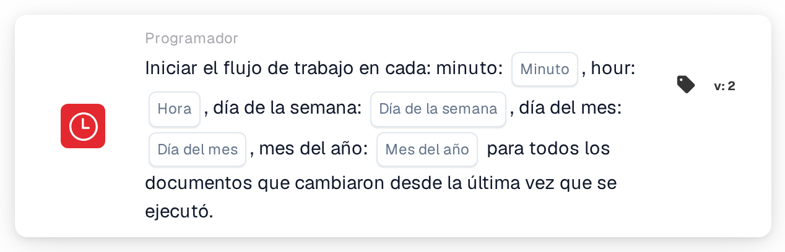

# Inicio programado del flujo de trabajo

<figure><figcaption>
Versión 2
</figcaption></figure>

## Propósito:

Esta tarjeta de flujo de trabajo inicia un flujo de trabajo (disparador) según una programación horaria, de forma similar a un cron job. En cada momento programado, el flujo de trabajo se ejecuta para todos los documentos que han cambiado desde la ejecución anterior. Resulta útil para procesamientos periódicos, como comprobaciones nocturnas, recordatorios periódicos o seguimientos que no deberían ejecutarse inmediatamente con cada cambio de un documento.

## Componentes de la tarjeta:

1. **Minuto**
   * **Descripción:** El minuto o los minutos de la hora en los que se inicia el flujo de trabajo.
   * **Detalle:** Valor en formato cron, por ejemplo `0`, `30`, `0,30` o `*/15`. Si se deja vacío, significa cada minuto (`*`).
2. **Hora**
   * **Descripción:** La hora o las horas del día en las que se inicia el flujo de trabajo.
   * **Detalle:** Valor en formato cron, por ejemplo `6` u `8-18`. Si se deja vacío, significa cada hora (`*`).
3. **Día de la semana**
   * **Descripción:** El día o los días de la semana en los que se inicia el flujo de trabajo.
   * **Detalle:** Valor en formato cron, por ejemplo `1-5`. Si se deja vacío, significa todos los días de la semana (`*`).
4. **Día del mes**
   * **Descripción:** El día o los días del mes en los que se inicia el flujo de trabajo.
   * **Detalle:** Valor en formato cron, por ejemplo `1` o `1,15`. Si se deja vacío, significa todos los días (`*`).
5. **Mes del año**
   * **Descripción:** El mes o los meses en los que se inicia el flujo de trabajo.
   * **Detalle:** Valor en formato cron, por ejemplo `1` o `1-6`. Si se deja vacío, significa todos los meses (`*`).

## Funcionalidad:

* **Zona horaria:** Todas las horas se indican en UTC, la zona horaria de los servidores de DocBits. Por ejemplo, las 6:00 UTC corresponden a las 8:00 en el horario de verano de Europa Central.
* **Cuándo se inicia el flujo de trabajo:** Cuando el flujo de trabajo se guarda y se activa, se crea una entrada de programación a partir de los cinco campos. Si el flujo de trabajo se desactiva o se elimina, la entrada de programación se suprime. En cada momento programado, el sistema:
  * busca los documentos de la organización que se modificaron, se guardaron o cambiaron de estado desde la última ejecución del flujo de trabajo,
  * inicia el flujo de trabajo por separado para cada uno de estos documentos en segundo plano, y
  * guarda la hora de esta ejecución como punto de partida para la siguiente.

  Los documentos que han alcanzado el límite de ejecuciones del flujo de trabajo se omiten. Si el flujo de trabajo se desactiva mientras se procesan los documentos, los documentos restantes ya no se procesan.
* **Evaluación de la condición:** La tarjeta comprueba si el flujo de trabajo se ha iniciado por la programación.
* **Ejecución de la acción:**
  * **Condición verdadera:**\
    Cuando el flujo de trabajo se inicia por la programación, la tarjeta se cumple y el flujo de trabajo continúa con las tarjetas siguientes.
  * **Condición falsa:**\
    Cuando el flujo de trabajo se inicia de cualquier otra forma, por ejemplo mediante un disparador de documento, un webhook o un cambio de variable, la tarjeta no se cumple y los pasos posteriores no se ejecutan.
* **Solo una programación por flujo de trabajo:** En el constructor avanzado de flujos de trabajo (Advanced Workflow Builder), si un flujo de trabajo contiene varias tarjetas de programación, solo se utiliza la primera para la programación.
* **Guardado:** Si la entrada de programación no puede actualizarse al guardar, el flujo de trabajo se guarda de todos modos y se muestra una advertencia. Al volver a guardar el flujo de trabajo, se reintenta la actualización.

## Configuración:

* La tarjeta se puede añadir desde el grupo **WHEN**, categoría **Programador**. A continuación se rellenan los campos de tiempo; los campos que se dejan vacíos significan «cada». Por ejemplo, minuto `0`, hora `6`, día de la semana `1-5` y los demás campos vacíos inician el flujo de trabajo a las 6:00 UTC los días laborables. Después se añaden las demás condiciones y acciones, y el flujo de trabajo se guarda y se activa.

## Conclusión:

La tarjeta «Scheduled workflow start» ejecuta flujos de trabajo a horas fijas en lugar de con cada evento. Como cada ejecución solo recoge los documentos que han cambiado desde la ejecución anterior, el procesamiento periódico se centra en el trabajo nuevo.
