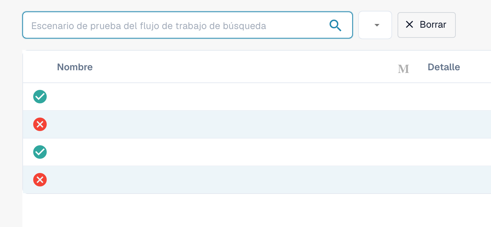

# Panel

El **Panel de flujo de trabajo** es la página de inicio del área de flujos de trabajo. Muestra cómo se comportan sus flujos de trabajo (totales de ejecuciones, tasas de éxito y de fallo, un gráfico de ejecuciones a lo largo del tiempo y la actividad reciente) y le da acceso a la lista de flujos de trabajo, al gestor de pruebas y al Card SDK.

<figure><figcaption>
El Workflow Dashboard: totales de ejecuciones, tasas de éxito/fallo y actividad reciente de cada flujo de trabajo.
</figcaption></figure>

## Pestañas

- **Panel**: métricas de ejecución y actividad reciente (se muestra arriba).
- **Lista de flujo de trabajo**: todos los flujos de trabajo con su tipo, orden de ejecución y disparador. Cree uno nuevo con **Nuevo flujo de trabajo**.
- **Lista de administradores de pruebas**: escenarios de prueba que validan sus flujos de trabajo; ejecútelos con **Ejecutar todas las pruebas**.
- **Licencia**: información de licencia de los flujos de trabajo.
- **SDK de tarjeta**: cree y suba tarjetas de flujo de trabajo personalizadas (consulte [Card SDK](card-sdk.md)).

La barra de herramientas también ofrece **Plantillas**, que abre la biblioteca de [Plantillas de flujo de trabajo](standard-workflow-builder.md#workflow-templates), e **Importar flujo de trabajo**, que importa un flujo de trabajo desde un archivo JSON.

El **Gestión de pruebas** le permite guardar escenarios de prueba por flujo de trabajo y ejecutarlos juntos, de modo que pueda confirmar que sus flujos de trabajo siguen comportándose correctamente después de los cambios:

<figure><figcaption>
Vista parcial del gestor de pruebas: búsqueda, columnas Nombre y Detalle y estados de los escenarios. Los valores privados están ocultos; algunos controles de la cabecera se muestran como «M» en esta versión.
</figcaption></figure>

<figure><figcaption>
Detalle de los botones Ejecutar todas las pruebas y Agregar escenario de prueba.
</figcaption></figure>

## Próximos pasos

- Cree una automatización lineal con el constructor **Flujo estándar**.
- Cree un flujo con ramificaciones con el constructor **Flujo de trabajo avanzado**.
