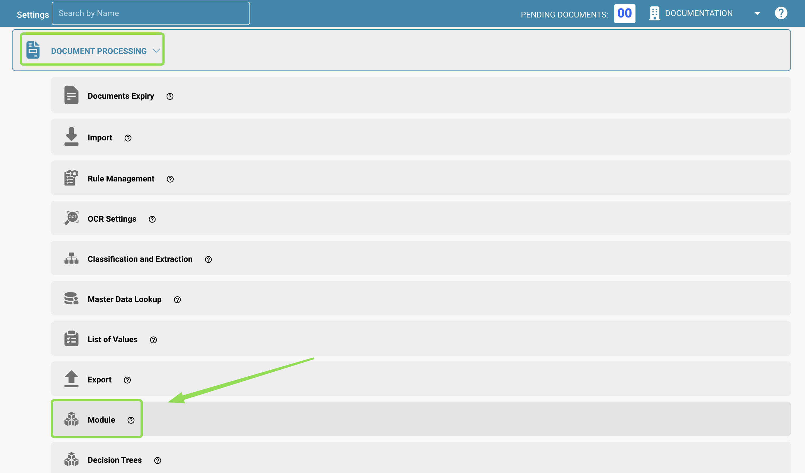

# DocBits Operator

## Resumen

El **DocBits Operator** es un asistente de automatización basado en IA, diseñado para simplificar las tareas repetitivas de sus flujos de trabajo. Los usuarios crean _prompts_: instrucciones paso a paso enriquecidas con variables que guían a la IA para navegar, introducir datos y hacer clic en las interfaces de forma automática. Esto reduce el esfuerzo manual y acelera las operaciones rutinarias.

## Activar el DocBits Operator

Para activar el DocBits Operator, siga estos pasos:

1. **Vaya a Settings**:
   * Desde el Dashboard, vaya a **Settings**.
   *   Seleccione **Document Processing** y, a continuación, elija **Module**.

       <figure><figcaption></figcaption></figure>
2. **Active la función**:
   * Desplácese hacia abajo hasta encontrar la opción **DocBits Operator**.
   *   Mueva el interruptor para activar el **DocBits Operator**.

       
<figure><figcaption></figcaption></figure>

## Acceder a la interfaz

* Una vez activada la función, abra el **DocBits Operator** desde el menú de navegación principal.

### **1. Entrada del prompt**

En la parte inferior de la pantalla hay un campo de entrada con la etiqueta _“Enter your prompt here…”_. Aquí es donde los usuarios escriben las instrucciones que debe seguir el operador.

Junto al campo de entrada hay varios botones de control:

* **Prompt Variables** – Abre una ventana emergente en la que puede introducir pares clave-valor que se utilizan en el prompt. Las variables se escriben entre llaves, como `{invoice_number}` o `{url}`. Estos valores se aplican únicamente al prompt actual del campo de entrada.
* **Save Prompt** – Guarda el prompt actual. Puede guardarlo como:
  * **Organization Prompt** – Editable dentro de su organización; incluye tanto el prompt como los valores de variable definidos.
  * **Global Prompt** – Compartido entre todos los tenants; incluye solo el prompt y los marcadores de posición de las variables (no se guarda ningún valor).
* **Clear Chat** – Borra la conversación actual con el operador, pero deja sin cambios el prompt del campo de entrada. Resulta útil al reutilizar o refinar un prompt.

Para obtener una guía detallada sobre cómo escribir prompts eficaces, incluidas la sintaxis, las variables y los ejemplos, consulte la [**Guía para escribir prompts**](prompt-writing-guide.md).

### **2. Navegación de la barra lateral**

Utilice el icono de la parte superior izquierda para abrir o cerrar la barra lateral. La barra lateral muestra los prompts guardados, organizados en dos categorías:

* **Organization Prompts**: editables y reutilizables dentro de su organización.
* **Global Prompts**: compartidos entre todos los tenants. No pueden almacenar variables y no se pueden editar ni eliminar.
  * Un prompt global sigue siendo editable y eliminable por la **organización que lo creó**, donde aparece en Organization Prompts.
* **Función de búsqueda:** una barra de búsqueda en la parte superior de la barra lateral permite encontrar rápidamente los prompts guardados por nombre o palabra clave.
* **Referencia de iconos:** cada prompt guardado tiene un conjunto de iconos de acción
  * **Flecha** – Iniciar el prompt
  * **Lápiz** – Editar el prompt (solo disponible para los prompts de su propia organización)
  * **Papelera** – Eliminar el prompt (solo disponible para los prompts de su propia organización)

### 3. Guardar el prompt

Al hacer clic en el botón **Save Prompt** se abre una ventana emergente en la que puede guardar el prompt actual para usarlo más adelante.

<figure><figcaption></figcaption></figure>

#### **Campos de la ventana emergente Save Prompt**

* **Prompt Name:** introduzca un nombre para identificar el prompt.
* **Save Prompt Publicly (casilla de verificación):** si está marcada, el prompt se guardará como **Global Prompt**. Los Global Prompts se comparten entre todos los tenants y no pueden almacenar **valores** de variable (solo **nombres** de variable).
* **Edit Variables:** abre la [**ventana emergente Prompt Variables**](prompt-writing-guide.md#ventana-emergente-de-variables-de-prompt) para revisar o ajustar las definiciones de las variables antes de guardar.

**Acciones**

* **Cancel:** cierra la ventana emergente sin guardar.
* **Save:** guarda el prompt con el nombre y el ajuste de visibilidad especificados.

### 4. Controles de ejecución del prompt

Cuando se está ejecutando un prompt, los usuarios disponen de varias opciones de control para gestionar el proceso de ejecución o intervenir en él:

* **Pause Prompt:** detiene temporalmente la ejecución actual. Resulta útil si desea observar el estado actual o preparar el sistema para los pasos siguientes.&#x20;
* **Resume Prompt:** continúa la ejecución desde el punto en el que se pausó.  (1).png>)
* **Cancel Prompt:** detiene la ejecución por completo y restablece la sesión. Es útil si hay que abortar o reiniciar el prompt por un comportamiento incorrecto o por cambios en la entrada.&#x20;
* **Take Control:** permite al usuario intervenir manualmente interactuando directamente con el sistema. Es útil si el operador se queda atascado o interpreta mal un paso. Al tomar el control, el prompt se **pausa automáticamente** y se pasa al modo manual hasta que usted decida reanudarlo o cancelarlo.

### 5. Vista de detalle del Operator

Una vez iniciado un prompt, aparece un botón adicional que permite a los usuarios cambiar a una **vista de ejecución detallada**. 

* **Open Detail View:** este botón le lleva a una vista dedicada que muestra, paso a paso, lo que el operador está haciendo en tiempo real.

En la vista de detalle, los usuarios pueden:

* Supervisar cada acción que se realiza (por ejemplo, clics, entradas, esperas).
* Ver qué paso está activo en ese momento.
* Identificar dónde se producen los problemas si el prompt encuentra dificultades.
* Utilizar las mismas acciones **Pause**, **Resume**, **Cancel** y **Take Control**.

<figure><figcaption></figcaption></figure>

