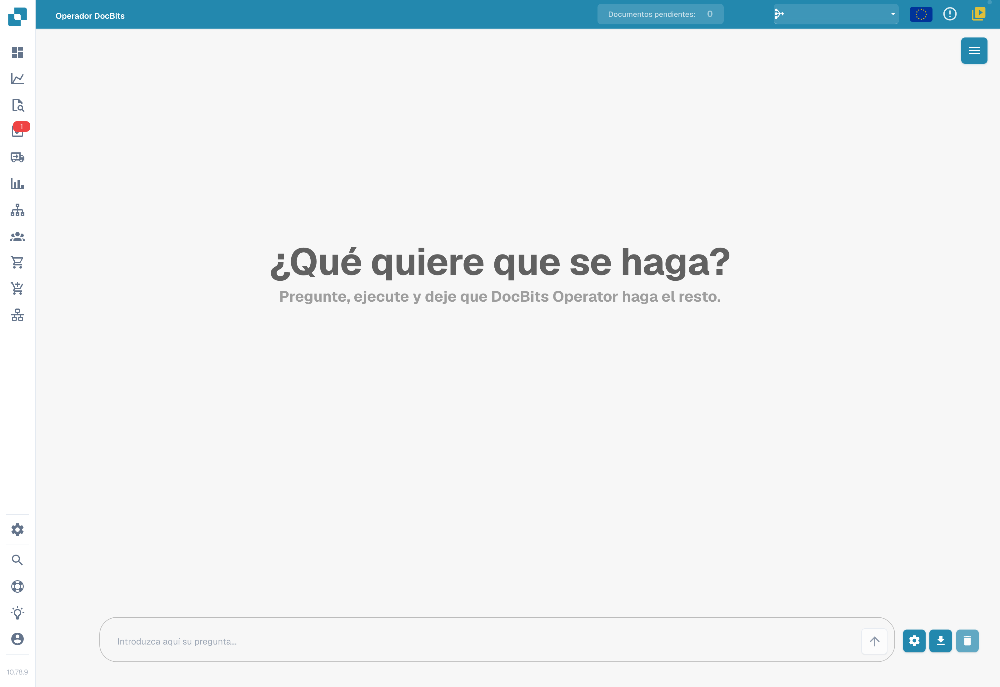
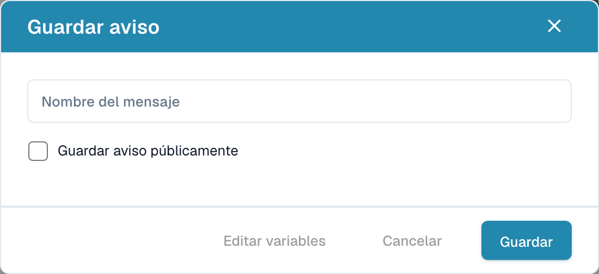

# Operador de DocBits

DocBits Operator ejecuta tareas a partir de las instrucciones del usuario. Cada instrucción describe los pasos; las variables aportan los datos necesarios para una ejecución concreta.

## Activación y acceso

1. Abra **Ajustes → Módulo → Integración de documentos**.
2. Desplácese hasta **DocBits Operator** y active la función si dispone de los permisos necesarios.
3. Abra **DocBits Operator** desde la navegación principal de la aplicación.

<figure><figcaption>
Módulos de integración de documentos: scripts, escaneo, extracción de códigos de barras y datos maestros personalizados.
</figcaption></figure>

## Introducir una instrucción

Describa el resultado esperado y los pasos en el campo situado en la parte inferior de la pantalla. Escriba las variables entre llaves, por ejemplo `{invoice_number}` o `{url}`. El engranaje abre la ventana para definir sus nombres y valores.

<figure><figcaption>
Pantalla inicial real de DocBits Operator en español, con el campo para introducir una instrucción. No se envió ni ejecutó ninguna instrucción.
</figcaption></figure>

La flecha inicia la ejecución. El icono de descarga abre el diálogo para guardar la instrucción, y la papelera borra la conversación. Abrir el diálogo no guarda ninguna plantilla.

Consulte los ejemplos de la [guía para escribir instrucciones](prompt-writing-guide.md).

## Guardar una instrucción

El diálogo se titula **Guardar aviso** en la versión mostrada; aquí «aviso» se refiere a una instrucción o prompt. Introduzca su nombre en **Nombre del mensaje**. La opción de publicación determina cómo se comparte la plantilla. Al preparar una plantilla compartida, use nombres de variables en el texto y complete los valores necesarios antes de cada ejecución.

<figure><figcaption>
Diálogo real para guardar una instrucción, con los campos vacíos. La etiqueta «Guardar aviso» se refiere aquí a una instrucción o prompt, no a una notificación. No se guardó ni compartió ninguna plantilla.
</figcaption></figure>

El botón para editar variables abre sus definiciones. El botón de guardado guarda la plantilla. Para cerrar el diálogo sin guardar, use la cruz de la esquina superior derecha.

El botón Cancelar cierra este diálogo sin guardar; también puede usar la cruz. La etiqueta Guardar aviso corresponde a guardar una instrucción. Para esta imagen no se escribió ni guardó ninguna plantilla.

## Instrucciones guardadas

El menú de la esquina superior derecha abre el panel de instrucciones guardadas. Contiene secciones separadas para las instrucciones de la organización y las públicas, además de una búsqueda por nombre.

Las instrucciones de la organización tienen iconos para ejecutar, editar y eliminar. En la sección pública, la flecha ejecuta la plantilla seleccionada. Complete sus variables antes de iniciarla.

## Controlar la ejecución

Durante la ejecución puede pausar, reanudar, cancelar o tomar el control. La pausa detiene los pasos siguientes para comprobar el estado actual. Reanudar continúa el trabajo; cancelar finaliza la ejecución. Tomar el control permite interactuar manualmente con la vista del navegador.

<figure><figcaption>
Ejemplo de iconos para reanudar y detener.
</figcaption></figure>

## Vista detallada

El botón de ampliación abre la vista detallada de la ejecución. Permite seguir las acciones, el paso actual y los mensajes del operador, y utilizar los controles de ejecución.

<figure><figcaption>
Icono para ampliar la vista detallada.
</figcaption></figure>
