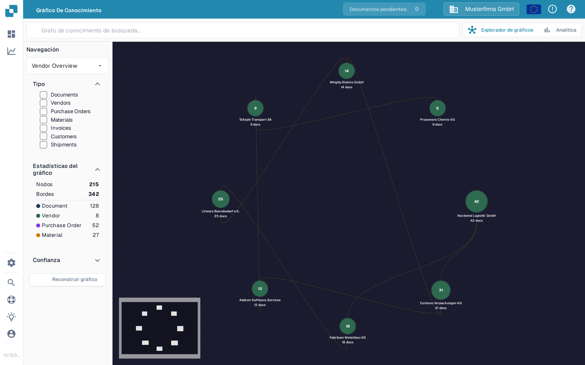

# Explorador de gráficos de conocimiento

El **Explorador de gráficos de conocimiento** te ayuda a ver las conexiones entre proveedores, documentos, órdenes de compra y otros registros. Úsalo cuando quieras seguir una relación o comprobar cuántos elementos conectados hay disponibles. El ejemplo siguiente muestra un gráfico con datos en la organización de prueba de Sandbox.

<figure><figcaption>
El gráfico de ejemplo muestra proveedores conectados. Busca un elemento o reconstruye el gráfico para ver tus propias conexiones.
</figcaption></figure>

## Para empezar

1. Abre **Explorador de gráficos** en DocBits. Comprueba que la organización que aparece arriba sea la que quieres inspeccionar.
2. Si el centro dice **Search for a node or compute the graph to get started**, elige **Reconstruir gráfico** y espera a que termine el mensaje de progreso. Esto prepara los datos del gráfico; puede tardar un poco. Si la organización todavía no tiene relaciones coincidentes, **Nodos** y **Bordes** pueden quedarse en cero.
3. Escribe un nombre u otro término de búsqueda en **Buscar en el gráfico de conocimiento** y pulsa Intro o selecciona el icono de búsqueda. Cuando aparezcan varios resultados, elige el que necesites. Un resultado único abre su gráfico directamente.
4. Selecciona un nodo para ver sus detalles. Cierra el panel de detalles con **X** cuando quieras volver al gráfico.

## Elige lo que ves

| Control | Qué hace |
| --- | --- |
| **Navegación** | Cambia entre **Vendor Overview** (proveedores conectados), **Vendor Intelligence** (una tabla de proveedores), **Document Journey** (pasos y variantes en el procesamiento de documentos) y **Anomalies** (relaciones inusuales). |
| **Tipo** | Selecciona las clases de elementos en las que centrarte, como Documents, Vendors, Purchase Orders o Invoices. Los tipos seleccionados también limitan los resultados de búsqueda. |
| **Estadísticas del gráfico** | Muestra el número de nodos (elementos) y bordes (conexiones) disponibles actualmente. Amplía o contrae esta sección según lo necesites. |
| **Confianza** | Abre esta sección para fijar la confianza mínima de relación al expandir un nodo. Un valor más alto reduce las conexiones mostradas. |
| **Reconstruir gráfico** | Inicia un nuevo cálculo del gráfico. Espera a que termine su progreso antes de volver a buscar. |
| **Explorador de gráficos / Analítica** | Cambia entre el gráfico interactivo y los gráficos resumen. Analítica muestra recuentos y gráficos cuando existen datos del gráfico; un gráfico vacío también deja Analítica vacía. |

Si necesitas resolver una diferencia entre una factura y su orden, continúa con la [Pantalla de coincidencia de órdenes de compra](../end-user-and-partner-section/end-user-section/purchase-order-matching/README.md). Para métricas más amplias fuera del gráfico, consulta el [Panel de Analítica](../administration-and-setup/analytics-dashboard.md).
